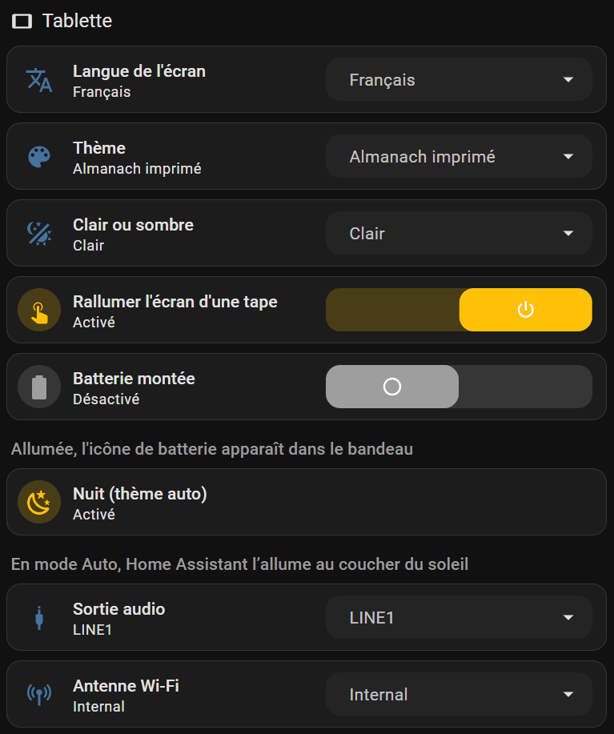
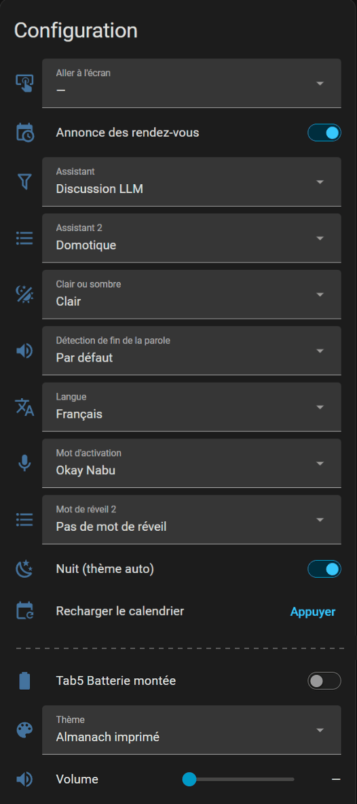

# Tablet settings and options

## English · [Français](#version-française)

---

Every setting of the tablet is an entity of its device in Home Assistant, and the tablet keeps it across restarts. Three places show them, all equivalent:

- the **Settings** view of the [tablet's dashboard](dashboard.md), left below: its « Tablette » column;
- the device page, right below: *Settings → Devices & services → ESPHome →* your tablet, cards **Controls** and **Configuration**;
- on the tablet itself, the **Settings** window (a tap on the gear button, top right), four pages since 2026-10-08: brightness, auto screen off and both ways to wake the screen (Screen page); theme, light or dark, night switch, animations and language (Appearance page); charge limit, charging mode, power saving, eco Wi-Fi and battery fitted, with the battery's state, level, voltage and consumption (Battery page); and the System page, the former system console ([user manual](../notice/settings.md)).

**The device page shows the entities under their English names, whatever the screen language.** Since 3.9.0-rc.8, the Tab5 integration offers the repair « Tab5: switch the entities to their English names »: one click gives the tablet's entities an English name and entity ID in Home Assistant, with their history, and the tablet keeps its settings. Before it, the entities keep their old French names (« Réveil » for « Alarm », « Thème » for « Theme »…). The firmware itself keeps its French names: Home Assistant identifies an ESPHome entity by that name, so the translation lives in Home Assistant's registry. For labels in your language, use the dashboard: it follows the screen language, or write it with `tab5_dashboard(langue='English')` ([step 7](dashboard.md)). The « Tab5 · » lists of the Home Assistant files are named in English.

 

## Theme, light or dark

| Entity | Values | What it does |
|---|---|---|
| Theme | 21 themes, from « Slate » (Ardoise on the screen) to « Ultraviolet »; a new tablet starts in « Soft relief » (Relief doux) | colours, shapes (radius, borders, shadows) and the fonts of the clock, the date and the titles. The screen repaints at once, without a restart; the games keep their own dark colours |
| Light or dark | Dark, Light, Auto | the mode of the theme. **Auto**: light by day, dark at night, following « Night (auto theme) » |
| Night (auto theme) | on / off | read only in Auto mode. The automation « Tab5 — day/night theme » (`packages/tab5_push.yaml`) turns it on when the sun sets and off when it rises (`sun.sun`, so the location of Home Assistant). To decide yourself (a light sensor, bedtime…), turn that automation off and switch it from your own. Without Home Assistant, Auto keeps the last state received |

On the screen the theme names stay as they are in every language: they are names. Home Assistant shows them in English (« Soft relief » for « Relief doux », since 2026-10-24, [ADR-0070](../decisions/0070-home-assistant-reads-english.md)). Six of them:

## Screen, sound and network

| Entity (name on the dashboard) | Values | What it does |
|---|---|---|
| Language (Screen language) | Français, English, Deutsch, Nederlands, Español, Italiano, Türkçe | screen, games, dates and the spoken alarm briefing. **The tablet restarts** to apply it. The menu options and the text states Home Assistant sees are in English whatever this choice ([ADR-0070](../decisions/0070-home-assistant-reads-english.md)) |
| Display Backlight (Brightness) | on / off, brightness | the screen backlight; 75 % at the very first start, then the brightness you chose. Off, the screen turns black (and the Waveshare 7B panel goes to sleep), it does not keep the last image |
| Screen direction | Normal, Upside down; Normal on a new board | Waveshare 7B only: **Upside down** for a board mounted upside down. The picture turns by 180° at once, without a restart, and the touch follows; kept across restarts and updates, so the published firmware fits both mountings ([Waveshare 7B](../waveshare-7b.md)). « Upside down » also draws a little faster: no rotation of each frame, about 69 ms for a full screen instead of 83. The Tab5 has no such setting ([ADR-0069](../decisions/0069-screen-direction-from-home-assistant.md)) |
| Screen auto-off | Never, 1 min, 2 min, 5 min, 10 min, 30 min; Never by default | turns the screen off after that long without a touch, the way Home Assistant turns it off; a touch, a tap (Tap-to-Wake), Home Assistant or the alarm clock turn it back on. Never while the alarm rings, while the voice assistant listens or answers, while a game is open or during an update |
| Screen auto-off on battery only (Auto-off on battery only) | on / off; off by default | on, the auto-off delay above only applies when the tablet runs on its battery (the « On battery » sensor); plugged in, the screen stays on. With « 5 min », a tablet carried around the house goes from 1.74 W to 1.23 W while nobody looks at it ([measure](../consumption.md)) |
| Night (screen off) | on / off; off at start | set by Home Assistant from the « Tab5 · night screen off » list ([sources](sources.md)), not by hand: on, the screen goes off after 1 min without a touch, even on « Never » or plugged in, with the same exceptions; turned off by the night, it comes back on when the night ends |
| Power saving (Energy saving) | Never, On battery, Always; On battery by default | energy saving: brightness capped at 50 %, down to the minimum (10 %) after 30 s without a touch and when the battery is at 35 % or less (a touch brings it back); no animation; the screen redrawn at most 30 times a second, except in a game. Home Assistant and the settings slider keep the brightness you chose. « On battery » follows the « On battery » sensor (decided from the battery current, every 60 s): plugged in, nothing changes |
| Animations | Full, Essential, None; Full by default | « Essential »: only the rotation of the central card stays, page swipes, the clock roller and the alert entrance become instant; « None »: everything instant. Energy saving, while on, means « None ». Since 3.8.0 ([ADR-0045](../decisions/0045-charging-animations-eco-wifi.md)) |
| Charge limit | 100 %, 80 %; 100 % by default | with a battery: at « 80 % », charging stops at 80 % and starts again at 70 %, after at least 10 minutes stopped, for a tablet that stays plugged in. The level is estimated from the voltage, which reads higher while charging: charging stops a little before a real 80 %. Since 3.8.0 ([battery](../hardware.md#power)) |
| Charge mode (Charging mode) | Classic, Fast; Classic by default | with a battery: « Fast » switches on the charger's quick charge, only while the charger is on. Currents not measured ([battery](../hardware.md#power)). Since 3.8.0 |
| WiFi power saving (Eco Wi-Fi) | Never, On battery, Always; Never by default | the Wi-Fi's light power save, on battery or always, never during voice, sound or an update. Answers may come a little later; current saved and latency not measured ([ADR-0045](../decisions/0045-charging-animations-eco-wifi.md)). Since 3.8.0 |
| Tap to wake (Wake the screen with a tap) | on / off, on by default | a tap on the tablet lights the screen up again when it is off |
| Wake screen on Okay Nabu (Wake the screen with Okay Nabu) | on / off, on by default | « Okay Nabu » lights the screen up again when it is off, as the assistant starts listening (not « Stop »). Off, the screen stays dark and the answer is only spoken |
| Volume | 0 to 100 % | speaker volume; also on the System page of the settings and in the assistant popup |
| Speaker Enable (Speaker) | on / off | turns the speaker on or off (a line of the IO expander) |
| DAC Output (Audio output) | LINE1, LINE2, BOTH | output of the ES8388 audio chip; the author's tablet uses LINE1 |
| WiFi Antenna (Wi-Fi antenna) | Internal, External | the internal antenna, or one on the external connector |
| Battery fitted | on / off, off by default | shows the battery icon in the status strip: a plug while « Battery detected » says no battery (below 5.5 V read with the charger switched off, since 3.8.1; before, a reading below 6 V in the last 10 minutes), else the battery's level |
| Devices on the weather (Devices on the forecast) | on / off, on by default | shows the rooms' devices on the forecast cards (icons and touch actions). Off, the forecast cards show the weather only; the « HA » button still shows the rooms and their devices |
| Go to screen (Show) | —, Home, Voice assistant, Calendar, Alarm, Air conditioning, Plants, TV remote, System console, Energy, Settings, Alerts, House, Lights, Shutter, Temperature, Weather, Music, Cameras, Tracking, Fridges, AI server | opens that screen or popup, from the dashboard or an automation, then goes back to « — ». A game in progress is closed first. « System console » opens the settings on their System page, « Settings » on their Screen page. In English since 2026-10-24 (« Accueil », « Caméras »… before, [ADR-0070](../decisions/0070-home-assistant-reads-english.md)): an automation that writes the old text is to be updated |
| Reload calendar | button | asks Home Assistant again for this month and the next, when a new appointment is not on screen yet |

## Alarm clock, appointments, voice

- **Alarm clock**: « Alarm » (armed or not), « Alarm: mode » (Fixed time, Work days, Before shift start), the fixed time and its days (Every day, Monday-Friday, Monday-Saturday, Weekend, Custom), « Alarm: never before » / « Alarm: never after », lead before the shift, minimum rest, snooze, maximum duration, ring tone, its own volume, fade-in and the spoken briefing. How the three modes compute the time: [alarm clock](../screens.md#alarm-clock--long-press-on-the-time).
- **Appointments**: « Appointment announcements » and « Appointments: announce before » (minutes): the tablet announces a timed appointment of « Tab5 · appointments calendar » that long before it; it counts down by itself, so a Home Assistant outage in between misses nothing.
- **Voice**: « Mot d'activation », « Assistant », « Assistant 2 », « Mot de réveil 2 » and « Détection de fin de la parole » are the Assist satellite settings Home Assistant adds to the device. The Domo / Discu modes of the screen: [below](#voice-assistant-the-two-modes).

Two settings stay on the tablet only: the text size of the assistant popup and a custom choice of alarm days. What applies to the whole home (sources, calendars, phone, presence: the « Tab5 · » lists of [step 5](sources.md)) and the rooms and tiles (the blueprint automation) are set in Home Assistant; the Settings view groups them too.

## Voice assistant: the two modes

Two buttons choose who answers when you speak: **Domo** (Home Assistant icon) and **Discu** (robot icon), on the home page and in the assistant popup (long press on the microphone). Each one uses a voice assistant of Home Assistant: speech-to-text, a conversation agent, text-to-speech. In Discu mode, each request opens the assistant popup with the answer; in Domo mode, a short command does not open it.

In Home Assistant:

1. *Settings → Voice assistants*. The assistant set as **preferred** is the one of **Domo**. To control the home, its conversation agent is « Home Assistant ».
2. For **Discu**, add a second assistant whose conversation agent is a language model: an online service, a local Ollama, or any other conversation integration.
3. Pick that assistant in the list « Tab5 · chat pipeline » (Settings view of the [dashboard](dashboard.md), or the entity itself). The list shows your assistants once the tablet is added. While it stays on « Not set », the Domo and Discu buttons are hidden (by the screen slots automation of [step 6](devices.md)) and the tablet stays in Domo.

The « Assistant » list of the tablet's device page follows these buttons: each tap, and each start of the tablet, sets it back to the preferred assistant (Domo) or to the Discu one. Do not set it by hand: change the preferred assistant, or the « Tab5 · chat pipeline » list.

**The author's Discu** goes through his own engine, [vromvrom-engine](https://github.com/Axellum/vromvrom-engine), for three reasons:
- a fast home shortcut: short home commands are recognised and run directly, without going through an LLM;
- an LLM with dedicated agents depending on the request (specialists);
- replacing the chosen LLM when it is unavailable, or for a smarter one for instance, local or in the cloud.

This engine is still a rough draft, which the author manages only through AI: it is not a prerequisite, nor something he can recommend. Any Home Assistant conversation agent will do.

**All local:** [Ollama](https://www.home-assistant.io/integrations/ollama/) is an official integration that works as a conversation agent; controlling the home with it is marked experimental. For speech, Home Assistant's [local voice guide](https://www.home-assistant.io/voice_control/voice_remote_local_assistant/) uses Whisper (free sentences, slow on a small machine) or Speech-to-Phrase (fast, home commands only) to understand, and Piper to speak; Home Assistant finds these add-ons through Wyoming. A server that speaks the OpenAI API (LM Studio…): the official OpenAI Conversation integration cannot change its address; the HACS integration [Home LLM](https://github.com/acon96/home-llm) can.

**Wake word:** « Okay Nabu » is recognised by the tablet itself, nothing goes to Home Assistant before it; the « Ok Nabu » button turns it on or off. « Assistant 2 » and « Mot de réveil 2 » are a second wake word and its assistant, added by Home Assistant: the Domo / Discu buttons leave them alone, and the firmware offers Home Assistant only one wake word (« Stop », for the alarm clock and the shutter, stays inside the tablet).

---

## Version Française

---

Chaque réglage de la tablette est une entité de son appareil dans Home Assistant, et la tablette le garde d'un démarrage à l'autre. Trois endroits les montrent, au choix :

- la vue **Réglages** du [tableau de bord de la tablette](dashboard.md#version-française), à gauche ci-dessous : sa colonne « Tablette » ;
- la page de l'appareil, à droite ci-dessous : *Paramètres → Appareils et services → ESPHome →* votre tablette, cartes **Contrôles** et **Configuration** ;
- sur la tablette elle-même, la fenêtre **Réglages** (un tap sur le bouton engrenage, en haut à droite), en quatre pages depuis le 08/10/2026 : luminosité, extinction auto et les deux façons de rallumer l'écran (page Écran) ; thème, clair ou sombre, nuit, animations et langue (page Apparence) ; limite de charge, mode de charge, économie d'énergie, Wi-Fi éco et batterie montée, avec l'état, le niveau, la tension et la consommation de la batterie (page Batterie) ; et la page Système, l'ancienne console système ([notice](../notice/settings.md#version-française)).

**La page de l'appareil montre les entités sous leur nom anglais, quelle que soit la langue de l'écran.** Depuis la 3.9.0-rc.8, l'intégration Tab5 propose la réparation « Tab5 : passer les entités à leurs noms anglais » : un clic donne aux entités de la tablette un nom et un identifiant anglais dans Home Assistant, avec leur historique, et la tablette garde ses réglages. Avant elle, les entités gardent leurs anciens noms français (« Réveil » pour « Alarm », « Thème » pour « Theme »…). Le firmware garde lui-même ses noms français : Home Assistant reconnaît une entité ESPHome à ce nom, la traduction se fait donc dans le registre de Home Assistant. Pour des libellés dans votre langue, passez par le tableau de bord : il suit la langue de l'écran, ou écrivez-le avec `tab5_dashboard(langue='English')` ([étape 7](dashboard.md#version-française)). Les listes « Tab5 · » des fichiers Home Assistant sont nommées en anglais.

 

## Thème, clair ou sombre

| Entité | Valeurs | Ce qu'elle fait |
|---|---|---|
| Theme | 21 thèmes, de « Slate » (Ardoise à l'écran) à « Ultraviolet » ; une tablette neuve démarre en « Soft relief » (Relief doux) | couleurs, formes (rayons, bordures, ombres) et polices de l'heure, de la date et des titres. L'écran se repeint aussitôt, sans redémarrer ; les jeux gardent leurs couleurs sombres |
| Light or dark | Dark, Light, Auto | le mode du thème. **Auto** : clair le jour, sombre la nuit, d'après « Night (auto theme) » |
| Night (auto theme) | allumé / éteint | lu seulement en mode Auto. L'automatisation « Tab5 — day/night theme » (`packages/tab5_push.yaml`) l'allume au coucher du soleil et l'éteint à son lever (`sun.sun`, donc le lieu de Home Assistant). Pour décider vous-même (capteur de luminosité, heure du coucher…), coupez cette automatisation et pilotez l'interrupteur depuis la vôtre. Sans Home Assistant, Auto garde le dernier état reçu |

À l'écran, les noms des thèmes restent les mêmes dans toutes les langues : ce sont des noms. Home Assistant les montre en anglais (« Soft relief » pour « Relief doux », depuis le 24/10/2026, [ADR-0070](../decisions/0070-home-assistant-reads-english.md)). Six d'entre eux :

## Écran, son et réseau

| Entité (nom sur le tableau de bord) | Valeurs | Ce qu'elle fait |
|---|---|---|
| Language (Langue de l'écran) | Français, English, Deutsch, Nederlands, Español, Italiano, Türkçe | écran, jeux, dates et briefing parlé du réveil. **La tablette redémarre** pour l'appliquer. Les options des menus et les états texte que voit Home Assistant sont en anglais quel que soit ce choix ([ADR-0070](../decisions/0070-home-assistant-reads-english.md)) |
| Display Backlight (Luminosité) | allumé / éteint, luminosité | le rétroéclairage de l'écran ; 75 % au tout premier démarrage, ensuite la luminosité choisie. Éteint, l'écran passe au noir (et la dalle de la Waveshare 7B se met en veille), il ne garde pas la dernière image |
| Screen direction (Sens de l'écran) | Normal, Upside down ; Normal sur une carte neuve | Waveshare 7B seulement : **Upside down** (retourné) pour une carte montée à l'envers. L'image tourne de 180° aussitôt, sans redémarrer, et le tactile suit ; gardé d'un démarrage et d'une mise à jour à l'autre : le firmware publié sert les deux montages ([Waveshare 7B](../waveshare-7b.md#version-française)). « Upside down » dessine aussi un peu plus vite : plus de rotation à chaque image, environ 69 ms un écran entier au lieu de 83. Le Tab5 n'a pas ce réglage ([ADR-0069](../decisions/0069-screen-direction-from-home-assistant.md)) |
| Screen auto-off (Extinction auto de l'écran) | Never, 1 min, 2 min, 5 min, 10 min, 30 min ; Never (jamais) par défaut | éteint l'écran après ce délai sans toucher, comme quand Home Assistant l'éteint ; un toucher, une tape (Tap-to-Wake), Home Assistant ou le réveil le rallument. Jamais pendant que le réveil sonne, que l'assistant vocal écoute ou répond, qu'un jeu est ouvert ou pendant une mise à jour |
| Screen auto-off on battery only (Extinction sur batterie seulement) | allumé / éteint ; éteint par défaut | allumé, le délai d'extinction auto ci-dessus ne s'applique que quand la tablette tire sur sa batterie (le capteur « On battery ») ; branchée, l'écran reste allumé. Avec « 5 min », une tablette portée dans la maison passe de 1,74 W à 1,23 W tant que personne ne la regarde ([mesure](../consumption.md)) |
| Night (screen off) | allumé / éteint ; éteint au démarrage | tenu par Home Assistant d'après la liste « Tab5 · night screen off » ([sources](sources.md#version-française)), pas à la main : allumé, l'écran s'éteint après 1 min sans toucher, même sur « Never » ou branché, avec les mêmes exceptions ; éteint par la nuit, il se rallume quand elle finit |
| Power saving (Économie d'énergie) | Never, On battery, Always (jamais, sur batterie, toujours) ; On battery par défaut | économie d'énergie : luminosité plafonnée à 50 %, au plus bas (10 %) après 30 s sans toucher et quand la batterie est à 35 % ou moins (un toucher la rend) ; plus d'animation ; l'écran redessiné 30 fois par seconde au plus, sauf dans un jeu. Home Assistant et le curseur des réglages gardent la luminosité choisie. « On battery » suit le capteur « On battery » (décidé au courant de la batterie, toutes les 60 s) : branchée, rien ne change |
| Animations | Full, Essential, None (complètes, essentielles, aucune) ; Full par défaut | « Essential » : seule la rotation de la carte du centre reste, les glissements de page, le rouleau de l'horloge et l'entrée des alertes deviennent instantanés ; « None » : tout est instantané. L'économie d'énergie, quand elle est active, impose « None ». Depuis la 3.8.0 ([ADR-0045](../decisions/0045-charging-animations-eco-wifi.md)) |
| Charge limit (Limite de charge) | 100 %, 80 % ; 100 % par défaut | avec une batterie : à « 80 % », la charge s'arrête à 80 % et reprend à 70 %, après au moins 10 minutes d'arrêt, pour une tablette toujours branchée. Le niveau est estimé d'après la tension, qui lit plus haut pendant la charge : la charge s'arrête un peu avant 80 % réels. Depuis la 3.8.0 ([batterie](../hardware.md#alimentation)) |
| Charge mode (Mode de charge) | Classic, Fast (classique, rapide) ; Classic par défaut | avec une batterie : « Fast » allume la charge rapide du chargeur, seulement quand le chargeur est allumé. Courants non mesurés ([batterie](../hardware.md#alimentation)). Depuis la 3.8.0 |
| WiFi power saving (Wi-Fi éco) | Never, On battery, Always ; Never par défaut | l'économie légère du Wi-Fi, sur batterie ou toujours, jamais pendant la voix, un son ou une mise à jour. Les réponses peuvent arriver un peu plus tard ; courant gagné et latence non mesurés ([ADR-0045](../decisions/0045-charging-animations-eco-wifi.md)). Depuis la 3.8.0 |
| Tap to wake (Rallumer l'écran d'une tape) | allumé / éteint, allumé par défaut | une tape sur la tablette rallume l'écran éteint |
| Wake screen on Okay Nabu (Rallumer l'écran à Okay Nabu) | allumé / éteint, allumé par défaut | « Okay Nabu » rallume l'écran éteint, quand l'assistant se met à écouter (pas « Stop »). Éteint, l'écran reste noir et la réponse est seulement parlée |
| Volume | 0 à 100 % | volume du haut-parleur ; aussi sur la page Système des réglages et dans le popup de l'assistant |
| Speaker Enable (Haut-parleur) | allumé / éteint | allume ou coupe le haut-parleur (une ligne de l'expandeur d'E/S) |
| DAC Output (Sortie audio) | LINE1, LINE2, BOTH | sortie de la puce audio ES8388 ; la tablette de l'auteur est sur LINE1 |
| WiFi Antenna (Antenne Wi-Fi) | Internal, External | l'antenne interne, ou une antenne sur le connecteur externe |
| Battery fitted (Batterie montée) | allumé / éteint, éteint par défaut | montre l'icône de batterie dans le bandeau d'état : une prise tant que « Battery detected » dit qu'il n'y a pas de batterie (moins de 5,5 V lus chargeur coupé, depuis la 3.8.1 ; avant, une lecture sous 6 V dans les 10 dernières minutes), sinon le niveau de la batterie |
| Devices on the weather (Appareils sur la météo) | allumé / éteint, allumé par défaut | montre les appareils des pièces sur les cartes de prévisions (icônes et appuis). Éteint, les cartes de prévisions montrent la météo seule ; le bouton « HA » montre toujours les pièces et leurs appareils |
| Go to screen (Afficher) | —, Home, Voice assistant, Calendar, Alarm, Air conditioning, Plants, TV remote, System console, Energy, Settings, Alerts, House, Lights, Shutter, Temperature, Weather, Music, Cameras, Tracking, Fridges, AI server | ouvre cet écran ou ce popup, depuis le tableau de bord ou une automatisation, puis revient à « — ». Un jeu en cours est d'abord fermé. « System console » ouvre les réglages sur leur page Système, « Settings » sur leur page Écran. En anglais depuis le 24/10/2026 (« Accueil », « Caméras »… avant, [ADR-0070](../decisions/0070-home-assistant-reads-english.md)) : une automatisation qui écrit l'ancien texte est à mettre à jour |
| Reload calendar | bouton | redemande à Home Assistant le mois en cours et le suivant, quand un nouveau rendez-vous n'est pas encore à l'écran |

## Réveil, rendez-vous, voix

- **Réveil** : « Alarm » (armé ou non), « Alarm: mode » (Fixed time, Work days, Before shift start : heure fixe, jours travaillés, avant l'ouverture), l'heure fixe et ses jours (Every day, Monday-Friday, Monday-Saturday, Weekend, Custom), « Alarm: never before » / « Alarm: never after », l'avance sur le poste, le repos minimum, la répétition, la durée maximale, la sonnerie, son volume propre, la montée progressive et le briefing parlé. Comment les trois modes calculent l'heure : [réveil](../screens.md#réveil--appui-long-sur-lheure).
- **Rendez-vous** : « Appointment announcements » et « Appointments: announce before » (minutes) : la tablette annonce un rendez-vous à heure fixe de « Tab5 · appointments calendar » ce temps avant ; elle décompte elle-même, une coupure de Home Assistant entre-temps ne fait rien manquer.
- **Voix** : « Mot d'activation », « Assistant », « Assistant 2 », « Mot de réveil 2 » et « Détection de fin de la parole » sont les réglages de satellite Assist que Home Assistant ajoute à l'appareil. Les modes Domo / Discu de l'écran : [plus bas](#assistant-vocal--les-deux-modes).

Deux réglages restent sur la tablette seulement : la taille du texte du popup de l'assistant et un choix personnalisé des jours du réveil. Ce qui vaut pour toute la maison (sources, agendas, téléphone, présence : les listes « Tab5 · » de l'[étape 5](sources.md#version-française)) et les pièces et tuiles (l'automatisation du blueprint) se règlent dans Home Assistant ; la vue Réglages les regroupe aussi.

## Assistant vocal : les deux modes

Deux boutons choisissent qui répond quand vous parlez : **Domo** (icône Home Assistant) et **Discu** (icône robot), sur l'accueil et dans le popup assistant (appui long sur le micro). Chacun utilise un assistant vocal de Home Assistant : reconnaissance de la parole, agent de conversation, synthèse vocale. En mode Discu, chaque demande ouvre le popup assistant avec la réponse ; en mode Domo, une commande courte ne l'ouvre pas.

Dans Home Assistant :

1. *Paramètres → Assistants vocaux*. L'assistant marqué **préféré** est celui de **Domo**. Pour commander la maison, son agent de conversation est « Home Assistant ».
2. Pour **Discu**, ajoutez un second assistant dont l'agent de conversation est un modèle de langage : un service en ligne, un Ollama local, ou toute autre intégration de conversation.
3. Choisissez cet assistant dans la liste « Tab5 · chat pipeline » (vue Réglages du [tableau de bord](dashboard.md#version-française), ou l'entité elle-même). La liste montre vos assistants une fois la tablette ajoutée. Si elle reste sur « Not set », les boutons Domo et Discu sont masqués (par l'automatisation des emplacements de l'[étape 6](devices.md#version-française)) et la tablette reste en Domo.

La liste « Assistant » de la page de l'appareil suit ces boutons : chaque appui, et chaque démarrage de la tablette, la remet sur l'assistant préféré (Domo) ou sur celui de Discu. Ne la réglez pas à la main : changez l'assistant préféré, ou la liste « Tab5 · chat pipeline ».

**Le Discu de l'auteur** passe par son propre moteur, [vromvrom-engine](https://github.com/Axellum/vromvrom-engine), pour trois raisons :
- un raccourci domotique rapide : les commandes courtes de la maison sont reconnues et exécutées directement, sans passer par un LLM ;
- un LLM avec des agents dédiés selon la demande (spécialistes) ;
- le remplacement du LLM choisi s'il n'est pas disponible, ou par exemple pour une meilleure intelligence, en local ou dans le cloud.

Ce moteur reste un gros brouillon, que l'auteur gère uniquement par l'IA : ce n'est pas un prérequis, ni quelque chose qu'il peut conseiller. N'importe quel agent de conversation de Home Assistant convient.

**Tout en local :** [Ollama](https://www.home-assistant.io/integrations/ollama/) est une intégration officielle qui sert d'agent de conversation ; y commander la maison est marqué expérimental. Pour la voix, le [guide de la voix en local](https://www.home-assistant.io/voice_control/voice_remote_local_assistant/) de Home Assistant utilise Whisper (phrases libres, lent sur une petite machine) ou Speech-to-Phrase (rapide, commandes de la maison seulement) pour comprendre, et Piper pour parler ; Home Assistant trouve ces add-ons par Wyoming. Un serveur qui parle l'API d'OpenAI (LM Studio…) : l'intégration officielle OpenAI Conversation ne permet pas de changer son adresse ; l'intégration HACS [Home LLM](https://github.com/acon96/home-llm) le permet.

**Mot d'activation :** « Okay Nabu » est reconnu par la tablette elle-même, rien ne part vers Home Assistant avant ; le bouton « Ok Nabu » l'allume ou l'éteint. « Assistant 2 » et « Mot de réveil 2 » sont un second mot d'activation et son assistant, ajoutés par Home Assistant : les boutons Domo / Discu n'y touchent pas, et le firmware ne propose à Home Assistant qu'un seul mot (« Stop », pour le réveil et le volet, reste dans la tablette).
