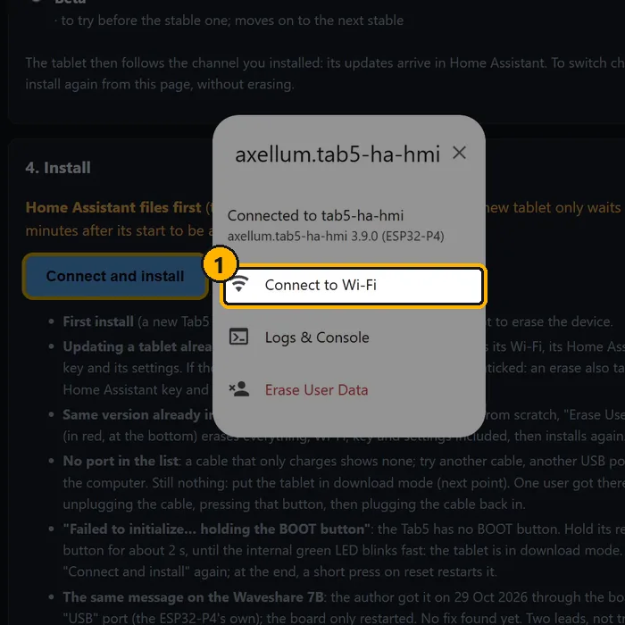

# Step 3 — Wi-Fi

## English · [Français](#version-française)

---

The firmware holds no Wi-Fi password ([ADR-0020](../decisions/0020-no-secret-firmware-signed-ota.md)): the tablet starts without a network, and you give it yours, either way. The tablet joins a **2.4 GHz** network only: its Wi-Fi 6 chip is listed for that band ([what you need](README.md)). A router that merges both bands under one name needs nothing; with two names, pick the 2.4 GHz one.

The [Waveshare 7B](../waveshare-7b.md) gets its Wi-Fi the same two ways.

## Over USB, right after the install

The window of the install page offers it as soon as the install ends: *Connect to Wi-Fi*, pick your network, type its password. It goes over the USB cable (Improv). The install page works in Chrome or Edge, so this is the same browser as [step 2](flash.md).

| | In the animation |
|---|---|
| **1** | *Connect to Wi-Fi* |
| **2** | your network (2.4 GHz) |
| **3** | its password |
| **4** | *Connect* |
| **5** | done: the tablet is on your network. The next step happens in Home Assistant |

The window is already closed? Open the [install page](https://axellum.github.io/M5-Tab5-ESPHome-LVGL/install/) again, *Connect and install*, then its Wi-Fi button. [ESPHome Web](https://web.esphome.io) does the same (*Connect*, then *Configure Wi-Fi*).

## Without a cable, with a phone

1. On the phone, join the open Wi-Fi network **« Tab5 Fallback AP »**.
2. A page opens by itself; otherwise go to `http://192.168.4.1`. <!-- pragma: allowlist secret -->
3. Pick your network and type its password.

The network is open on purpose, without a password: a password written in a public repository would protect nothing. Someone within range could change the network of a tablet that lost its own, but cannot flash it (the update is signed) nor talk to its Home Assistant connection (that needs the key Home Assistant gave it) ([ADR-0020](../decisions/0020-no-secret-firmware-signed-ota.md)).

## When the network changes

A new router, a new name, a new password: the tablet cannot reach its network any more, and « Tab5 Fallback AP » comes back after about a minute without a connection. Join it with a phone and pick the new network, exactly as above. The USB way works again too.

## Good to know

- The network is kept across updates.
- The tablet goes straight back to the access point and the channel of its last connection, without scanning. On a first start, with that access point off, or on another network, it scans again, which takes a little longer.
- The « Tab5 Fallback AP » network starts at once on a tablet that has no saved network, and comes back whenever the tablet loses its Wi-Fi for a minute, to give it another one. A tablet that has no Home Assistant key yet stops offering it 30 minutes after its start, and refuses every connection from then on: restart the tablet, and the network comes back. Once Home Assistant has given the tablet its key, that 30-minute window no longer applies.
- The Wi-Fi power saving is off at start (the radio listens all the time, for the fastest pushes from Home Assistant and for the voice).
- Note the tablet's IP address if you can (your router, or the page of « Tab5 Fallback AP » right after you picked the network): it helps at step 4 if Home Assistant does not find the tablet by itself, and for the [demo mode](../demo_mode.md).

## If something looks wrong

- **No « Tab5 Fallback AP » on the phone**: the tablet may have been started more than 30 minutes ago without a Home Assistant key, or it is already on a network. Restart it, and look again.
- **Black screen and no network after an update, an ordinary reboot does not help**: [Black screen + device off the network after an OTA](../troubleshooting.md#black-screen--device-off-the-network-after-an-ota--the-wi-fi-co-processor-never-came-up) — the Wi-Fi co-processor did not come back; unplugging the tablet is the fix that worked.
- **Waveshare 7B restarting every ~17 seconds after a reboot, never reaching Wi-Fi**: [Waveshare 7B: boot loop after a software reboot](../troubleshooting.md#waveshare-7b-boot-loop-after-a-software-reboot-wi-fi-link-down-2026-10-16).

**Next: [step 4, add the tablet to Home Assistant](add-to-home-assistant.md)**, within 30 minutes of its start.

---

## Version Française

---

Le firmware ne contient aucun mot de passe Wi-Fi ([ADR-0020](../decisions/0020-no-secret-firmware-signed-ota.md)) : la tablette démarre sans réseau, et vous lui donnez le vôtre, au choix. La tablette ne rejoint qu'un réseau en **2,4 GHz** : sa puce Wi-Fi 6 est donnée pour cette bande ([ce qu'il faut](README.md#version-française)). Une box qui réunit les deux bandes sous un même nom n'exige rien ; avec deux noms, choisissez celui du 2,4 GHz.

La [Waveshare 7B](../waveshare-7b.md#version-française) reçoit son Wi-Fi des mêmes deux façons.

## Par l'USB, juste après l'installation

La fenêtre de la page d'installation le propose dès la fin de l'installation : *Connect to Wi-Fi*, choisissez votre réseau, tapez son mot de passe. Il passe par le câble USB (Improv). La page d'installation marche dans Chrome ou Edge : c'est donc le même navigateur qu'à l'[étape 2](flash.md#version-française).

| | Dans l'animation (page en anglais) |
|---|---|
| **1** | *Connect to Wi-Fi* (se connecter au Wi-Fi) |
| **2** | votre réseau (2,4 GHz) |
| **3** | son mot de passe |
| **4** | *Connect* (connecter) |
| **5** | c'est fait : la tablette est sur votre réseau. La suite se passe dans Home Assistant |

La fenêtre est déjà fermée ? Rouvrez la [page d'installation](https://axellum.github.io/M5-Tab5-ESPHome-LVGL/install/), *Connecter et installer*, puis son bouton Wi-Fi. [ESPHome Web](https://web.esphome.io) fait la même chose (*Connect*, puis *Configure Wi-Fi*).

## Sans câble, avec un téléphone

1. Sur le téléphone, connectez-vous au réseau Wi-Fi ouvert **« Tab5 Fallback AP »**.
2. Une page s'ouvre toute seule ; sinon allez sur `http://192.168.4.1`. <!-- pragma: allowlist secret -->
3. Choisissez votre réseau et tapez son mot de passe.

Le réseau est ouvert exprès, sans mot de passe : un mot de passe écrit dans un dépôt public ne protégerait rien. Quelqu'un à portée pourrait changer le réseau d'une tablette qui a perdu le sien, mais ne peut ni la flasher (la mise à jour est signée) ni parler à sa connexion Home Assistant (il faut la clé que Home Assistant lui a donnée) ([ADR-0020](../decisions/0020-no-secret-firmware-signed-ota.md), en anglais).

## Quand le réseau change

Une nouvelle box, un nouveau nom, un nouveau mot de passe : la tablette ne retrouve plus son réseau, et « Tab5 Fallback AP » revient après environ une minute sans connexion. Connectez-vous-y avec un téléphone et choisissez le nouveau réseau, exactement comme ci-dessus. La voie par l'USB marche de nouveau aussi.

## Bon à savoir

- Le réseau est gardé d'une mise à jour à l'autre.
- La tablette retourne directement au point d'accès et au canal de sa dernière connexion, sans balayage. Au premier démarrage, avec ce point d'accès éteint, ou sur un autre réseau, elle balaye de nouveau, ce qui prend un peu plus de temps.
- Le réseau « Tab5 Fallback AP » démarre tout de suite sur une tablette sans réseau enregistré, et revient dès que la tablette perd son Wi-Fi une minute, pour lui en donner un autre. Une tablette qui n'a pas encore de clé Home Assistant cesse de le proposer 30 minutes après son démarrage, et refuse dès lors toute connexion : redémarrez-la, le réseau revient. Une fois que Home Assistant a donné sa clé à la tablette, cette fenêtre de 30 minutes ne s'applique plus.
- L'économie d'énergie du Wi-Fi est coupée au démarrage (la radio écoute en permanence, pour les envois les plus rapides de Home Assistant et pour la voix).
- Notez l'adresse IP de la tablette si vous le pouvez (votre box, ou la page de « Tab5 Fallback AP » juste après le choix du réseau) : elle sert à l'étape 4 si Home Assistant ne trouve pas la tablette seul, et pour le [mode démo](../demo_mode.md#version-française).

## Si quelque chose cloche

- **Pas de « Tab5 Fallback AP » sur le téléphone** : la tablette a peut-être démarré il y a plus de 30 minutes sans clé Home Assistant, ou elle est déjà sur un réseau. Redémarrez-la, et regardez de nouveau.
- **Écran noir et pas de réseau après une mise à jour, un redémarrage ordinaire n'y change rien** : [Écran noir + appareil absent du réseau après une OTA](../troubleshooting.md#écran-noir--appareil-absent-du-réseau-après-une-ota--le-co-processeur-wifi-nest-pas-remonté) — le co-processeur Wi-Fi n'est pas remonté ; débrancher la tablette est le remède qui a marché.
- **Waveshare 7B qui redémarre toutes les ~17 secondes après un redémarrage, sans jamais atteindre le Wi-Fi** : [Waveshare 7B : boucle de redémarrages après un redémarrage logiciel](../troubleshooting.md#waveshare-7b--boucle-de-redémarrages-après-un-redémarrage-logiciel-lien-wi-fi-absent-16102026).

**Ensuite : [étape 4, ajouter la tablette à Home Assistant](add-to-home-assistant.md#version-française)**, dans les 30 minutes qui suivent son démarrage.
