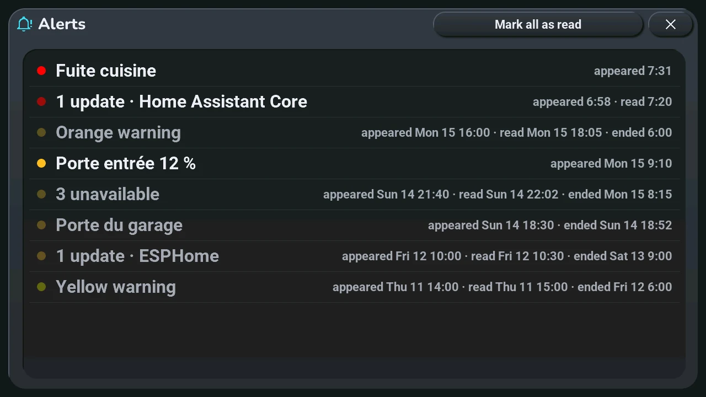
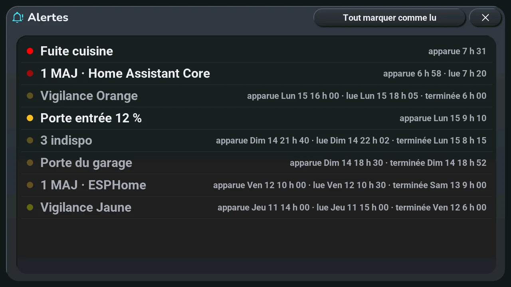

# Alerts

## English · [Français](#version-française)

---

**Opens with** « Alerts », the first button of the navigation wheel: a long press on the central card of the home screen, whatever it shows (the schedule, the rain, a warning, a message or an alert), opens the wheel ([home screen](home.md#central-card-12)). It also opens from « Go to screen » → *Alerts* in Home Assistant.

## What the window shows

- **One line per alert**, the newest at the top, the 20 latest: a dot of its colour (red, orange, yellow), its text, then when it **appeared**, was **read** (tapped on the central card) and **ended** (back to normal). A time alone is today; another day shows its name and date first.
- **Bright dot**: still to read. **Faded dot**: read, still going on. **Grey text**: ended.
- **Mark all as read**, top right: every alert still to read is read at once, also those that did not fit on the central card. The button is hidden when nothing is left to read.
- Before Home Assistant answers, the window says « Waiting for Home Assistant »; with nothing to list, « No alerts ».

The window only shows. Closing it is the **×** or a tap on the dark area around it.

## On the central card

Alerts reach the home screen as banners, up to four at a time, in the card's rotation with the schedule, the rain and the weather warning ([home screen](home.md#central-card-12)).

- **A tap on a banner reads it**: it leaves the card, and the window keeps it as read.
- **Order**: red first, then orange, then yellow, the oldest first within a colour. Past four, each banner shows its rank (« 2/6 »).
- **A new red alert** takes the card at once and stays a full turn, then rotates with the rest.
- **A read alert does not come back** unless it changes (a newer version, another warning level, a new unavailable entity), or it really stops and starts again: back to normal for 5 minutes, or an entity gone for an hour.
- **An alert that returns to normal leaves the card** at once.

## What you set in Home Assistant

Only the alerts you subscribed to show, on the card and in the window. They are the « Tab5 · alerts: … » lists of Home Assistant, in the « Alerts » section of the tablet's settings view:

- **updates** (all, or Home Assistant's only);
- **weather warnings from** yellow, orange or red;
- **problem sensors**, **unavailable entities**, and the entities labelled « Tab5 · alerte »;
- **fridges and freezers**;
- **batteries below** 10 to 30 %.

Unsubscribing hides the alerts at once; subscribing again does not bring back what was already read.

## Limits

- **The 20 latest** alerts are listed. Home Assistant keeps the last 30, and shows the ones you subscribed to.
- **Home Assistant decides, the tablet shows.** The memory of what is read lives in Home Assistant, and survives its restarts and crashes. Nothing is stored on the tablet but what it last received and its own taps, which only hide a banner until the next push.
- **After a restart of Home Assistant**, nothing ends and nothing comes back for 15 minutes, so that a restart does not make everything return.
- **An unavailable source never ends an alert**: an unread alert stays when its source cannot be read.
- **New firmware, older Home Assistant files**: the window shows « Waiting for Home Assistant ». Update the files first, then the firmware ([updates](../installation/updates.md)).

## If something looks wrong

No incident of [known incidents](../troubleshooting.md) is about the alerts themselves. If the window stays on « Waiting for Home Assistant », check that the Home Assistant files are those of the same release ([updates](../installation/updates.md)).

---

## Version Française

---

**S'ouvre par** « Alertes », le premier bouton de la roue de navigation : un appui long sur la carte centrale de l'accueil, quoi qu'elle montre (le planning, la pluie, une vigilance, un message ou une alerte), ouvre la roue ([accueil](home.md#carte-centrale-12)). Elle s'ouvre aussi par « Go to screen » → *Alerts* dans Home Assistant.

## Ce que montre la fenêtre

- **Une ligne par alerte**, la plus récente en haut, les 20 dernières : une pastille de sa couleur (rouge, orange, jaune), son texte, puis l'heure où elle est **apparue**, a été **lue** (touchée sur la carte centrale) et s'est **terminée** (revenue à la normale). Une heure seule, c'est aujourd'hui ; un autre jour montre d'abord son nom et sa date.
- **Pastille vive** : à lire. **Pastille pâle** : lue, toujours en cours. **Texte gris** : terminée.
- **Tout marquer comme lu**, en haut à droite : toutes les alertes à lire sont lues d'un coup, même celles qui ne tenaient pas sur la carte centrale. Le bouton disparaît quand il ne reste rien à lire.
- Avant que Home Assistant réponde, la fenêtre dit « En attente de Home Assistant » ; sans rien à lister, « Aucune alerte ».

La fenêtre montre seulement. Pour la fermer : la **×**, ou un tap sur la zone sombre autour.

## Sur la carte centrale

Les alertes arrivent sur l'accueil en bandeaux, quatre au plus à la fois, dans la rotation de la carte avec le planning, la pluie et la vigilance météo ([accueil](home.md#carte-centrale-12)).

- **Un tap sur un bandeau le lit** : il quitte la carte, et la fenêtre le garde comme lu.
- **L'ordre** : rouge d'abord, puis orange, puis jaune, la plus ancienne en premier dans une couleur. Au-delà de quatre, chaque bandeau montre son rang (« 2/6 »).
- **Une nouvelle alerte rouge** prend la carte tout de suite et y reste un tour complet, puis tourne avec le reste.
- **Une alerte lue ne revient pas** sauf si elle change (une version plus récente, un autre niveau de vigilance, une nouvelle entité indisponible), ou si elle s'arrête vraiment puis recommence : revenue à la normale pendant 5 minutes, ou une entité disparue pendant une heure.
- **Une alerte qui revient à la normale quitte la carte** tout de suite.

## Ce qui se règle dans Home Assistant

Seules les alertes auxquelles vous êtes abonné s'affichent, sur la carte et dans la fenêtre. Ce sont les listes « Tab5 · alerts: … » de Home Assistant, dans la section « Alertes » de la vue des réglages de la tablette :

- **les mises à jour** (toutes, ou celles de Home Assistant seulement) ;
- **les vigilances météo à partir de** jaune, orange ou rouge ;
- **les capteurs de problème**, **les entités indisponibles**, et les entités à l'étiquette « Tab5 · alerte » ;
- **les frigos et congélateurs** ;
- **les piles sous** 10 à 30 %.

Se désabonner masque les alertes tout de suite ; se réabonner ne fait pas revenir ce qui était déjà lu.

## Limites

- **Les 20 dernières** alertes sont listées. Home Assistant garde les 30 dernières, et montre celles auxquelles vous êtes abonné.
- **Home Assistant décide, la tablette montre.** La mémoire de ce qui est lu vit dans Home Assistant, et survit à ses redémarrages et à ses plantages. La tablette ne garde que ce qu'elle a reçu en dernier et ses propres taps, qui ne font que masquer un bandeau jusqu'à la poussée suivante.
- **Après un redémarrage de Home Assistant**, rien ne se termine et rien ne revient pendant 15 minutes, pour qu'un redémarrage ne fasse pas tout revenir.
- **Une source indisponible ne termine jamais une alerte** : une alerte non lue reste quand sa source ne peut pas être lue.
- **Firmware neuf, anciens fichiers Home Assistant** : la fenêtre montre « En attente de Home Assistant ». Mettez à jour les fichiers d'abord, puis le firmware ([mises à jour](../installation/updates.md#version-française)).

## Si quelque chose cloche

Aucun incident des [incidents connus](../troubleshooting.md#version-française) ne porte sur les alertes elles-mêmes. Si la fenêtre reste sur « En attente de Home Assistant », vérifiez que les fichiers Home Assistant sont ceux de la même version ([mises à jour](../installation/updates.md#version-française)).
