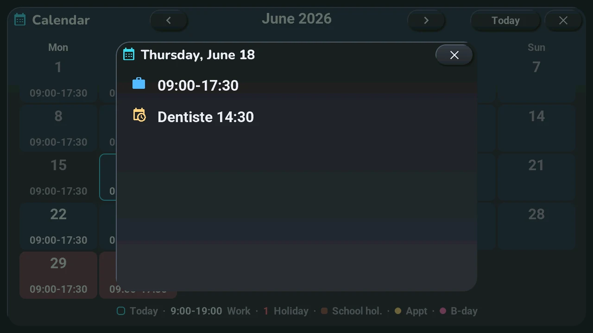
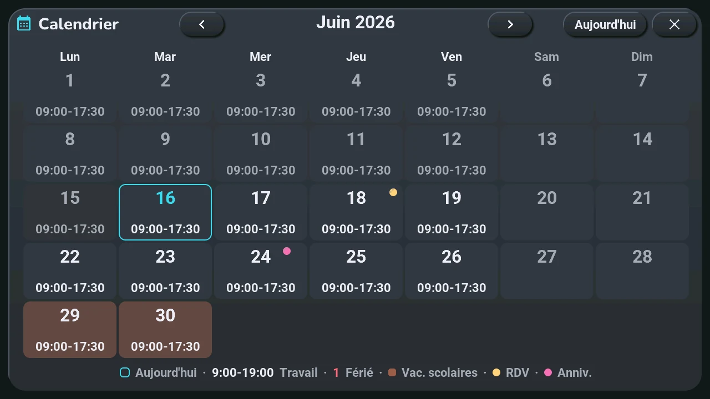
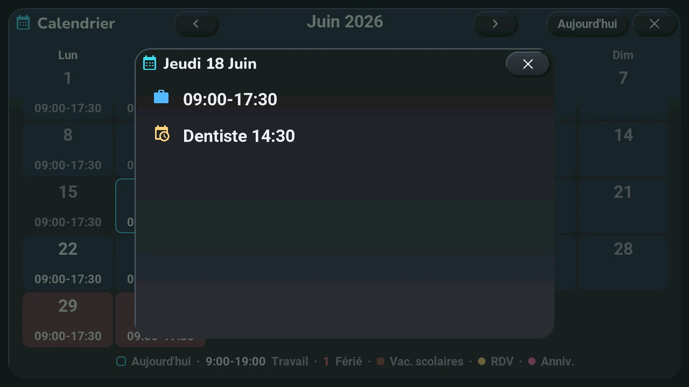

# Calendar

## English · [Français](#version-française)

---

**Opens with** a long press on the date, under the clock (a long press on the time opens the [alarm clock](alarm.md)); another gesture can be chosen in the blueprint ([home screen](home.md#clock-and-date-5)). It also opens from « Calendar » under « Agenda » in the [navigation wheel](home.md#central-card-12), and from « Go to screen » → *Calendar* in Home Assistant.

## The month

A grid of days, Monday first, six rows. Today's number is framed, the weekend and the days already gone are dimmed.

- **‹** and **›**: the previous or next month. **Today**: back to the current month.
- Each day shows its work hours (in pink when the day starts before 9:00). The legend at the bottom gives the rest: today framed, a public holiday's number in red, school holidays in a coloured cell, a gold dot for an appointment, a pink dot for a birthday.
- **Tap a day**: its detail.

## The detail of a day

It lists, with an icon each and six lines at most: the day's public holiday, school holidays, work hours, appointments with their time, birthdays, and civil observances (Mother's Day and the like, which the month does not mark). While Home Assistant answers it says « Loading... »; a day with nothing says « Nothing planned this day »; with Home Assistant out of reach, « Home Assistant offline ».

Its **×**, or a tap around it, brings the month back.

## Where the data comes from

The grid of days works without Home Assistant, from the tablet's clock; the hours and events come from your calendars ([step 5](../installation/sources.md)). Five lists of Home Assistant, « Tab5 · … calendar », say which:

- **work**: the events whose title holds one of the words of « Tab5 · work event keyword » (any case; empty means every event of that calendar). Its other events count as appointments ([which events are work](../installation/sources.md#which-events-are-work));
- **appointments**, **birthdays**, **public holidays** and **school holidays** (every event of that calendar counts).

A calendar left on « Not set » is simply absent from the screen, with no error. In France the ministry publishes the school holidays as one file per zone, which [step 5](../installation/sources.md#school-holidays) shows how to add.

For public holidays, a calendar of Home Assistant's Holiday integration holds only holidays, so all its days count. A calendar that mixes them with other celebrations (Google's « Jours fériés et autres fêtes en France ») goes through a list of the French public holidays: the other celebrations only show in the day's detail.

## What you set in Home Assistant

- The five calendars and the work keyword: the lists of [step 5](../installation/sources.md).
- The gesture that opens the calendar: the blueprint ([home screen](home.md#clock-and-date-5)).
- **Appointment reminders** (« Appointment announcements » and « Appointments: announce before »): the tablet announces a timed appointment of the appointments calendar that long before it ([tablet settings](../installation/settings.md#alarm-clock-appointments-voice)).

## Limits

- **Past days carry only the school holidays.** Work hours, public holidays, appointments and birthdays are computed from today on. A tap on a past day still asks for its detail.
- **A new appointment is not there yet?** The tablet asks for the month shown and its two neighbours, keeps those three, and shows a month it already has at once, refreshing it quietly. The tablet's « Reload calendar » button, in Home Assistant, asks again for this month and the next.
- **Six lines a day** in the detail.
- Without Home Assistant, the grid stays. The hours, holidays, dots and details are only those of the months the tablet already received, kept in its memory until it restarts.

## If something looks wrong

The month is empty although your calendars have events: check in Home Assistant that the five lists of [step 5](../installation/sources.md) are not on « Not set », then use « Reload calendar ». If you write your own automations around `calendar.get_events`, the incident [« A calendar/weather push silently breaks the rest of the same automation »](../troubleshooting.md#a-calendarweather-push-silently-breaks-the-rest-of-the-same-automation) shows how one bad call can stop the rest of an automation.

---

## Version Française

---

**S'ouvre par** un appui long sur la date, sous l'horloge (un appui long sur l'heure ouvre le [réveil](alarm.md#version-française)) ; un autre geste peut se choisir dans le blueprint ([écran d'accueil](home.md#horloge-et-date-5)). Elle s'ouvre aussi par « Calendrier » sous « Agenda » dans la [roue de navigation](home.md#carte-centrale-12), et par « Go to screen » → *Calendar* dans Home Assistant.

## Le mois

Une grille de jours, le lundi en premier, six lignes. Le numéro d'aujourd'hui est encadré, le week-end et les jours déjà passés sont estompés.

- **‹** et **›** : le mois précédent ou suivant. **Aujourd'hui** : retour au mois en cours.
- Chaque jour montre ses heures de travail (en rose quand la journée commence avant 9:00). La légende du bas donne le reste : aujourd'hui encadré, le numéro d'un jour férié en rouge, les vacances scolaires en case colorée, un point doré pour un rendez-vous, un point rose pour un anniversaire.
- **Tap sur un jour** : son détail.

## Le détail d'un jour

Il liste, avec une icône chacun et six lignes au plus : le férié du jour, les vacances scolaires, les heures de travail, les rendez-vous avec leur heure, les anniversaires, et les fêtes civiles (fête des mères et semblables, que le mois ne marque pas). Pendant que Home Assistant répond, il dit « Chargement... » ; un jour sans rien dit « Rien de prévu ce jour » ; Home Assistant injoignable, « Home Assistant hors ligne ».

Sa **×**, ou un tap autour, ramène le mois.

## D'où viennent les données

La grille des jours marche sans Home Assistant, depuis l'horloge de la tablette ; les heures et les événements viennent de vos agendas ([étape 5](../installation/sources.md#version-française)). Cinq listes de Home Assistant, « Tab5 · … calendar », disent lesquels :

- **travail** : les événements dont le titre contient un des mots de « Tab5 · work event keyword » (sans tenir compte des majuscules ; vide = tous les événements de cet agenda). Ses autres événements comptent comme rendez-vous ([quels événements sont du travail](../installation/sources.md#quels-événements-sont-du-travail)) ;
- **rendez-vous**, **anniversaires**, **jours fériés** et **vacances scolaires** (tous les événements de cet agenda comptent).

Un agenda laissé sur « Not set » est simplement absent de l'écran, sans erreur. En France, le ministère publie les vacances scolaires en un fichier par zone, que l'[étape 5](../installation/sources.md#vacances-scolaires) montre comment ajouter.

Pour les jours fériés, un agenda de l'intégration « Jours fériés » de Home Assistant ne contient que des fériés : tous ses jours comptent. Un agenda qui les mêle à d'autres fêtes (celui de Google, « Jours fériés et autres fêtes en France ») passe par une liste des jours fériés français : les autres fêtes n'apparaissent que dans le détail du jour.

## Ce qui se règle dans Home Assistant

- Les cinq agendas et le mot du travail : les listes de l'[étape 5](../installation/sources.md#version-française).
- Le geste qui ouvre le calendrier : le blueprint ([écran d'accueil](home.md#horloge-et-date-5)).
- **Les rappels de rendez-vous** (« Appointment announcements » et « Appointments: announce before ») : la tablette annonce un rendez-vous horodaté de l'agenda des rendez-vous à l'avance ([réglages de la tablette](../installation/settings.md#réveil-rendez-vous-voix)).

## Limites

- **Les jours passés ne portent que les vacances scolaires.** Les heures de travail, les jours fériés, les rendez-vous et les anniversaires sont calculés à partir d'aujourd'hui. Un tap sur un jour passé demande quand même son détail.
- **Un nouveau rendez-vous n'y est pas encore ?** La tablette demande le mois affiché et ses deux voisins, garde ces trois-là, et montre tout de suite un mois qu'elle a déjà, en le rafraîchissant discrètement. Le bouton « Reload calendar » de la tablette, dans Home Assistant, redemande ce mois et le suivant.
- **Six lignes par jour** dans le détail.
- Sans Home Assistant, la grille reste. Les heures, les fériés, les points et les détails sont seulement ceux des mois que la tablette a déjà reçus, gardés dans sa mémoire jusqu'à son redémarrage.

## Si quelque chose cloche

Le mois est vide alors que vos agendas ont des événements : vérifiez dans Home Assistant que les cinq listes de l'[étape 5](../installation/sources.md#version-française) ne sont pas sur « Not set », puis utilisez « Reload calendar ». Si vous écrivez vos propres automatisations autour de `calendar.get_events`, l'incident [« Un push calendrier/météo casse silencieusement le reste de la même automation »](../troubleshooting.md#un-push-calendriermétéo-casse-silencieusement-le-reste-de-la-même-automation) montre comment un seul appel raté peut arrêter la suite d'une automatisation.
