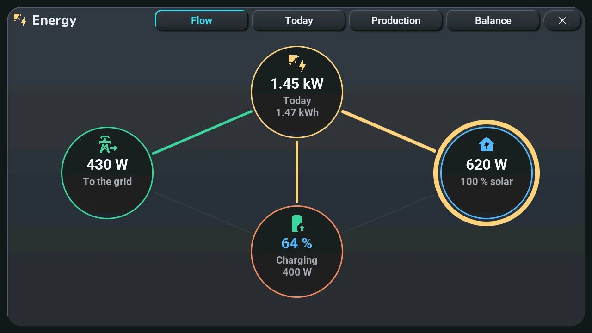
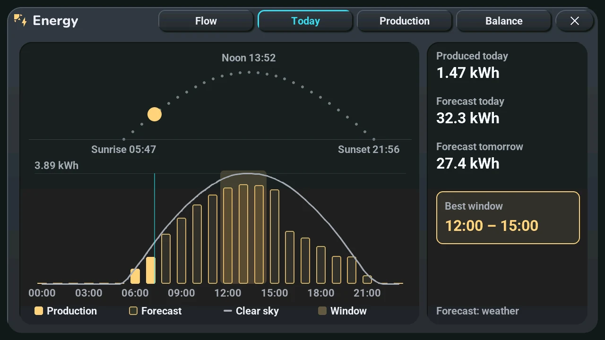
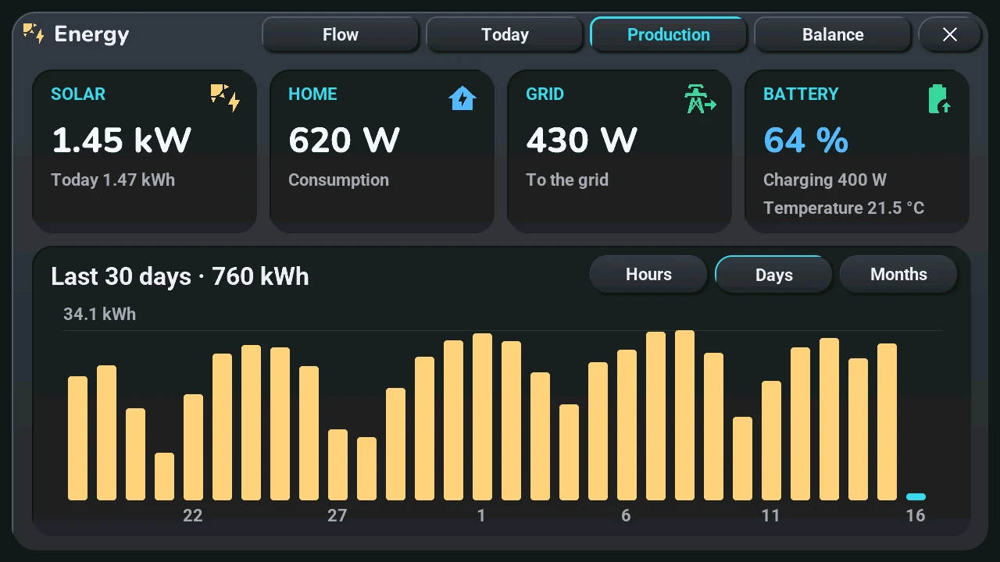
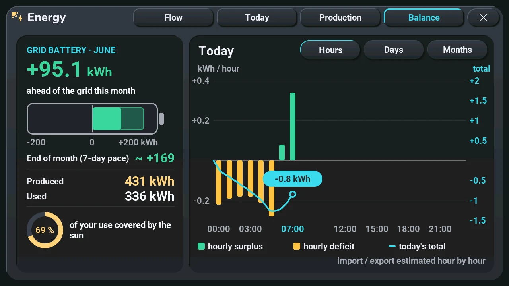
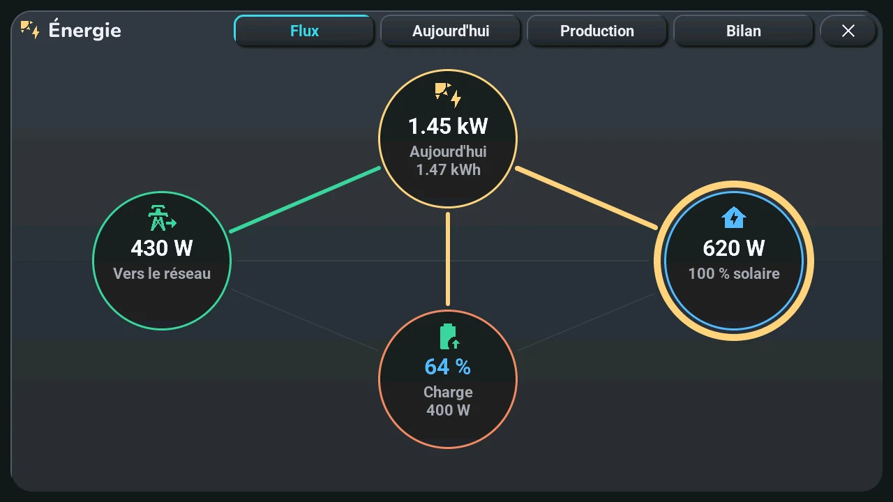
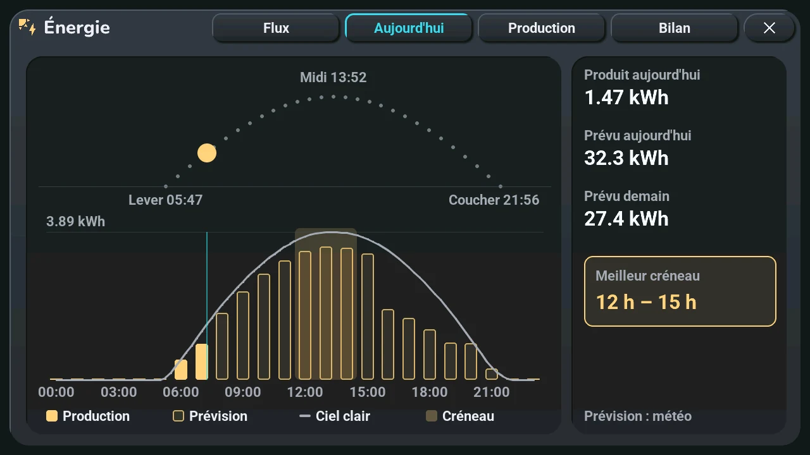
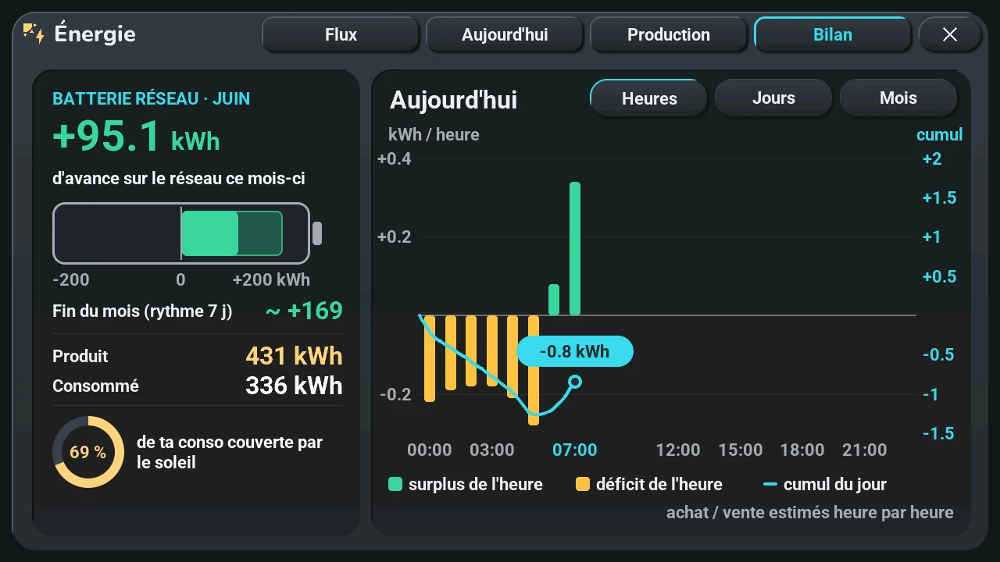

# Energy

## English · [Français](#version-française)

---

Only if sensors are picked in the « Énergie » sections of the blueprint ([solar energy](../installation/adapt-to-your-home.md#solar-energy-optional)). **Opens with** a tap or a long press on one of those sensors' cards ([bottom row](tiles.md)), the solar one with its solar-panel icon. When the solar production shows in the status row, a long press on the Home Assistant button, top right of the home screen, opens it too.

The window has up to five pages: swipe left or right, or touch their names at the top. It opens on the first one that has data; a page without its data is not shown. The fifth, **Charges**, only exists with electric cars ([further down](#electric-cars)).

- **Flow**: solar, home, grid and battery as circles, joined by lines as thick as the power flowing; the ring around the home shows the share coming from the sun and from the grid. **With electric cars** (up to two, [see below](#electric-cars)), each car is a circle too, with its name, battery, charging power and state (« Charging », « Plugged in », « Unplugged »), joined to the sun and the grid; the energy added and the end of the charge sit in its corner. The charge is served after the home (sun, battery, then grid) and shared between the cars by their power. Not drawn on the Waveshare 7B.
- **Today**: the sun's course from sunrise to sunset with the sun at its place, and solar noon. Below, hour by hour: what was produced (full bars), the forecast (outlined bars) and the learned clear-sky curve (the line: what your panels give on a sunny day, shade included). The light band is the best window of the rest of the day, to run the washing machine for instance. On the right: produced, forecast for today and tomorrow. Until a few sunny days are known, the window says the curve is being learned. **With electric cars**, each hour also gets a stack beside its production bar: the home (bottom), then car 1, then car 2; a legend at the top left gives the name and the kWh of each series, and a card under the best window says how much of the charging came from the sun (Tab5 only).
- **Production**:
    - **top, live**: **Solar** (power and today's production), **Home** (consumption), **Grid** (from or to the grid), **Battery** (level, charging or discharging, temperature). A card without a sensor is not shown.
    - **bottom**: the production, with the period and its total as title. **Hours** (today, hour by hour), **Days** (the last 30 days), **Months** (the last 12 months). The current hour, day or month is in the accent colour; the line at the top gives the highest bar.
- **Charges** (electric cars only, between Production and Balance): the last six charges of the cars, one line each: the car, the day and time (« Today · 09:02 », « Yesterday »), the duration, the kWh, a sun / grid bar and the share of the sun in %; then a total (« Total: 95.1 kWh, of which 62 % solar »). A charge in progress has a lightning bolt. The page exists once Home Assistant has sent charges; on the 7B it is the same list without the bar.
- **Balance**, in kWh (with the production and the home consumption, or a grid meter; [ADR-0062](../decisions/0062-energy-balance-kwh-grid-battery.md)):
    - **left, « Grid battery »**: this calendar month, as if the grid were a battery. The big number is the net of the month (produced − consumed): green when you are ahead of the grid, in the warning colour when behind. The gauge is centred on 0; the faded part is where the month should end at the pace of the last 7 days, written below. Then produced, consumed, the savings when prices are given, and the ring: the share of your use covered by the sun.
    - **right**: the net of each hour, day or month as bars (surplus up, deficit down) and its running total as a line. **Hours** (today), **Days** (the days of the month: today has a bubble, the dots go on to the end of the month at the recent pace), **Months** (the months of the year).
    - Without an import or export meter, Home Assistant estimates them hour by hour from the production and the consumption; the window says « import / export estimated hour by hour ».
    - **With electric cars**, a fourth button, **Cars**, appears next to Hours, Days and Months (Tab5 only): it replaces the chart with the month's cars balance. On the left, the cars together: a ring « x % of the home » shared between car 1 and car 2, the kWh charged this month, the share of the sun (and its kWh) and the kWh bought from the grid. On the right, one card per car: its kWh, a bar « sun share » over the grid share, the grid kWh, then the km driven and the kWh / 100 km, written with a « ~ » (an estimate: the energy charged over the km, never a measured consumption; they need the odometer, otherwise « -- »). The screen shows no amount of money for the cars.

| Today | Production | Balance |
|---|---|---|
|  |  |  |

The history needs the produced-energy sensor; without it, the live cards fill the window. Before Home Assistant answers, the window says it is waiting. What to pick in Home Assistant: [solar energy](../installation/adapt-to-your-home.md#solar-energy-optional).

### Electric cars

Up to two electric cars ([ADR-0076](../decisions/0076-cars-on-the-flux-page.md)), as soon as the battery level of one is picked in the blueprint ([what to pick](../installation/adapt-to-your-home.md#electric-cars-optional)). They show on the pages above and in a window of their own. **The Cars window opens with** a short tap on a car's circle on the Flow page, or with the option « Cars » of the tablet's « Go to screen » select in Home Assistant (the only way on the Waveshare 7B, whose Flow page draws no car). It has pages you swipe or touch by name at the top; a page without its data has no name:

- **Overview**: one big card per car (two at most, side by side; a single car takes the whole width): its name, a silhouette tinted by its state (green charging, blue plugged in), the battery in a ring, the range, a state line (« Charging · 7.20 kW », « Plugged in », « Unplugged », « Offline ») and its detail (energy added, time left, limit).
- **Charge** (Tab5 only): per car, the battery, the charge limit, the state and the arrival time the car announces; then the **24-hour strip** of the day: the hours each car charged (green), the sun's production forecast (gold bars), the line of the current hour and, for a car charging, the end of charge it announces. At the bottom, a **suggested slot** to charge on the sun, computed on the tablet from the day's forecast: the run of hours that keeps 70 % of the peak, none when the sun is too weak. The screen says it is a suggestion from the forecast, never a fact, and says when the forecast is missing.
- **Trips** (needs the odometer): per car, the odometer, the km of the month, the **estimated** kWh / 100 km (the energy charged over the km: an approximation, never called a consumption), then seven bars of km per day and seven of kWh received. A day without a reading stays empty, never « 0 km ». The kWh row is not drawn on the 7B.
- **State**: per car, the car seen from above with the **pressure of its four tyres** (« Tires OK » in green, « Low pressure » in orange when one is under 2.2 bar), then the cabin and outside temperatures, the doors (« Locked » / « Unlocked »), Sentry (« On » / « Off ») and the software (« Up to date » / « Update due »). What Home Assistant does not give reads « -- ». Pressures and temperatures use the unit received (bar, psi, kPa; °C, °F).

The cars screens have been checked with demo data and in the off-device render only, never with a real car: tell us what looks wrong.

---

## Version Française

---

Seulement si des capteurs sont choisis dans les sections « Énergie » du blueprint ([énergie solaire](../installation/adapt-to-your-home.md#énergie-solaire-facultatif)). **S'ouvre par** un tap ou un appui long sur la carte d'un de ces capteurs ([rangée du bas](tiles.md#version-française)), celle du solaire avec son icône de panneau. Quand la production solaire s'affiche dans la ligne d'état, un appui long sur le bouton Home Assistant, en haut à droite de l'accueil, l'ouvre aussi.

La fenêtre a jusqu'à cinq pages : glissez à gauche ou à droite, ou touchez leur nom en haut. Elle s'ouvre sur la première qui a des données ; une page sans ses données n'apparaît pas. La cinquième, **Charges**, n'existe qu'avec des voitures électriques ([plus bas](#voitures-électriques)).

- **Flux** : solaire, maison, réseau et batterie en cercles, reliés par des traits aussi épais que la puissance qui passe ; l'anneau autour de la maison montre la part qui vient du soleil et celle du réseau. **Avec des voitures électriques** (deux au plus, [voir plus bas](#voitures-électriques)), chaque voiture est aussi un cercle, avec son nom, sa batterie, sa puissance de charge et son état (« En charge », « Branchée », « Débranchée »), relié au soleil et au réseau ; l'énergie ajoutée et la fin de la charge sont dans son coin. La charge est servie après la maison (soleil, batterie, puis réseau) et partagée entre les voitures selon leur puissance. Non dessiné sur la Waveshare 7B.
- **Aujourd'hui** : la course du soleil du lever au coucher avec le soleil à sa place, et le midi solaire. En dessous, heure par heure : ce qui a été produit (barres pleines), la prévision (barres en contour) et la courbe « ciel clair » apprise (la ligne : ce que donnent vos panneaux un jour de soleil, ombres comprises). La bande claire est le meilleur créneau du reste de la journée, pour lancer la machine à laver par exemple. À droite : produit, prévu aujourd'hui et demain. Tant que quelques jours de soleil ne sont pas connus, la fenêtre dit que la courbe s'apprend. **Avec des voitures électriques**, chaque heure reçoit aussi une pile à côté de sa barre de production : la maison (en bas), puis la voiture 1, puis la voiture 2 ; une légende en haut à gauche donne le nom et les kWh de chaque série, et une carte sous le meilleur créneau dit quelle part de la charge est venue du soleil (Tab5 seulement).
- **Production** :
    - **en haut, en direct** : **Solaire** (puissance et production du jour), **Maison** (consommation), **Réseau** (depuis ou vers le réseau), **Batterie** (niveau, en charge ou en décharge, température). Une carte sans capteur n'apparaît pas.
    - **en bas** : la production, avec la période et son total pour titre. **Heures** (aujourd'hui, heure par heure), **Jours** (les 30 derniers jours), **Mois** (les 12 derniers mois). L'heure, le jour ou le mois en cours est dans la couleur d'accent ; la ligne du haut donne la plus haute barre.
- **Charges** (voitures électriques seulement, entre Production et Bilan) : les six dernières charges des voitures, une ligne chacune : la voiture, le jour et l'heure (« Aujourd'hui · 09:02 », « Hier »), la durée, les kWh, une barre soleil / réseau et la part du soleil en % ; puis un total (« Total : 95.1 kWh, dont 62 % par le soleil »). Une charge en cours a un éclair. La page existe dès que Home Assistant a envoyé des charges ; sur la 7B, c'est la même liste sans la barre.
- **Bilan**, en kWh (avec la production et la consommation de la maison, ou un compteur du réseau ; [ADR-0062](../decisions/0062-energy-balance-kwh-grid-battery.md)) :
    - **à gauche, « Batterie réseau »** : le mois civil en cours, comme si le réseau était une batterie. Le grand nombre est le net du mois (produit − consommé) : en vert quand vous avez de l'avance sur le réseau, dans la couleur d'avertissement quand vous êtes en retard. La jauge est centrée sur 0 ; la partie estompée est là où le mois devrait finir au rythme des 7 derniers jours, écrit en dessous. Puis produit, consommé, les économies quand les prix sont donnés, et l'anneau : la part de votre consommation couverte par le soleil.
    - **à droite** : le net de chaque heure, jour ou mois en barres (surplus en haut, déficit en bas) et son cumul en courbe. **Heures** (aujourd'hui), **Jours** (les jours du mois : aujourd'hui a une bulle, les points vont jusqu'à la fin du mois au rythme récent), **Mois** (les mois de l'année).
    - Sans compteur d'achat ni de vente, Home Assistant les estime heure par heure depuis la production et la consommation ; la fenêtre dit « achat / vente estimés heure par heure ».
    - **Avec des voitures électriques**, un quatrième bouton, **Voitures**, apparaît à côté de Heures, Jours et Mois (Tab5 seulement) : il remplace le graphique par le bilan du mois des voitures. À gauche, les voitures ensemble : un anneau « x % de la maison » partagé entre la voiture 1 et la voiture 2, les kWh chargés ce mois-ci, la part du soleil (et ses kWh) et les kWh achetés au réseau. À droite, une carte par voiture : ses kWh, une barre « part du soleil » sur la part du réseau, les kWh du réseau, puis les km parcourus et les kWh / 100 km, écrits avec un « ~ » (une estimation : l'énergie chargée divisée par les km, jamais une consommation mesurée ; il faut le compteur kilométrique, sinon « -- »). L'écran n'affiche aucun montant d'argent pour les voitures.

| Aujourd'hui | Production | Bilan |
|---|---|---|
|  |  |  |

L'historique demande le capteur d'énergie produite ; sans lui, les cartes en direct remplissent la fenêtre. Avant que Home Assistant réponde, la fenêtre dit qu'elle attend. Quoi choisir dans Home Assistant : [énergie solaire](../installation/adapt-to-your-home.md#énergie-solaire-facultatif).

### Voitures électriques

Deux voitures électriques au plus ([ADR-0076](../decisions/0076-cars-on-the-flux-page.md)), dès que le niveau de batterie de l'une est choisi dans le blueprint ([quoi choisir](../installation/adapt-to-your-home.md#voitures-électriques-facultatif)). Elles apparaissent sur les pages ci-dessus et dans une fenêtre à part. **La fenêtre Voitures s'ouvre par** un appui court sur le cercle d'une voiture de la page Flux, ou par l'option « Cars » de la liste « Go to screen » de la tablette, dans Home Assistant (la seule voie sur la Waveshare 7B, dont la page Flux ne dessine aucune voiture). Elle a des pages qu'on feuillette ou qu'on touche par leur nom en haut ; une page sans ses données n'a pas de nom :

- **Aperçu** : une grande carte par voiture (deux au plus, côte à côte ; une seule voiture occupe toute la largeur) : son nom, une silhouette teintée par son état (verte en charge, bleue branchée), la batterie dans un anneau, l'autonomie, une ligne d'état (« En charge · 7.20 kW », « Branchée », « Débranchée », « Hors ligne ») et son détail (énergie ajoutée, temps restant, limite).
- **Charge** (Tab5 seulement) : par voiture, la batterie, la limite de charge, l'état et l'heure d'arrivée annoncée par la voiture ; puis la **frise des 24 heures** du jour : les heures où chaque voiture a chargé (en vert), la prévision de production du soleil (barres dorées), le trait de l'heure actuelle et, pour une voiture en charge, la fin de charge qu'elle annonce. En bas, un **créneau conseillé** pour charger au soleil, calculé sur la tablette d'après la prévision du jour : la suite d'heures qui garde 70 % du pic, aucune si le soleil est trop faible. L'écran dit que c'est une suggestion fondée sur la prévision, jamais un fait, et dit quand la prévision manque.
- **Trajets** (demande le compteur kilométrique) : par voiture, le compteur, les kilomètres du mois, le **kWh / 100 km estimé** (l'énergie chargée sur les kilomètres : une approximation, jamais appelée consommation), puis sept barres de kilomètres par jour et sept de kWh reçus. Un jour sans relevé reste vide, jamais « 0 km ». La rangée de kWh n'est pas dessinée sur la 7B.
- **État** : par voiture, la voiture vue de dessus avec la **pression de ses quatre pneus** (« Pneus corrects » en vert, « Pression basse » en orange quand l'un passe sous 2,2 bar), puis les températures de la cabine et de l'extérieur, les portes (« Verrouillées » / « Déverrouillées »), la Sentinelle (« Activée » / « Désactivée ») et le logiciel (« À jour » / « À mettre à jour »). Ce que Home Assistant ne donne pas s'écrit « -- ». Les pressions et les températures gardent l'unité reçue (bar, psi, kPa ; °C, °F).

Les écrans des voitures n'ont été vérifiés qu'avec des données de démonstration et dans le rendu hors tablette, jamais avec une vraie voiture : dites-nous ce qui cloche.
