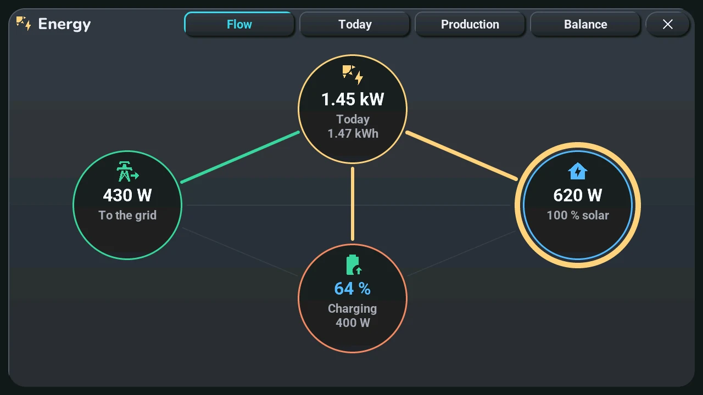
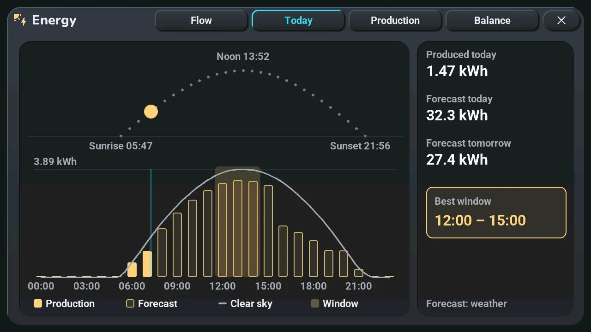
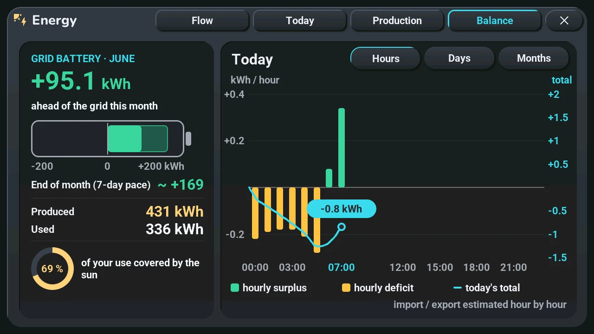
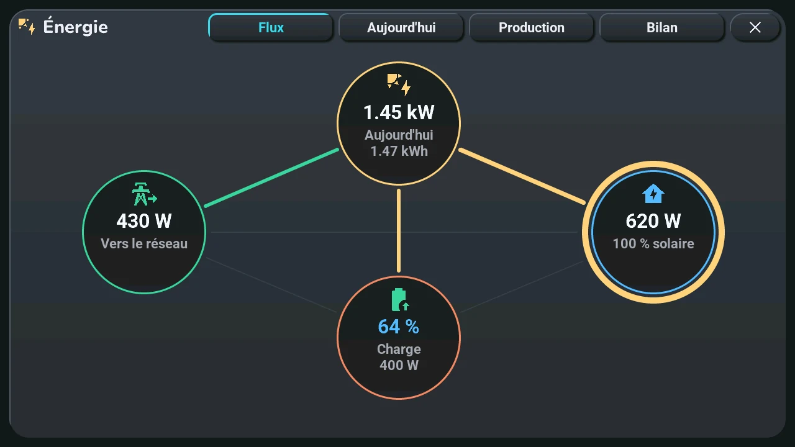
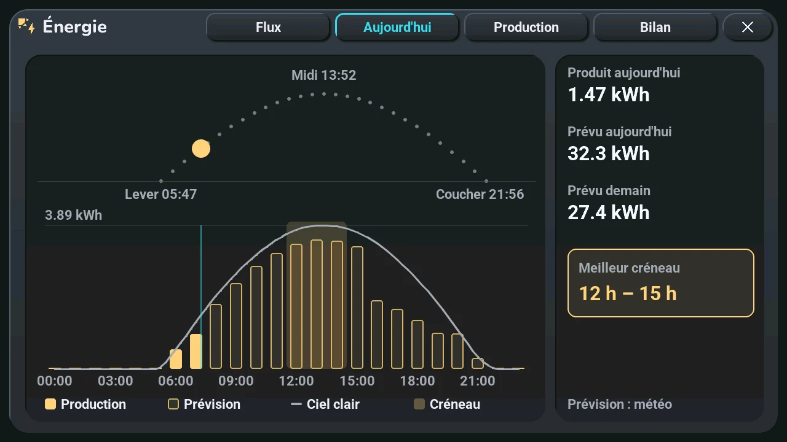
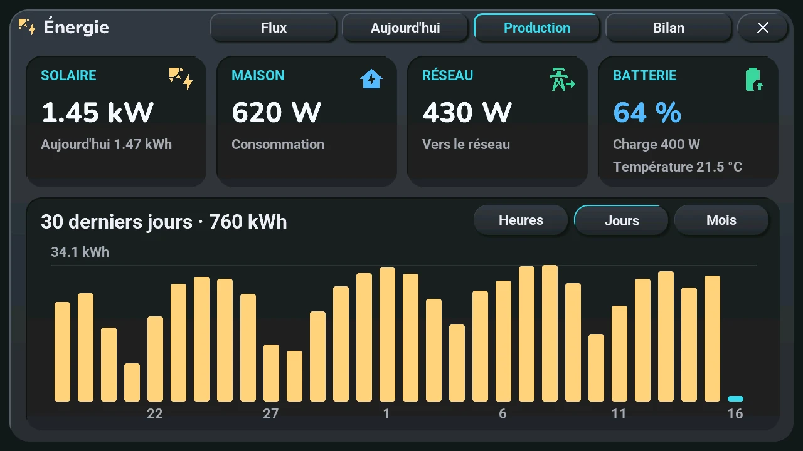
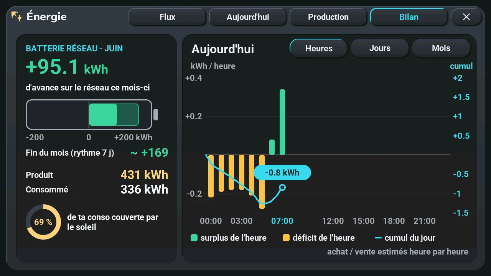

# Energy

## English · [Français](#version-française)

---

Only if sensors are picked in the « Énergie » sections of the blueprint ([solar energy](../installation/adapt-to-your-home.md#solar-energy-optional)). **Opens with** a tap or a long press on one of those sensors' cards ([bottom row](tiles.md)), the solar one with its solar-panel icon. When the solar production shows in the status row, a long press on the Home Assistant button, top right of the home screen, opens it too.

The window has up to four pages: swipe left or right, or touch their names at the top. It opens on the first one that has data; a page without its data is not shown.

- **Flow**: solar, home, grid and battery as circles, joined by lines as thick as the power flowing; the ring around the home shows the share coming from the sun and from the grid.
- **Today**: the sun's course from sunrise to sunset with the sun at its place, and solar noon. Below, hour by hour: what was produced (full bars), the forecast (outlined bars) and the learned clear-sky curve (the line: what your panels give on a sunny day, shade included). The light band is the best window of the rest of the day, to run the washing machine for instance. On the right: produced, forecast for today and tomorrow. Until a few sunny days are known, the window says the curve is being learned.
- **Production**:
    - **top, live**: **Solar** (power and today's production), **Home** (consumption), **Grid** (from or to the grid), **Battery** (level, charging or discharging, temperature). A card without a sensor is not shown.
    - **bottom**: the production, with the period and its total as title. **Hours** (today, hour by hour), **Days** (the last 30 days), **Months** (the last 12 months). The current hour, day or month is in the accent colour; the line at the top gives the highest bar.
- **Balance**, in kWh (with the production and the home consumption, or a grid meter; [ADR-0062](../decisions/0062-energy-balance-kwh-grid-battery.md)):
    - **left, « Grid battery »**: this calendar month, as if the grid were a battery. The big number is the net of the month (produced − consumed): green when you are ahead of the grid, in the warning colour when behind. The gauge is centred on 0; the faded part is where the month should end at the pace of the last 7 days, written below. Then produced, consumed, the savings when prices are given, and the ring: the share of your use covered by the sun.
    - **right**: the net of each hour, day or month as bars (surplus up, deficit down) and its running total as a line. **Hours** (today), **Days** (the days of the month: today has a bubble, the dots go on to the end of the month at the recent pace), **Months** (the months of the year).
    - Without an import or export meter, Home Assistant estimates them hour by hour from the production and the consumption; the window says « import / export estimated hour by hour ».

| Today | Production | Balance |
|---|---|---|
|  |  |  |

The history needs the produced-energy sensor; without it, the live cards fill the window. Before Home Assistant answers, the window says it is waiting. What to pick in Home Assistant: [solar energy](../installation/adapt-to-your-home.md#solar-energy-optional).

---

## Version Française

---

Seulement si des capteurs sont choisis dans les sections « Énergie » du blueprint ([énergie solaire](../installation/adapt-to-your-home.md#énergie-solaire-facultatif)). **S'ouvre par** un tap ou un appui long sur la carte d'un de ces capteurs ([rangée du bas](tiles.md#version-française)), celle du solaire avec son icône de panneau. Quand la production solaire s'affiche dans la ligne d'état, un appui long sur le bouton Home Assistant, en haut à droite de l'accueil, l'ouvre aussi.

La fenêtre a jusqu'à quatre pages : glissez à gauche ou à droite, ou touchez leur nom en haut. Elle s'ouvre sur la première qui a des données ; une page sans ses données n'apparaît pas.

- **Flux** : solaire, maison, réseau et batterie en cercles, reliés par des traits aussi épais que la puissance qui passe ; l'anneau autour de la maison montre la part qui vient du soleil et celle du réseau.
- **Aujourd'hui** : la course du soleil du lever au coucher avec le soleil à sa place, et le midi solaire. En dessous, heure par heure : ce qui a été produit (barres pleines), la prévision (barres en contour) et la courbe « ciel clair » apprise (la ligne : ce que donnent vos panneaux un jour de soleil, ombres comprises). La bande claire est le meilleur créneau du reste de la journée, pour lancer la machine à laver par exemple. À droite : produit, prévu aujourd'hui et demain. Tant que quelques jours de soleil ne sont pas connus, la fenêtre dit que la courbe s'apprend.
- **Production** :
    - **en haut, en direct** : **Solaire** (puissance et production du jour), **Maison** (consommation), **Réseau** (depuis ou vers le réseau), **Batterie** (niveau, en charge ou en décharge, température). Une carte sans capteur n'apparaît pas.
    - **en bas** : la production, avec la période et son total pour titre. **Heures** (aujourd'hui, heure par heure), **Jours** (les 30 derniers jours), **Mois** (les 12 derniers mois). L'heure, le jour ou le mois en cours est dans la couleur d'accent ; la ligne du haut donne la plus haute barre.
- **Bilan**, en kWh (avec la production et la consommation de la maison, ou un compteur du réseau ; [ADR-0062](../decisions/0062-energy-balance-kwh-grid-battery.md)) :
    - **à gauche, « Batterie réseau »** : le mois civil en cours, comme si le réseau était une batterie. Le grand nombre est le net du mois (produit − consommé) : en vert quand vous avez de l'avance sur le réseau, dans la couleur d'avertissement quand vous êtes en retard. La jauge est centrée sur 0 ; la partie estompée est là où le mois devrait finir au rythme des 7 derniers jours, écrit en dessous. Puis produit, consommé, les économies quand les prix sont donnés, et l'anneau : la part de votre consommation couverte par le soleil.
    - **à droite** : le net de chaque heure, jour ou mois en barres (surplus en haut, déficit en bas) et son cumul en courbe. **Heures** (aujourd'hui), **Jours** (les jours du mois : aujourd'hui a une bulle, les points vont jusqu'à la fin du mois au rythme récent), **Mois** (les mois de l'année).
    - Sans compteur d'achat ni de vente, Home Assistant les estime heure par heure depuis la production et la consommation ; la fenêtre dit « achat / vente estimés heure par heure ».

| Aujourd'hui | Production | Bilan |
|---|---|---|
|  |  |  |

L'historique demande le capteur d'énergie produite ; sans lui, les cartes en direct remplissent la fenêtre. Avant que Home Assistant réponde, la fenêtre dit qu'elle attend. Quoi choisir dans Home Assistant : [énergie solaire](../installation/adapt-to-your-home.md#énergie-solaire-facultatif).
