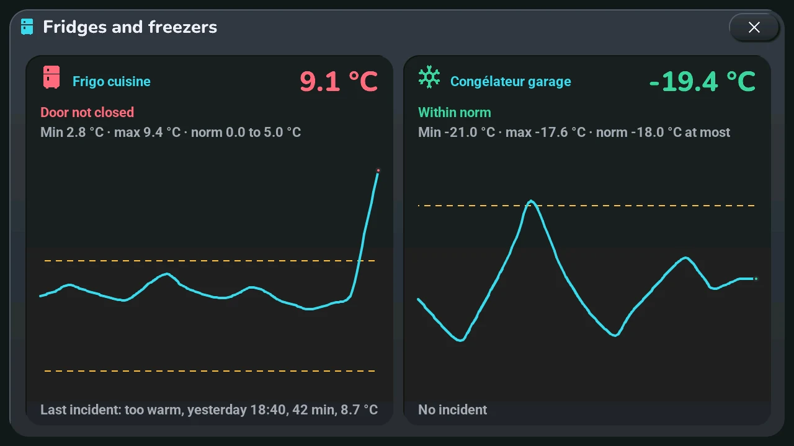
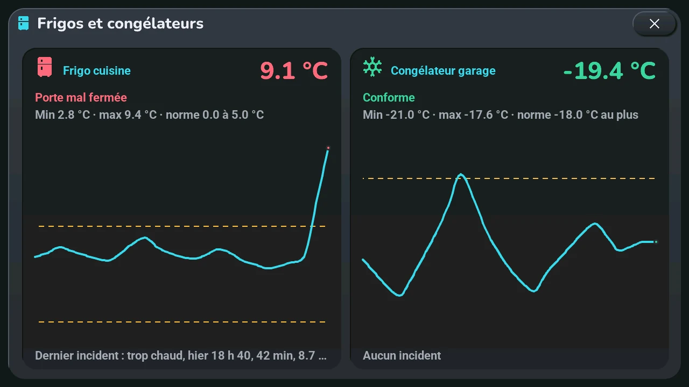

# Fridges and freezers

## English · [Français](#version-française)

---

**Opens with** a tap on the icon that blinks in the clock's top-right corner, the « Fridges » entry of the tablet's « Go to screen » list in Home Assistant, « Frigos » in the Agenda family of the navigation wheel (long press on the central card), or a tap or a long press of the clock or of a button top right when the blueprint gives it « Froid (réfrigérateurs, congélateurs) · Cold (fridges, freezers) » ([home screen](home.md#the-three-buttons-top-right-6-to-8)).

The window « Frigos et congélateurs » shows your fridges and freezers, one card each, up to four:

- **Icon and name**: a fridge or a snowflake (freezer), the sensor's name cut with « … » when it is too long.
- **Temperature**, in green within the norm, in orange for attention, in red for a serious problem.
- **Status**: « Conforme », « Trop chaud depuis 14 h 32 », « Coup de chaud », « Trop froid », « Porte ouverte ? », « Porte mal fermée », « Capteur muet »…
- **Lowest and highest** of the last 24 hours, and the norm (fridge 0 to 5 °C, freezer -18 °C at most).
- **Curve** of the last 24 hours, one point per hour and the current value, between the dashed lines of the norm.
- **Last incident**: its cause, when it started, how long it lasted and the temperature it reached — or « Aucun incident ».

One or two appliances sit on one row; three or four on two rows of two.

**What Home Assistant checks** (the `tab5_froid.yaml` package, thresholds at the top of its script):

| | Fridge | Freezer |
|---|---|---|
| Attention (orange) | 15-minute mean above 5 °C or below 0 °C | 15-minute mean above -15 °C |
| Serious (red) | above 8 °C for 30 minutes, or 10 °C reached | above -12 °C for 30 minutes, or -10 °C reached |
| Door open? (orange) | +2 °C since the lowest of the last 30 minutes | +4 °C |
| Door not closed (red) | the same rise still there after 20 minutes, without cooling down | |
| Sensor silent (orange) | no reading for 30 minutes | |

**On the home screen**, each problem is an alert of the central card (orange or red), like the others: a tap marks it as read; it comes back only if it gets worse (another cause or level). A serious problem also makes a red fridge icon blink in the clock's top-right corner, as long as it lasts; a tap on it opens this window.

**Setting up** in Home Assistant, where to find the lists: *Settings → Devices & services → Entities*, then search « Tab5 · fridges » or « Tab5 · freezers » (entities `select.tab5_refrigerateurs` and `select.tab5_congelateurs`); or the dashboard's *Tab5 settings* view, section *Home*, tiles « Fridges (Cold popup) » and « Freezers (Cold popup) ». Each is a drop-down list: open it, pick an appliance's temperature sensor (« ○ » becomes « ✓ »), then the next one; each entry shows the sensor's name, then its entity ID. Four appliances at most in all; picking a ticked sensor again removes it. Only temperature sensors with statistics are offered (`state_class: measurement`). With no appliance chosen, the window gives this path. The alerts can be turned off with « Tab5 · alerts: fridges and freezers ». This needs the `tab5_froid.yaml` package of this version.

Like every window, it closes with its **×**, a tap on the dark area around it, or after 45 s without a touch.

---

## Version Française

---

**S'ouvre par** un tap sur l'icône qui clignote dans le coin haut droit de l'horloge, l'entrée « Fridges » de la liste « Go to screen » de la tablette dans Home Assistant, « Frigos » dans la famille Agenda de la roue de navigation (appui long sur la carte centrale), ou un tap ou un appui long sur l'horloge ou un bouton en haut à droite quand le blueprint lui donne « Froid (réfrigérateurs, congélateurs) · Cold (fridges, freezers) » ([écran d'accueil](home.md#les-trois-boutons-en-haut-à-droite-6-à-8)).

La fenêtre « Frigos et congélateurs » montre vos réfrigérateurs et congélateurs, une carte chacun, quatre au plus :

- **Icône et nom** : un réfrigérateur ou un flocon (congélateur), le nom du capteur coupé par « … » s'il est trop long.
- **Température**, en vert dans la norme, en orange pour une attention, en rouge pour un problème grave.
- **Statut** : « Conforme », « Trop chaud depuis 14 h 32 », « Coup de chaud », « Trop froid », « Porte ouverte ? », « Porte mal fermée », « Capteur muet »…
- **Plus basse et plus haute** des 24 dernières heures, et la norme (réfrigérateur 0 à 5 °C, congélateur -18 °C au plus).
- **Courbe** des 24 dernières heures, un point par heure et la valeur actuelle, entre les pointillés de la norme.
- **Dernier incident** : sa cause, son début, sa durée et la température atteinte — ou « Aucun incident ».

Un ou deux appareils tiennent sur une rangée ; trois ou quatre sur deux rangées de deux.

**Ce que vérifie Home Assistant** (package `tab5_froid.yaml`, seuils en tête de son script) :

| | Réfrigérateur | Congélateur |
|---|---|---|
| Attention (orange) | moyenne de 15 min au-dessus de 5 °C ou sous 0 °C | moyenne de 15 min au-dessus de -15 °C |
| Grave (rouge) | au-dessus de 8 °C pendant 30 min, ou 10 °C atteints | au-dessus de -12 °C pendant 30 min, ou -10 °C atteints |
| Porte ouverte ? (orange) | +2 °C depuis le plus bas des 30 dernières minutes | +4 °C |
| Porte mal fermée (rouge) | la même montée encore là après 20 min, sans redescendre | |
| Capteur muet (orange) | aucune mesure depuis 30 min | |

**Sur l'écran d'accueil**, chaque problème est une alerte de la carte centrale (orange ou rouge), comme les autres : un tap la marque comme lue ; elle ne revient que si elle s'aggrave (autre cause ou autre niveau). Un problème grave fait aussi clignoter une icône rouge de réfrigérateur dans le coin haut droit de l'horloge, tant qu'il dure ; un tap dessus ouvre cette fenêtre.

**Réglage** dans Home Assistant, où trouver les listes : *Paramètres → Appareils et services → Entités*, puis chercher « Tab5 · fridges » ou « Tab5 · freezers » (entités `select.tab5_refrigerateurs` et `select.tab5_congelateurs`) ; ou la vue *Réglages Tab5* du tableau de bord, section *Maison*, tuiles « Réfrigérateurs (popup Froid) » et « Congélateurs (popup Froid) ». Ce sont des listes déroulantes : en ouvrir une, choisir le capteur de température d'un appareil (« ○ » devient « ✓ »), puis le suivant ; chaque ligne montre le nom du capteur, puis son identifiant. Quatre appareils au plus en tout ; choisir à nouveau un capteur coché le retire. Seuls les capteurs de température qui ont des statistiques sont proposés (`state_class: measurement`). Sans appareil choisi, la fenêtre donne ce chemin. Les alertes se coupent par « Tab5 · alerts: fridges and freezers ». Il faut le package `tab5_froid.yaml` de cette version.

Comme toute fenêtre, elle se ferme par sa **×**, un tap sur la zone sombre autour, ou après 45 s sans toucher.
