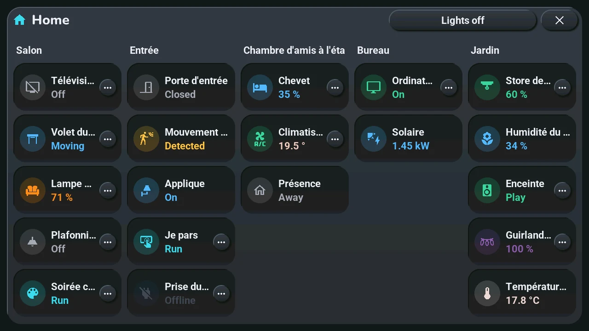
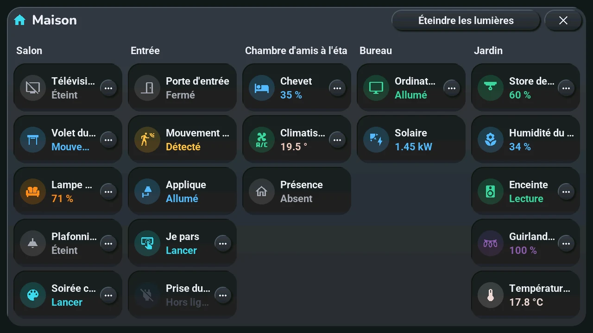

# House

## English · [Français](#version-française)

---

**Opens with** a tap on the room's name in the central card, in device mode (after a tap on the Home Assistant button), with the « House » entry of the tablet's « Go to screen » list in Home Assistant, or with a long press on one of the three buttons top right when the blueprint gives it « Maison · House » ([home screen](home.md#the-three-buttons-top-right-6-to-8)).

The whole house at a glance, like a Home Assistant dashboard: one column per room of the « Tab5 — emplacements » blueprint that has devices, in the blueprint's order (room 1 to 10), headed by the room's name (« Room 2 » when it has none). Five columns at most: with more rooms, the window has pages, shared out evenly (eight rooms: two pages of four), swiped left or right, their names at the top (« Rooms 1 to 4 »); it opens on the page of the room shown in device mode. Under it, one row per device, drawn like its card in device mode: its icon in a round badge of its state's colour, its name and its state. A state too long for the column ends with « … ». Without any device, the window says « Aucun appareil » (no device).

- **Tap a row**: what a tap on that device's card does ([bottom row](tiles.md#tap-and-long-press-by-device)): a light or a switch turns on or off, a shutter moves or stops, an action runs.
- **Long press on a row**, or **its « ⋯ » button**: what a long press on the card does. A light, a shutter or a climate shows its quick-action wheel around the row's icon, without its « Home » link (touch elsewhere to close only the wheel; its « Details » opens the device's window); the others open that device's window (lights, shutter, TV remote, device window) over this one; close it and the house is still there. A climate with no wheel opens its climate window (a tap too); a shutter set to *confirm* sends the other way, as on its card. Only devices that have a long press show « ⋯ »: a sensor has none (one of the « Énergie » sections still opens the energy window), a *read only* device neither, and its row does nothing.
- **Éteindre les lumières** (lights off), top right: the « All off » of the lights window, in every room that has lights, at once, without asking. The button is hidden when no room has a light.
- **More than five devices in a room**: each column shows five rows per page. The window then has pages, named « 1–5 », « 6–10 », « 11–15 », « 16–20 » at the top, next to its title (the rows of every column that the page shows): tap a name, or **swipe** left or right on the window for the next or previous page. Every device has its row on a page.

States change on the rows while the window is open. Like every window, it closes with its **×**, a tap on the dark area around it, or after 45 s without a touch.

---

## Version Française

---

**S'ouvre par** un tap sur le nom de la pièce dans la carte centrale, en mode appareils (après un tap sur le bouton Home Assistant), par l'entrée « House » de la liste « Go to screen » de la tablette dans Home Assistant, ou par un appui long sur l'un des trois boutons en haut à droite quand le blueprint lui donne « Maison · House » ([écran d'accueil](home.md#les-trois-boutons-en-haut-à-droite-6-à-8)).

Toute la maison d'un coup d'œil, comme un tableau de bord Home Assistant : une colonne par pièce du blueprint « Tab5 — emplacements » qui a des appareils, dans l'ordre du blueprint (pièce 1 à 10), avec le nom de la pièce en tête (« Pièce 2 » si elle n'en a pas). Cinq colonnes au plus : avec plus de pièces, la fenêtre a des pages, partagées également (huit pièces : deux pages de quatre), qu'on glisse vers la gauche ou la droite, leurs noms en haut (« Pièces 1 à 4 ») ; elle s'ouvre sur la page de la pièce montrée en mode appareils. Dessous, une ligne par appareil, dessinée comme sa carte en mode appareils : son icône dans une pastille ronde de la couleur de son état, son nom et son état. Un état trop long pour la colonne finit par « … ». Sans aucun appareil, la fenêtre dit « Aucun appareil ».

- **Tap sur une ligne** : ce que fait un tap sur la carte de cet appareil ([rangée du bas](tiles.md#tap-et-appui-long-par-appareil)) : une lumière ou un interrupteur s'allume ou s'éteint, un volet bouge ou s'arrête, une action se lance.
- **Appui long sur une ligne**, ou **son bouton « ⋯ »** : ce que fait un appui long sur sa carte. Une lumière, un volet ou une clim montre sa roue d'actions rapides autour de l'icône de la ligne, sans son lien « Maison » (touchez ailleurs pour ne fermer que la roue ; son « Détails » ouvre la fenêtre de l'appareil) ; les autres ouvrent la fenêtre de cet appareil (lumières, volet, télécommande TV, fenêtre de l'appareil) par-dessus celle-ci ; fermez-la et la maison est toujours là. Une clim sans roue ouvre sa fenêtre de clim (un tap aussi) ; un volet réglé sur *confirmer* envoie l'autre sens, comme sur sa carte. Seuls les appareils qui ont un appui long montrent « ⋯ » : un capteur n'en a pas (celui d'une section « Énergie » ouvre quand même la fenêtre Énergie), un appareil en *lecture seule* non plus, et sa ligne ne fait rien.
- **Éteindre les lumières**, en haut à droite : le « Tout éteindre » de la fenêtre des lumières, dans chaque pièce qui a des lumières, d'un coup, sans confirmation. Le bouton disparaît quand aucune pièce n'a de lumière.
- **Plus de cinq appareils dans une pièce** : chaque colonne montre cinq lignes par page. La fenêtre a alors des pages, nommées « 1–5 », « 6–10 », « 11–15 », « 16–20 » en haut, à côté de son titre (les lignes de chaque colonne que la page montre) : tap sur un nom, ou **glisser** vers la gauche ou la droite sur la fenêtre pour la page suivante ou précédente. Chaque appareil a sa ligne sur une page.

Les états changent sur les lignes pendant que la fenêtre est ouverte. Comme toute fenêtre, elle se ferme par sa **×**, un tap sur la zone sombre autour, ou après 45 s sans toucher.
