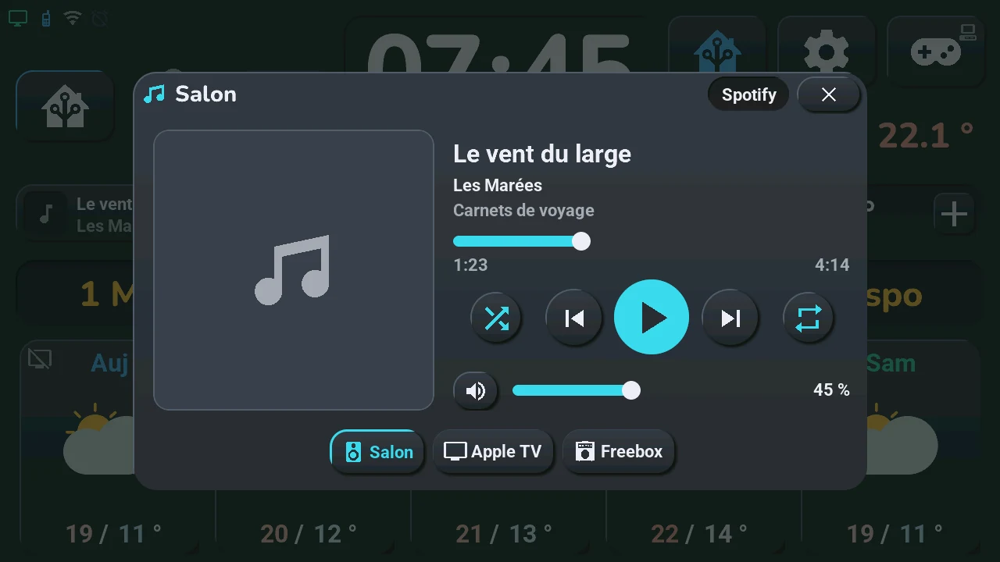

# Music

## English · [Français](#version-française)

---

**Opens with** a long press on a TV or media player card that is not the blueprint's TV ([tiles](tiles.md)), a tap on the « now playing » bar of the home screen or on the compact player left of the clock, « Musique » under « Devices » in the [navigation wheel](home.md#central-card-12) (long press on the central card; not offered once Home Assistant says no player is chosen), the « Music » entry of the tablet's « Go to screen » list in Home Assistant, or a tap or a long press of the clock or of a button top right when the blueprint gives it « Musique (lecteur) · Music (player) » ([home screen](home.md#the-three-buttons-top-right-6-to-8)).

A music player for any media player of Home Assistant (an Apple TV, a TV, a Freebox, a speaker, the tablet itself…), in a window that leaves the edges of the screen visible.

- **Header**: the player's name and, on the right, the app it plays from (when Home Assistant knows it).
- **Cover** on the left; a music note when the player sends none.
- **Title, artist, album** on the right, then the **position bar** with the elapsed time and the duration: drag it to move in the track (a live stream has no duration and no bar).
- **Buttons**: shuffle, previous, play / pause, next, repeat (all, one, off). Shuffle and repeat are in colour when on.
- **Volume**: the speaker button mutes, the slider sets the volume.
- **Players** at the bottom: one chip per chosen player, the one shown outlined in colour. A tap shows that player.

A button only shows when the player can do it: a TV that cannot skip tracks has no previous and next. A player that is off says « Lecteur éteint » (player off) with an « Allumer » (turn on) button when it can be turned on.

**The « now playing » bar** takes the place of the Ok Nabu button on the home screen while the shown player plays, and for 5 minutes after a pause: the cover, the title and the artist, and a play / pause button. A tap on the bar opens this window. The Ok Nabu button comes back when the bar goes.

**The compact player** can take the place of the voice controls left of the clock (chosen in the « Tab5 — emplacements » blueprint, section « Zone à gauche de l'horloge », or by a tap on the second temperature): the cover, the title and the artist, a thin position bar, and previous, play / pause and next — the same player and the same buttons as this window. A tap elsewhere on it opens this window. While it shows, the « now playing » bar stays hidden and the Ok Nabu button stays in place; the bar comes back when the area shows something else. With no player chosen, the tablet skips it.

**Pages**: the window shows the track on « Lecture » and can have up to three more pages, named on the title line next to the ×, in this order: « Playlists » (your favourite playlists), « Pièces » (rooms, two players or more) and « Bibliothèque » (library, Music Assistant only). Tap a name or swipe left / right; a page only shows when it has something to show.

**Favourite playlists** (the « Playlists » page): when your favourite YouTube or YouTube Music playlists are written in Home Assistant, the « Playlists » page comes after « Lecture ». It keeps the cover and the player chips and shows one button per playlist (up to eight). A tap starts the playlist on your Apple TV in its YouTube app (the button turns to the accent colour), and the window comes back to « Lecture ». Write them in the « Tab5 — emplacements » blueprint, input « Playlists favorites · Favourite playlists », one per line: « Name | link », the link copied in YouTube or YouTube Music (Share → Copy link; it must contain « list= »). The playlist plays on the Apple TV the window shows, otherwise on the first Apple TV of « Tab5 · music players » that has the YouTube app; if tvOS asks « Open in YouTube? », Home Assistant answers with the Apple TV's remote. Only an Apple TV (Apple TV integration) with the YouTube app can play them; a link without « list= » or no Apple TV in the list gives a Home Assistant notification that says what to fix. This needs the `tab5_lecteur.yaml` package and the blueprint of this version.

**Music of the whole home** ([ADR-0067](../decisions/0067-hifi-music-assistant.md), Home Assistant package `tab5_musique.yaml`): the « Pièces » and « Bibliothèque » pages.

- **« Pièces »** (rooms): one card per player, eight at most — its kind (speaker, TV, screen, group), its name, its state or its track, a volume slider (the volume is sent when you lift the finger) and up to three buttons: group with the player shown on « Lecture » (or leave its group), bring the music here, turn on or off. A tap on a card shows that player on « Lecture ». A long press opens its wheel: source, mute, « Musique ici » (bring the music here), « Séparer » (leave the group). « Tout ici » groups every player with the shown one, « Tout séparer » ungroups them all. With Music Assistant, the shown player gets a « + n » chip next to its name when n players play with it, and « Lecture » says « À suivre » (next) with the next track and the number of tracks in the queue.
- **« Bibliothèque »** (library, with Music Assistant only): favourites, playlists, albums, artists, radios, podcasts and recent items, ten per page with their covers (the kind's icon until the cover comes, or when it cannot). The arrows change page, the back arrow goes up a level. A tap plays a track, a radio or an episode on the shown player, or opens an album, an artist, a playlist or a podcast; a long press opens its wheel: « Lire » (play now), « À la suite » (next), « En fin de file » (at the end of the queue), « Radio » (similar music), « Ouvrir » (open). The page says « Chargement... » while Home Assistant looks, and a short sentence when it does not answer within 8 s. « Source » in the wheel of a card lists the sources of that player on this page: a tap picks one.

Without Music Assistant, only « Pièces » with the players of the list below: volume, mute and power, no group and no library.

**Setting up** in Home Assistant: choose the players in the list « Tab5 · music players » (up to six; a choice is added or removed each time you pick it). With no player chosen, the window says where to choose them. The player shown is the one picked on the tablet, otherwise the first of the list that plays; a player of the list that starts playing is shown when the current one does not play. This needs the `tab5_lecteur.yaml` package of this version. The cover comes from Home Assistant over http: with a Home Assistant reached only in https, the music note shows instead.

**Music in every room** ([ADR-0067](../decisions/0067-hifi-music-assistant.md)) needs the `tab5_musique.yaml` package and `custom_templates/tab5_musique.jinja`, nothing to set. With **Music Assistant** installed in Home Assistant, the rooms are its players (eight at most, by name) and its library, queue and transfer come with them; without it, the rooms are the players of the list above and there is no library. A room is named after its player in Home Assistant: rename the entity for a shorter name. « Récents » (recent) lists what Home Assistant saw playing on a Music Assistant player (twenty at most).

Like every window, it closes with its **×**, a tap on the dark area around it, or after 45 s without a touch.

---

## Version Française

---

**S'ouvre par** un appui long sur une carte TV ou lecteur multimédia qui n'est pas la TV du blueprint ([tuiles](tiles.md#version-française)), un tap sur la barre « en lecture » de l'écran d'accueil ou sur le lecteur compact à gauche de l'horloge, « Musique » sous « Appareils » dans la [roue de navigation](home.md#carte-centrale-12) (appui long sur la carte centrale ; plus proposée quand Home Assistant dit qu'aucun lecteur n'est choisi), l'entrée « Music » de la liste « Go to screen » de la tablette dans Home Assistant, ou un tap ou un appui long sur l'horloge ou un bouton en haut à droite quand le blueprint lui donne « Musique (lecteur) · Music (player) » ([écran d'accueil](home.md#les-trois-boutons-en-haut-à-droite-6-à-8)).

Un lecteur de musique pour n'importe quel lecteur multimédia de Home Assistant (une Apple TV, une TV, une Freebox, une enceinte, la tablette elle-même…), dans une fenêtre qui laisse voir les bords de l'écran.

- **En-tête** : le nom du lecteur et, à droite, l'application d'où vient la musique (quand Home Assistant la connaît).
- **Pochette** à gauche ; une note de musique quand le lecteur n'en envoie pas.
- **Titre, artiste, album** à droite, puis la **barre de position** avec le temps écoulé et la durée : la faire glisser pour se déplacer dans le morceau (un direct n'a ni durée ni barre).
- **Boutons** : aléatoire, précédent, lecture / pause, suivant, répétition (tout, un seul, non). Aléatoire et répétition sont en couleur quand ils sont actifs.
- **Volume** : le bouton du haut-parleur coupe le son, le curseur règle le volume.
- **Lecteurs** en bas : une pastille par lecteur choisi, celui affiché cerclé de couleur. Un tap affiche ce lecteur.

Un bouton n'apparaît que si le lecteur sait le faire : une TV qui ne sait pas changer de morceau n'a ni précédent ni suivant. Un lecteur éteint affiche « Lecteur éteint » avec un bouton « Allumer » quand il peut être allumé.

**La barre « en lecture »** prend la place du bouton Ok Nabu sur l'écran d'accueil pendant que le lecteur affiché joue, et 5 min après une pause : la pochette, le titre et l'artiste, et un bouton lecture / pause. Un tap sur la barre ouvre cette fenêtre. Le bouton Ok Nabu revient quand la barre s'en va.

**Le lecteur compact** peut prendre la place des commandes vocales à gauche de l'horloge (choisi dans le blueprint « Tab5 — emplacements », section « Zone à gauche de l'horloge », ou par un tap sur la seconde température) : la pochette, le titre et l'artiste, une fine barre de position, et précédent, lecture / pause et suivant — le même lecteur et les mêmes boutons que cette fenêtre. Un tap ailleurs l'ouvre. Pendant qu'il s'affiche, la barre « en lecture » reste masquée et le bouton Ok Nabu reste en place ; la barre revient quand la zone montre autre chose. Sans lecteur choisi, la tablette le saute.

**Les pages** : la fenêtre montre le morceau sur « Lecture » et peut avoir jusqu'à trois autres pages, nommées sur la ligne du titre à côté de la ×, dans cet ordre : « Playlists » (vos playlists favorites), « Pièces » (à partir de deux lecteurs) et « Bibliothèque » (avec Music Assistant seulement). Un tap sur un nom ou un glissement à gauche / à droite ; une page ne s'affiche que si elle a quelque chose à montrer.

**Playlists favorites** (la page « Playlists ») : quand vos playlists YouTube ou YouTube Music préférées sont écrites dans Home Assistant, la page « Playlists » vient après « Lecture ». Elle garde la pochette et les pastilles des lecteurs et montre un bouton par playlist (huit au plus). Un tap lance la playlist sur votre Apple TV, dans son appli YouTube (le bouton passe en couleur), et la fenêtre revient à « Lecture ». Elles s'écrivent dans le blueprint « Tab5 — emplacements », entrée « Playlists favorites · Favourite playlists », une par ligne : « Nom | lien », le lien copié dans YouTube ou YouTube Music (Partager → Copier le lien ; il doit contenir « list= »). La playlist part sur l'Apple TV que montre la fenêtre, sinon sur la première Apple TV de « Tab5 · music players » qui a l'appli YouTube ; si tvOS demande « Ouvrir dans « YouTube » ? », Home Assistant répond avec la télécommande de l'Apple TV. Seule une Apple TV (intégration Apple TV) avec l'appli YouTube sait les jouer ; un lien sans « list= » ou aucune Apple TV dans la liste donne une notification de Home Assistant qui dit quoi corriger. Il faut le package `tab5_lecteur.yaml` et le blueprint de cette version.

**La musique de toute la maison** ([ADR-0067](../decisions/0067-hifi-music-assistant.md), package Home Assistant `tab5_musique.yaml`) : les pages « Pièces » et « Bibliothèque ».

- **« Pièces »** : une carte par lecteur, huit au plus — son genre (enceinte, TV, écran, groupe), son nom, son état ou son morceau, un curseur de volume (le volume part quand on lève le doigt) et jusqu'à trois boutons : grouper avec le lecteur affiché sur « Lecture » (ou quitter son groupe), faire venir la musique ici, allumer ou éteindre. Un tap sur une carte affiche ce lecteur sur « Lecture ». Un appui long ouvre sa roue : source, sourdine, « Musique ici », « Séparer » (quitter le groupe). « Tout ici » groupe tous les lecteurs avec celui affiché, « Tout séparer » les sépare tous. Avec Music Assistant, le lecteur affiché a une puce « + n » à côté de son nom quand n lecteurs jouent avec lui, et « Lecture » dit « À suivre » avec le morceau suivant et le nombre de titres de la file.
- **« Bibliothèque »** (avec Music Assistant seulement) : favoris, playlists, albums, artistes, radios, podcasts et récents, dix par page avec leurs pochettes (l'icône du genre tant que la pochette n'est pas arrivée, ou quand elle ne peut pas). Les flèches changent de page, la flèche de retour remonte d'un niveau. Un tap joue un titre, une radio ou un épisode sur le lecteur affiché, ou ouvre un album, un artiste, une playlist ou un podcast ; un appui long ouvre sa roue : « Lire », « À la suite », « En fin de file », « Radio » (une musique proche), « Ouvrir ». La page dit « Chargement... » pendant que Home Assistant cherche, et une phrase courte s'il ne répond pas en 8 s. « Source » dans la roue d'une carte liste les sources de ce lecteur sur cette page : un tap en choisit une.

Sans Music Assistant, seulement « Pièces » avec les lecteurs de la liste ci-dessous : volume, sourdine et marche, ni groupe ni bibliothèque.

**Réglage** dans Home Assistant : choisir les lecteurs dans la liste « Tab5 · music players » (six au plus ; chaque choix ajoute ou retire un lecteur). Sans lecteur choisi, la fenêtre dit où les choisir. Le lecteur affiché est celui choisi sur la tablette, sinon le premier de la liste qui joue ; un lecteur de la liste qui se met à jouer est affiché quand celui en cours ne joue pas. Il faut le package `tab5_lecteur.yaml` de cette version. La pochette vient de Home Assistant en http : avec un Home Assistant joint seulement en https, la note de musique s'affiche à la place.

**La musique de toute la maison** ([ADR-0067](../decisions/0067-hifi-music-assistant.md)) demande le package `tab5_musique.yaml` et `custom_templates/tab5_musique.jinja`, rien à régler. Avec **Music Assistant** installé dans Home Assistant, les pièces sont ses lecteurs (huit au plus, par nom) et sa bibliothèque, sa file et le transfert viennent avec ; sans lui, les pièces sont les lecteurs de la liste ci-dessus, sans bibliothèque. Une pièce porte le nom de son lecteur dans Home Assistant : renommer l'entité pour un nom plus court. « Récents » montre ce que Home Assistant a vu jouer sur un lecteur Music Assistant (vingt au plus).

Comme toute fenêtre, elle se ferme par sa **×**, un tap sur la zone sombre autour, ou après 45 s sans toucher.
