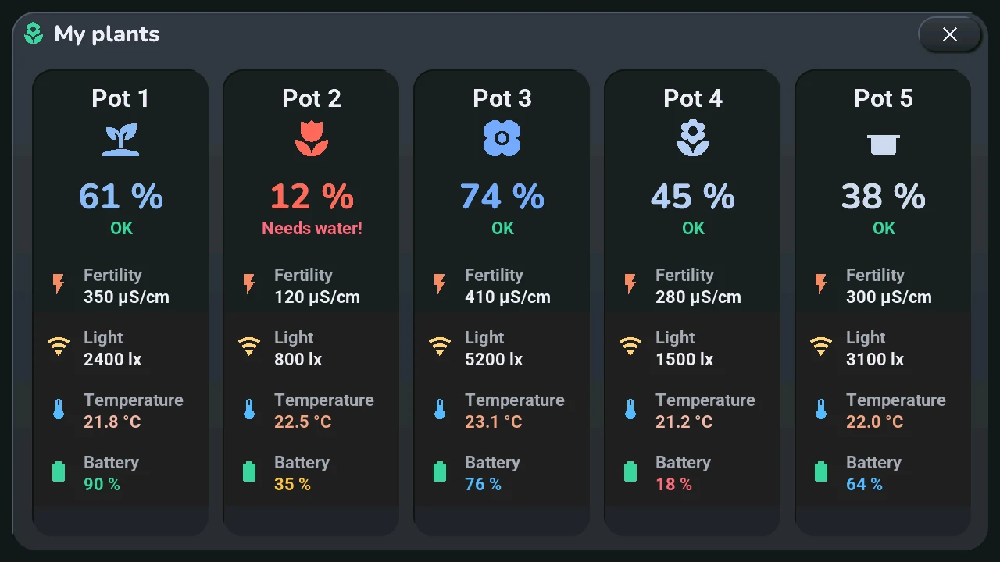
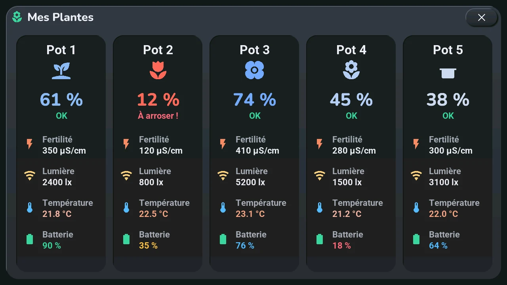

# Plants

## English · [Français](#version-française)

---

On the home screen, the plants line under the clock shows one coloured icon per pot, from the driest on the left to the wettest on the right: red when a pot needs water, blue when it is very wet. A long press on it opens the details of every pot: moisture, fertility, light, temperature and the sensor's battery.

## The plants line

- **Five pots, at least four of them reporting**: four icons, the driest, the next one, the middle one and the wettest. Which pot sits where changes as they dry.
- **Fewer pots, or several offline**: one icon per pot, the ones that report from the driest to the wettest, then the offline ones, in grey.
- **Never more than four icons**, and neither names nor values: those are in the window below.
- **The colour is a scale**: red at 14 % or less, yellow around 22 %, the theme's « comfortable » colour at 30 %, then drifting to blue up to 80 % and more. Each [theme](../installation/settings.md#theme-light-or-dark) can recolour it, so the middle of the scale is not always green.

## How to open the window

**Opens with** a long press on those icons, **while the plants line is the one on show**. The lines of the row under the clock take turns, and on a line of sensors a long press does nothing: it only shows. A tap shows the next line of the row, if it has others ([home screen](home.md)).

The window also opens from « Plants » under « Devices » in the [navigation wheel](home.md#central-card-12), from « Go to screen » → *Plants* in Home Assistant, or from a clock or top-button gesture set to *Plants* in the blueprint ([your own gestures](home.md)). With no pot chosen in Home Assistant, there is no plants line and no window.

One card per pot, always in the same order: **Pot 1** to **Pot 5**, as in the « Plants » section of the blueprint. The titles are fixed, and each pot keeps its own icon.

- the pot's moisture in large digits, in the scale's colour, and its state: **OK**, **Drying soon** (20 % or less), **Needs water!** (14 % or less), **Offline** (the sensor is unavailable, the digits read « -- »);
- **Fertility** (µS/cm), **Light** (lx), **Temperature** (°C, coloured by its own scale), and the sensor's **Battery** (green above 80 %, blue above 40 %, amber from 20 %, red below);
- a value that Home Assistant does not send stays at « -- ».

## Gestures

- **×**, top right, or a tap on the dark area around the window: closes it. Apart from that, the window has no button: it only shows.
- Nothing to swipe: every pot is on the same page.

## What you set in Home Assistant

- **The pots**: the « Plants » section of the « Tab5 — emplacements » blueprint ([step 6](../installation/devices.md)). One moisture sensor per pot, up to five; an empty pot is hidden, and the cards left are centred.
- **Fertility, light, temperature and battery** are not chosen: Home Assistant takes them on the same device as the moisture sensor, by their class (Flower Care sensors and the like).
- **Where the plants line goes** in the row: first (the default), second, third or hidden, in the section « Sous l'horloge · Under the clock ».

## Limits

- **Five pots at most.** A sixth is a change of the firmware, not a setting.
- **Home Assistant sends the measurements every 5 minutes**, the ones that changed: a value on screen can be a few minutes old. Changing a choice in the blueprint goes at once.
- **Names are not shown**: the cards say « Pot 1 » to « Pot 5 », not the name of the sensor in Home Assistant.

## If something looks wrong

No incident of [known incidents](../troubleshooting.md) concerns the plants. Before looking further:

- **No plants line**: no moisture sensor chosen, or the line is hidden in the blueprint.
- **Grey icons, « Offline »**: Home Assistant says the sensor is unavailable: look at that sensor in Home Assistant first.
- **Nothing at all of your home on the screen**: the push from Home Assistant is not reaching it, see [step 6](../installation/devices.md) and the [known incidents](../troubleshooting.md).

---

## Version Française

---

Sur l'écran d'accueil, la ligne des plantes sous l'horloge montre une icône colorée par pot, du plus sec à gauche au plus humide à droite : rouge quand un pot a besoin d'eau, bleu quand il est très humide. Un appui long dessus ouvre le détail de chaque pot : humidité, fertilité, lumière, température et batterie du capteur.

## La ligne des plantes

- **Cinq pots, dont au moins quatre répondent** : quatre icônes, le plus sec, le suivant, celui du milieu et le plus humide. Quel pot est où change à mesure qu'ils sèchent.
- **Moins de pots, ou plusieurs hors ligne** : une icône par pot, ceux qui répondent du plus sec au plus humide, puis ceux hors ligne, en gris.
- **Jamais plus de quatre icônes**, et ni noms ni valeurs : ils sont dans la fenêtre ci-dessous.
- **La couleur suit une échelle** : rouge à 14 % ou moins, jaune vers 22 %, la couleur « confortable » du thème à 30 %, puis qui glisse vers le bleu jusqu'à 80 % et plus. Chaque [thème](../installation/settings.md#thème-clair-ou-sombre) peut la recolorer : le milieu de l'échelle n'est donc pas toujours vert.

## Comment ouvrir la fenêtre

**S'ouvre par** un appui long sur ces icônes, **tant que la ligne des plantes est celle qui est affichée**. Les lignes de la rangée sous l'horloge se relaient, et sur une ligne de capteurs un appui long ne fait rien : elle montre seulement. Un tap montre la ligne suivante de la rangée, s'il y en a d'autres ([écran d'accueil](home.md#version-française)).

La fenêtre s'ouvre aussi par « Plantes » sous « Appareils » dans la [roue de navigation](home.md#carte-centrale-12), par « Go to screen » → *Plants* dans Home Assistant, ou par un geste de l'horloge ou d'un bouton du haut réglé sur *Plantes* dans le blueprint ([vos propres gestes](home.md#version-française)). Sans pot choisi dans Home Assistant, il n'y a ni ligne des plantes ni fenêtre.

Une carte par pot, toujours dans le même ordre : **Pot 1** à **Pot 5**, comme dans la section « Plantes » du blueprint. Les titres sont fixes, et chaque pot garde son icône.

- l'humidité du pot en grands chiffres, dans la couleur de l'échelle, et son état : **OK**, **Bientôt sec** (20 % ou moins), **À arroser !** (14 % ou moins), **Hors ligne** (le capteur est indisponible, les chiffres affichent « -- ») ;
- **Fertilité** (µS/cm), **Lumière** (lx), **Température** (°C, colorée par sa propre échelle), et la **Batterie** du capteur (vert au-dessus de 80 %, bleu au-dessus de 40 %, ambre à partir de 20 %, rouge en dessous) ;
- une valeur que Home Assistant n'envoie pas reste à « -- ».

## Gestes

- **×**, en haut à droite, ou un tap sur la zone sombre autour de la fenêtre : la ferme. À part cela, la fenêtre n'a pas de bouton : elle montre seulement.
- Rien à faire glisser : tous les pots sont sur la même page.

## Ce qui se règle dans Home Assistant

- **Les pots** : la section « Plantes » du blueprint « Tab5 — emplacements » ([étape 6](../installation/devices.md#version-française)). Un capteur d'humidité par pot, cinq au plus ; un pot laissé vide est masqué, et les cartes qui restent sont centrées.
- **Fertilité, lumière, température et batterie** ne se choisissent pas : Home Assistant les prend sur le même appareil que le capteur d'humidité, par leur classe (capteurs Flower Care et semblables).
- **La place de la ligne des plantes** dans la rangée : première (d'origine), deuxième, troisième ou masquée, dans la section « Sous l'horloge · Under the clock ».

## Limites

- **Cinq pots au plus.** Un sixième est une modification du firmware, pas un réglage.
- **Home Assistant envoie les mesures toutes les 5 minutes**, celles qui ont changé : une valeur à l'écran peut avoir quelques minutes. Un changement de choix dans le blueprint part tout de suite.
- **Les noms ne sont pas montrés** : les cartes disent « Pot 1 » à « Pot 5 », pas le nom du capteur dans Home Assistant.

## Si quelque chose cloche

Aucun incident des [incidents connus](../troubleshooting.md#version-française) ne concerne les plantes. Avant de chercher plus loin :

- **Pas de ligne des plantes** : aucun capteur d'humidité choisi, ou la ligne est masquée dans le blueprint.
- **Icônes grises, « Hors ligne »** : Home Assistant dit que le capteur est indisponible : regardez d'abord ce capteur dans Home Assistant.
- **Rien de votre maison à l'écran** : la poussée de Home Assistant n'arrive pas jusqu'à lui, voir l'[étape 6](../installation/devices.md#version-française) et les [incidents connus](../troubleshooting.md#version-française).
