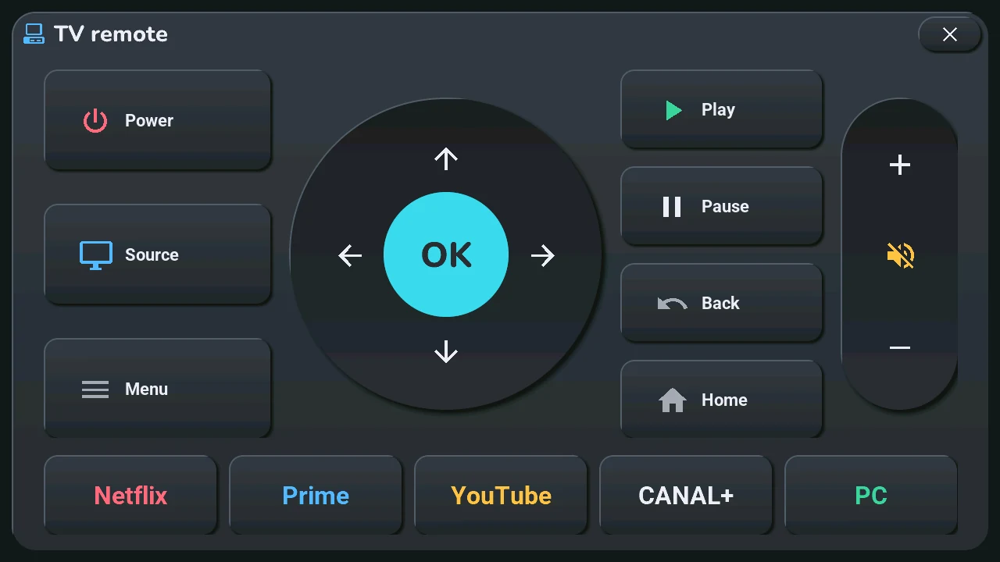
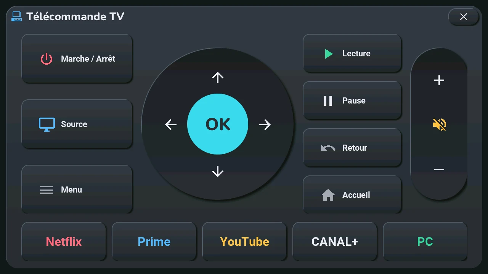

# TV remote

## English · [Français](#version-française)

---

**Opens with** a long press on the gamepad button, top right of the home screen, on the card of the TV picked in the blueprint ([bottom row](tiles.md)), or « TV » under « Devices » in the [navigation wheel](home.md#central-card-12) (long press on the central card). It also opens from « Go to screen » → *TV remote* in Home Assistant, or from a clock or top-button gesture set to the TV remote in the blueprint ([your own gestures](home.md)).

## The keys

- **Power**, **Source**, **Menu** (left).
- The round pad: the four arrows and **OK** (centre).
- **Play**, **Pause**, **Back**, **Home**, right of the pad.
- The volume column (right): **+**, mute, **−**.
- The bottom row opens an app on the TV: **Netflix**, **Prime**, **YouTube**, **CANAL+**; **PC** switches to the computer's input.

Every key is a plain tap: there is no long press and no key repeat. The window closes with its **×**, top right, or with a tap on the dark area around it.

## Several remotes

Up to four: the TV's, then the ones picked in « Autres télécommandes » in the blueprint (an Apple TV, a Freebox Player…). Each one has its page: their names at the top — tap one, or swipe left or right. The page changes at once. With one remote, or none pushed yet, there are no names and no swipe.

A name is the device's own name in Home Assistant, without its area and without a final parenthesis (« Salon · Freebox Player (Apple TV 3) » reads « Freebox Player »).

On a box of the Apple TV integration (Apple TV, Freebox Player), **Stop** takes the place of Source, the volume has no mute, and the bottom row becomes **Previous**, **Rewind**, **Play / Pause**, **Forward**, **Next**; there are no app buttons. Home Assistant translates the keys for such a box; a key with no counterpart (mute, source) sends nothing.

## What you set in Home Assistant

- **The remotes**: « Télécommande de la TV » and « Autres télécommandes » in the « Tab5 — emplacements » blueprint ([other zones](../installation/adapt-to-your-home.md#other-zones)). The first remote of the list is the TV's; with none chosen, the screen shows no remote.
- **The Samsung TV for the app buttons**: the « Tab5 · Samsung TV » list and the text « Tab5 · TV address » (its IP address or host name on the local network), in [step 5](../installation/sources.md). By default the list takes the only TV of the Samsung Smart TV integration; with an empty address, Home Assistant looks for it in a network tracker that carries the TV's MAC address.
- **The app ids and the PC input** live in the Home Assistant package `tab5_tv.yaml`, not in the firmware: a change is a file edit and a reload, with no flash. The **PC** key sequence (the source menu, three steps to the right of the far left, OK) is set for the author's TV: if your menu is ordered differently, change the number of right-arrow steps there.

## How the keys travel

The tablet has no infrared. Each key goes to Home Assistant as an event, and the blueprint sends it to the remote of the page shown (`remote.send_command`). The app buttons go through the script `tab5_tv_app`, which switches the TV on first if it is off, then asks the TV to launch the app through the TV's own web interface (port 8001). On the author's Samsung TV, Home Assistant's usual calls (`select_source`, `play_media`) do not launch an app: the explanation is at the top of `tab5_tv.yaml`.

## Limits

- **The app buttons need a Samsung TV** (the Smart TV integration). The script also knows Disney+ and Apple TV, and the TV's tuner and Freebox inputs, but the window has no button for them.
- **The keys are sent with Samsung key codes.** Only a box of the Apple TV integration is translated; a remote of another brand gets the Samsung codes as they are.
- **Power** on a box is a turn on or off chosen from its state; on another remote it is a toggle.

## If something looks wrong

The app buttons do nothing: Home Assistant shows a notification « Tab5 : TV à régler dans Home Assistant », which says what is missing (no TV chosen, no address, or no remote for that TV). No incident of the [known incidents](../troubleshooting.md) concerns the remote.

---

## Version Française

---

**S'ouvre par** un appui long sur le bouton manette, en haut à droite de l'accueil, sur la carte de la TV choisie dans le blueprint ([rangée du bas](tiles.md#version-française)), ou par « TV » sous « Appareils » dans la [roue de navigation](home.md#carte-centrale-12) (appui long sur la carte centrale). Elle s'ouvre aussi par « Go to screen » → *TV remote* dans Home Assistant, ou par un geste de l'horloge ou d'un bouton du haut réglé sur la télécommande TV dans le blueprint ([vos propres gestes](home.md#version-française)).

## Les touches

- **Marche / Arrêt**, **Source**, **Menu** (à gauche).
- Le pavé rond : les quatre flèches et **OK** (au centre).
- **Lecture**, **Pause**, **Retour**, **Accueil**, à droite du pavé.
- La colonne du volume (à droite) : **+**, muet, **−**.
- La rangée du bas ouvre une application sur la TV : **Netflix**, **Prime**, **YouTube**, **CANAL+** ; **PC** passe sur l'entrée de l'ordinateur.

Chaque touche est un simple tap : pas d'appui long, pas de répétition. La fenêtre se ferme par sa **×**, en haut à droite, ou par un tap sur la zone sombre autour.

## Plusieurs télécommandes

Jusqu'à quatre : celle de la TV, puis celles choisies dans « Autres télécommandes » du blueprint (un Apple TV, un Freebox Player…). Chacune a sa page : leurs noms en haut — touchez-en un, ou glissez à gauche ou à droite. La page change tout de suite. Avec une seule télécommande, ou aucune poussée encore, il n'y a ni noms ni glissement.

Un nom est celui de l'appareil dans Home Assistant, sans sa pièce et sans parenthèse finale (« Salon · Freebox Player (Apple TV 3) » devient « Freebox Player »).

Sur un boîtier de l'intégration Apple TV (Apple TV, Freebox Player), **Stop** prend la place de Source, le volume n'a pas de muet, et la rangée du bas devient **Précédent**, **Reculer**, **Lecture / Pause**, **Avancer**, **Suivant** ; pas de boutons d'applications. Home Assistant traduit les touches pour un tel boîtier ; une touche sans équivalent (muet, source) n'envoie rien.

## Ce qui se règle dans Home Assistant

- **Les télécommandes** : « Télécommande de la TV » et « Autres télécommandes » dans le blueprint « Tab5 — emplacements » ([autres zones](../installation/adapt-to-your-home.md#autres-zones)). La première de la liste est celle de la TV ; sans aucune choisie, l'écran ne montre pas de télécommande.
- **La TV Samsung des boutons d'applications** : la liste « Tab5 · Samsung TV » et le texte « Tab5 · TV address » (son adresse IP ou son nom d'hôte sur le réseau local), à l'[étape 5](../installation/sources.md#version-française). La liste prend d'origine la seule TV de l'intégration Samsung Smart TV ; avec une adresse vide, Home Assistant la cherche dans un suivi réseau qui porte l'adresse MAC de la TV.
- **Les identifiants des applications et l'entrée PC** vivent dans le package Home Assistant `tab5_tv.yaml`, pas dans le firmware : un changement est une modification de fichier et un rechargement, sans flash. La suite de touches de **PC** (le menu des sources, trois crans à droite du bord gauche, OK) est réglée pour la TV de l'auteur : si votre menu est rangé autrement, changez-y le nombre de crans vers la droite.

## Le trajet des touches

La tablette n'a pas d'infrarouge. Chaque touche part vers Home Assistant sous forme d'événement, et le blueprint l'envoie à la télécommande de la page montrée (`remote.send_command`). Les boutons d'applications passent par le script `tab5_tv_app`, qui allume d'abord la TV si elle est éteinte, puis demande à la TV de lancer l'application par sa propre interface web (port 8001). Sur la TV Samsung de l'auteur, les appels habituels de Home Assistant (`select_source`, `play_media`) ne lancent pas d'application : l'explication est en tête de `tab5_tv.yaml`.

## Limites

- **Les boutons d'applications demandent une TV Samsung** (l'intégration Smart TV). Le script connaît aussi Disney+ et Apple TV, et les entrées du tuner de la TV et de la Freebox, mais la fenêtre n'a pas de bouton pour eux.
- **Les touches partent avec des codes de touche Samsung.** Seul un boîtier de l'intégration Apple TV est traduit ; une télécommande d'une autre marque reçoit les codes Samsung tels quels.
- **Marche / Arrêt** d'un boîtier est un allumage ou une extinction choisi d'après son état ; sur une autre télécommande, c'est une bascule.

## Si quelque chose cloche

Les boutons d'applications ne font rien : Home Assistant affiche une notification « Tab5 : TV à régler dans Home Assistant », qui dit ce qui manque (pas de TV choisie, pas d'adresse, ou pas de télécommande pour cette TV). Aucun incident des [incidents connus](../troubleshooting.md#version-française) ne concerne la télécommande.
