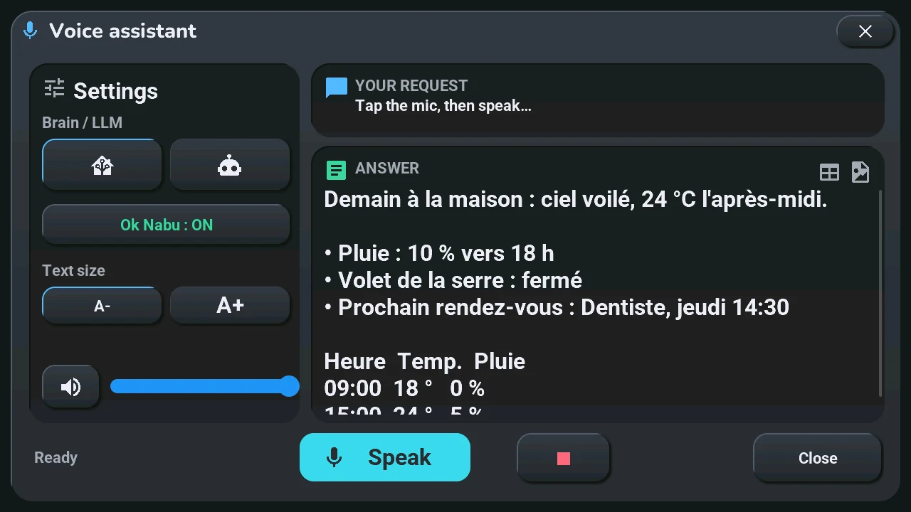
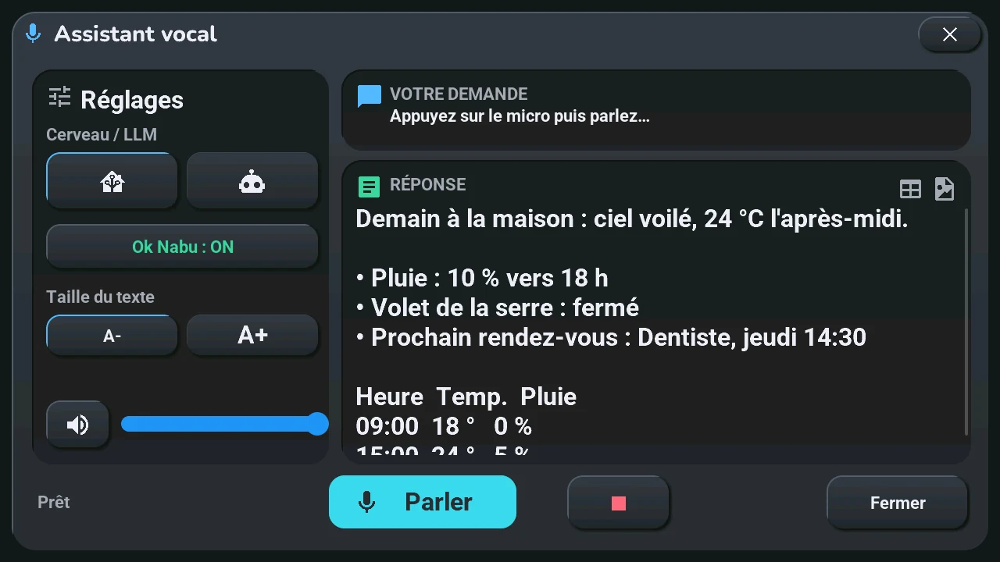

# Voice

## English · [Français](#version-française)

---

Say « Ok Nabu », or tap the microphone of the home screen, then speak: the tablet detects the wake word itself, and only then streams what you say to your Home Assistant voice assistant. The answer is spoken and shows for a moment in the central card.

▶ **See it in a video** (3 min, spoken, subtitles in seven languages): [“Okay Nabu” and follow-up questions](https://youtu.be/gTc45PRshdk).

The microphone's colour gives the state:

| Colour | State |
|---|---|
| dim grey | wake word off: only a tap on the microphone listens |
| grey | waiting for « Ok Nabu » |
| green | listening |
| orange | thinking |
| blue | answering: a tap on the microphone cuts the answer and listens again |
| red | error, or not understood |

**Domo** or **Discu**, the two buttons on each side of the microphone, picks who answers: Home Assistant's assistant (commands) or your conversation assistant ([home screen](home.md)).

## What happens when you speak

1. **The wake word stays on the tablet.** « Okay Nabu » is recognised by the tablet; while it only waits, no sound is sent anywhere.
2. **After it**, the tablet streams your voice to the voice assistant of Home Assistant: speech-to-text, a conversation agent, text-to-speech. What those three are (local or online) is what you chose in Home Assistant.
3. **The answer** comes back as sound through the tablet's speaker, and as text in the central card (in Domo mode, a short command does not open the window) or in the voice assistant window (in Discu mode).

How it is built: [voice assistant pipeline](../voice_assistant.md).

## Gestures

- **Tap the microphone**: listen now; while it answers (blue), cuts the answer and listens again.
- **Long press the microphone**: the voice assistant window below. It also opens from « Assistant » in the [navigation wheel](home.md#central-card-12), or from « Go to screen » → *Voice assistant* in Home Assistant.
- **Tap « Ok Nabu: ON / OFF »**: the wake word on or off.
- **« Stop »**: a second word, also recognised by the tablet itself, only while a [shutter](shutters.md) is moving (it halts it) and in the silences between two passes of the [alarm clock](alarm.md)'s melody.

## The voice assistant window

**Opens with** a long press on the microphone. In Discu mode, it also opens by itself when you speak.

**Settings** (left)

- **Brain / LLM**: the house (Domo) or the robot (Discu), as on the home screen.
- **Ok Nabu: ON / OFF**: the wake word.
- **Text size**: **A-** or **A+**, for the answer.
- The speaker button mutes or unmutes the sound; the slider is the tablet's volume (the same as in the [system console](console.md)).

**Your request**: what the tablet heard. **Answer**: what it replied; a long answer scrolls with your finger, and it can hold tables, bold, lists and an image.

**Bottom**: the state (« Ready »…), **Speak** (listens; while it answers, cuts and listens again), **■** (cuts the answer), **Close**.

The window does not close by itself while a conversation goes on, even without a touch.

## What you set in Home Assistant

- **Domo** uses the assistant set as *preferred* in *Settings → Voice assistants*. **Discu** uses the one picked in the « Tab5 · chat pipeline » list: any assistant with a conversation agent, an online language model or a local one. Left on « Not set », the Domo and Discu buttons are hidden and the tablet stays in Domo ([the two voice modes](../installation/settings.md#voice-assistant-the-two-modes)).
- **« Wake screen on Okay Nabu »**, on by default: « Okay Nabu » lights up a screen that is off. Off, the screen stays dark and the answer is only spoken ([tablet settings](../installation/settings.md)).
- **The language of the voice** that speaks is the one of the pipeline in Home Assistant: give it a voice of the screen's language ([screen languages](../translations.md)).

## Limits

- **While the assistant answers, the wake word is inactive**: the microphone belongs to the pipeline. A spoken « Ok Nabu » cannot cut a long answer; a tap on the microphone can.
- **A sound the tablet plays itself, such as the alarm melody, takes the microphone**: « Ok Nabu » only hears again in the silences ([ADR-0010](../decisions/0010-shared-i2s-bus-mic-speaker.md)).
- **The « Assistant » list of the tablet's device page follows the Domo and Discu buttons**: every tap, and every start of the tablet, sets it back. Change the preferred assistant or the « Tab5 · chat pipeline » list, not that list by hand.
- **One wake word**: the firmware offers « Okay Nabu » only.

## If something looks wrong

The incident [« STT/TTS broken, dozens of "entity already exists" log lines »](../troubleshooting.md#stttts-broken-dozens-of-entity-already-exists--ignoring-log-lines) concerns a voice pipeline whose speech-to-text seems missing; it only happens with two Home Assistant instances mirrored into each other. Otherwise, check the assistant's own parts in Home Assistant (speech-to-text, conversation agent, text-to-speech) before the tablet.

---

## Version Française

---

Dites « Ok Nabu », ou touchez le micro de l'écran d'accueil, puis parlez : la tablette détecte elle-même le mot de réveil, et seulement ensuite envoie ce que vous dites à votre assistant vocal Home Assistant. La réponse est dite à voix haute et s'affiche un moment dans la carte centrale.

▶ **En vidéo** (3 min, parlée, sous-titres en sept langues) : [« Okay Nabu » et questions de suite](https://youtu.be/gTc45PRshdk).

La couleur du micro donne l'état :

| Couleur | État |
|---|---|
| gris pâle | mot de réveil coupé : seul un tap sur le micro écoute |
| gris | attend « Ok Nabu » |
| vert | écoute |
| orange | réflexion |
| bleu | réponse : un tap sur le micro coupe la réponse et réécoute |
| rouge | erreur, ou pas compris |

**Domo** ou **Discu**, les deux boutons de chaque côté du micro, choisit qui répond : l'assistant de Home Assistant (commandes) ou votre assistant de discussion ([écran d'accueil](home.md#version-française)).

## Ce qui se passe quand vous parlez

1. **Le mot de réveil reste sur la tablette.** « Okay Nabu » est reconnu par la tablette ; tant qu'elle attend seulement, aucun son n'est envoyé nulle part.
2. **Après lui**, la tablette envoie votre voix à l'assistant vocal de Home Assistant : reconnaissance de la parole, un agent de conversation, synthèse vocale. Ce que sont ces trois éléments (locaux ou en ligne) dépend de votre choix dans Home Assistant.
3. **La réponse** revient en son par le haut-parleur de la tablette, et en texte dans la carte centrale (en mode Domo, une commande courte n'ouvre pas la fenêtre) ou dans la fenêtre de l'assistant vocal (en mode Discu).

Comment c'est construit : [pipeline de l'assistant vocal](../voice_assistant.md#version-française).

## Gestes

- **Tap sur le micro** : écoute maintenant ; pendant une réponse (bleu), coupe la réponse et réécoute.
- **Appui long sur le micro** : la fenêtre de l'assistant vocal ci-dessous. Elle s'ouvre aussi par « Assistant » dans la [roue de navigation](home.md#carte-centrale-12), ou par « Go to screen » → *Voice assistant* dans Home Assistant.
- **Tap sur « Ok Nabu : ON / OFF »** : le mot de réveil activé ou coupé.
- **« Stop »** : un second mot, reconnu lui aussi par la tablette elle-même, seulement pendant qu'un [volet](shutters.md#version-française) bouge (il l'arrête) et dans les silences entre deux passages de la mélodie du [réveil](alarm.md#version-française).

## La fenêtre de l'assistant vocal

**S'ouvre par** un appui long sur le micro. En mode Discu, elle s'ouvre aussi seule quand vous parlez.

**Réglages** (à gauche)

- **Cerveau / LLM** : la maison (Domo) ou le robot (Discu), comme sur l'accueil.
- **Ok Nabu : ON / OFF** : le mot de réveil.
- **Taille du texte** : **A-** ou **A+**, pour la réponse.
- Le bouton du haut-parleur coupe ou rétablit le son ; le curseur est le volume de la tablette (le même que dans la [console système](console.md#version-française)).

**Votre demande** : ce que la tablette a entendu. **Réponse** : ce qu'elle a répondu ; une longue réponse défile sous le doigt, et elle peut contenir des tableaux, du gras, des listes et une image.

**En bas** : l'état (« Prêt »…), **Parler** (écoute ; pendant une réponse, la coupe et réécoute), **■** (coupe la réponse), **Fermer**.

La fenêtre ne se ferme pas seule tant qu'une conversation se poursuit, même sans toucher l'écran.

## Ce qui se règle dans Home Assistant

- **Domo** utilise l'assistant défini comme *préféré* dans *Paramètres → Assistants vocaux*. **Discu** utilise celui choisi dans la liste « Tab5 · chat pipeline » : n'importe quel assistant avec un agent de conversation, un modèle de langage en ligne ou local. Laissée sur « Not set », les boutons Domo et Discu sont masqués et la tablette reste en Domo ([les deux modes vocaux](../installation/settings.md#assistant-vocal--les-deux-modes)).
- **« Wake screen on Okay Nabu »**, activé d'origine : « Okay Nabu » rallume un écran éteint. Désactivé, l'écran reste noir et la réponse est seulement dite ([réglages de la tablette](../installation/settings.md#version-française)).
- **La langue de la voix** qui parle est celle du pipeline dans Home Assistant : donnez-lui une voix de la langue de l'écran ([langues de l'écran](../translations.md#version-française)).

## Limites

- **Pendant que l'assistant répond, le mot de réveil est inactif** : le micro appartient au pipeline. Un « Ok Nabu » dit à voix haute ne coupe pas une longue réponse ; un tap sur le micro, si.
- **Un son que la tablette joue elle-même, comme la mélodie du réveil, prend le micro** : « Ok Nabu » n'entend de nouveau que dans les silences ([ADR-0010](../decisions/0010-shared-i2s-bus-mic-speaker.md), en anglais).
- **La liste « Assistant » de la page de la tablette suit les boutons Domo et Discu** : chaque tap, et chaque démarrage de la tablette, la remet. Changez l'assistant préféré ou la liste « Tab5 · chat pipeline », pas cette liste à la main.
- **Un seul mot de réveil** : le firmware ne propose que « Okay Nabu ».

## Si quelque chose cloche

L'incident [« STT/TTS cassé, dizaines de logs "entity already exists — ignoring" »](../troubleshooting.md#stttts-cassé-dizaines-de-logs-entity-already-exists--ignoring) concerne un pipeline vocal dont la reconnaissance de la parole semble manquer ; il n'arrive qu'avec deux instances de Home Assistant qui se reflètent l'une dans l'autre. Sinon, vérifiez d'abord les éléments de l'assistant dans Home Assistant (reconnaissance de la parole, agent de conversation, synthèse vocale) avant la tablette.
