# Screens & Features

## English · [Français](#version-française)

---

What the Tab5 shows and does, area by area: a short description, a picture when there is one, and the page of the [user manual](notice/README.md) that says what every touch does. How each part works inside — file names, functions, sizes in pixels, timings, decisions — is in [Screen internals](screens_internals.md), section by section. The pictures are renders of the current firmware (drawn by the firmware itself on a PC, with demo data), except the photo of the main page. The same firmware also runs on the [Waveshare 7B board](waveshare-7b.md). If anything below stops matching the running firmware, the firmware is right — fix this page.

---

## Layout overview

The tablet shows one page of 1280×720 pixels, not a set of tabs, in three regions:

1. **Home area** — always visible: clock, indoor sensors, quick actions, compact climate card, and the row under the clock (plants and sensors).
2. **Central card** — a small area that automatically rotates between planning, rain forecast, weather alerts and an info panel (calendar recap / alert text).
3. **Bottom card region** — either the 5-card weather forecast (with the devices of each page's room in the tiles' shoulders), or, in HA mode, the 5 device cards of the current room.

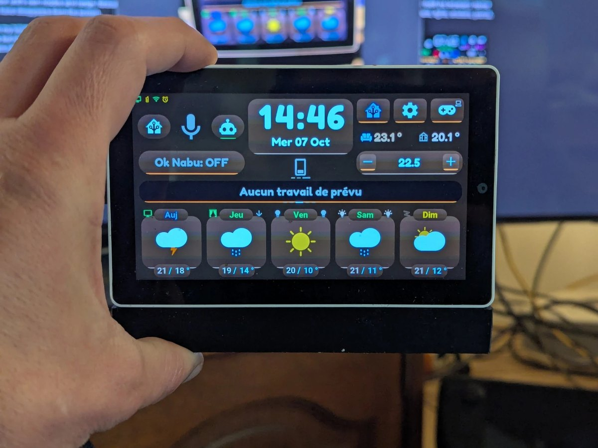

Windows open on top of this page — lights, shutters, climate, TV remote, voice assistant, calendar, alarm clock, plants, energy and settings, whose last page is the system console — and the Arcade's games have pages of their own. A tap on the gear button (top right) opens the settings, a long press on it their System page. Which touch opens which window, and what every button does: the [user manual](notice/README.md).

**User manual:** [Overview of the screen](notice/README.md) · **Internals:** [details](screens_internals.md#layout-overview)

---

## Generated screenshots

These pictures are not photos: the CI draws them without a tablet, from the same interface code, on every pull request that touches the screen ([ADR-0021](decisions/0021-host-render-stubs.md), workflow `rendu-host.yml`). The three scenes are those of [demo mode](demo_mode.md), on a fixed date (16 June, 07:45, Paris time), in French then in English. They are also the references the CI compares new renders with, so they match the current firmware.

| Scene | Français | English |
|---|---|---|
| Sunny day | 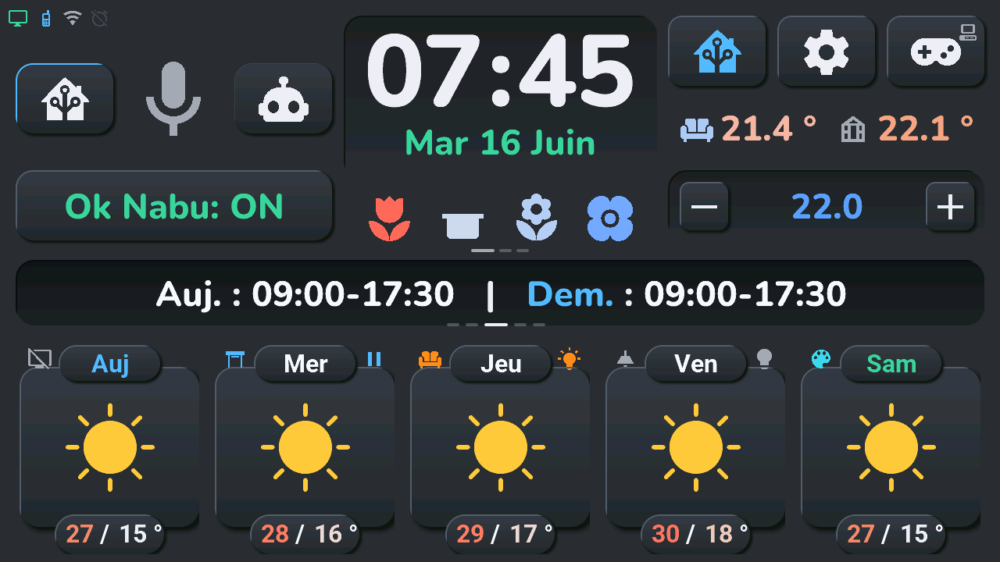 | 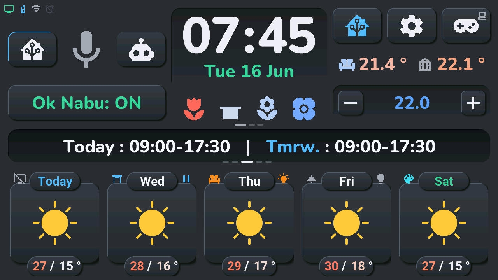 |
| Rain and orange warning | 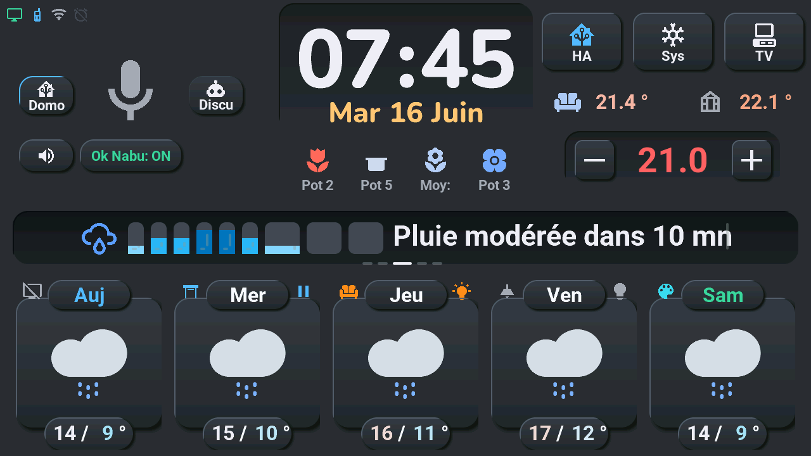 | 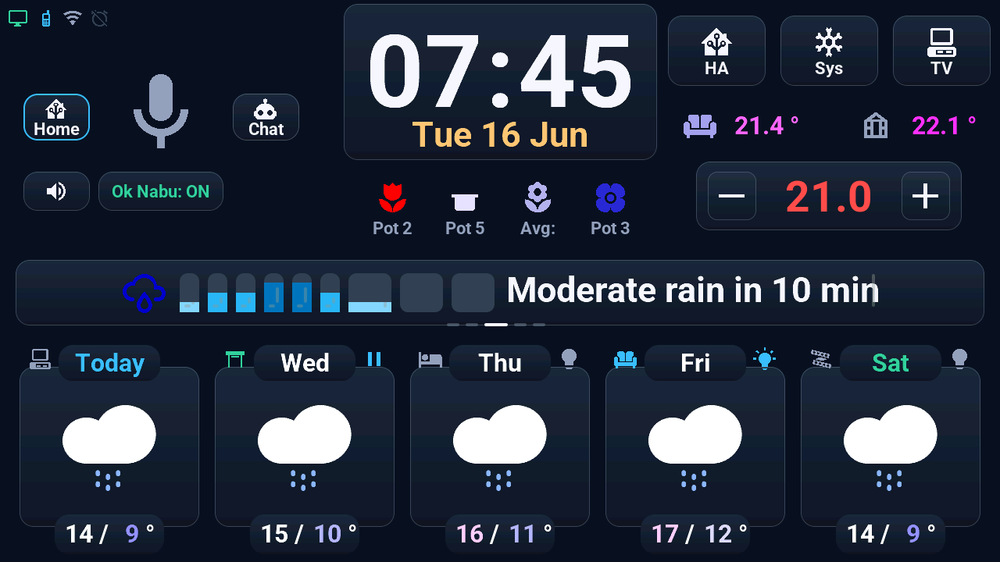 |
| Day off, plants to watch | 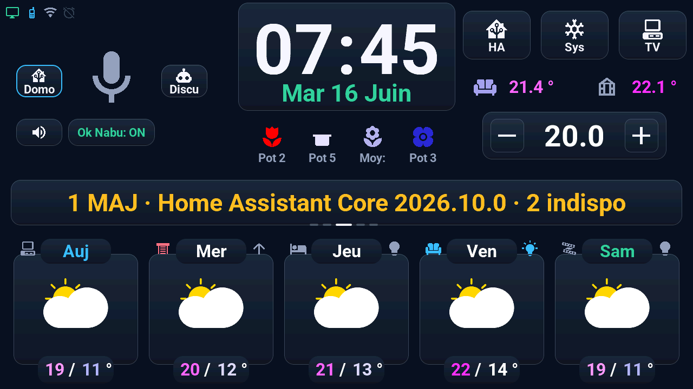 | 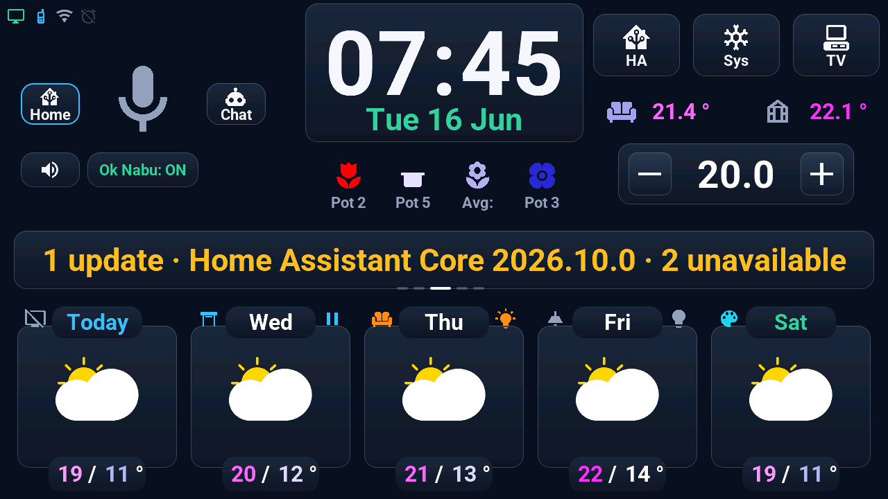 |

---

## Home area

The top of the screen never changes:

- **Status icons**, top left: PC, phone, Wi-Fi, alarm and, when they apply, the solar production and the tablet's own battery.
- **Clock and date**, each with its own touch areas: a long press on the hours or the minutes opens the alarm clock, on the date the calendar.
- **Indoor temperature and humidity**; a long press on a temperature shows its history.
- **Voice controls**: the microphone, the two voice modes and the **Ok Nabu** wake-word button. The area left of the clock can show instead a chart of the next 15 hours, a compact music player or a tracked sensor.
- **Three buttons, top right**: Home Assistant (the devices instead of the weather), settings (gear) and Arcade (gamepad). A long press on each opens another window.
- **Compact climate card**: the temperature and its target, with − / + buttons.
- **Row under the clock**: the plants and up to three lines of sensors.

What a tap and a long press on the clock and on the top buttons do can be chosen in the blueprint.

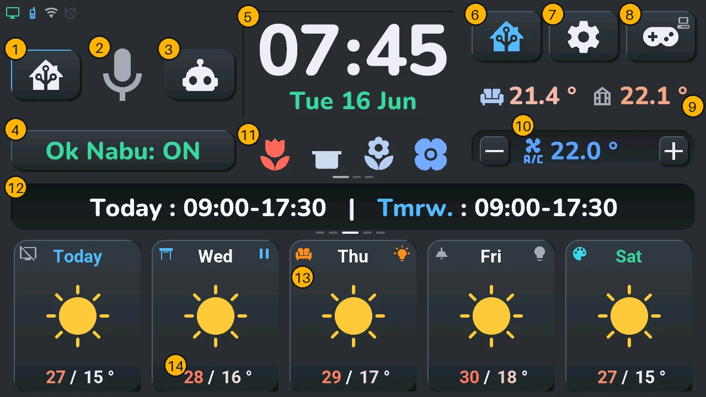

**User manual:** [Home screen](notice/home.md) · **Internals:** [details](screens_internals.md#home-area)

---

## Central card — planning / rain / alerts / info

A single card in the middle of the screen turns by itself, every 8 seconds, between the day's planning, the rain forecast for the next hour, the weather warnings, an information panel (a calendar recap or an alert text) and up to four messages or alerts pushed by Home Assistant. A panel with nothing to show is skipped. Weather warnings keep the official yellow, orange and red.

A tap shows the next panel at once; a tap on a message or an alert dismisses it until Home Assistant sends a new one. A long press opens the navigation wheel, which reaches every screen of the tablet. When you swipe to another forecast window, the card shows that window's dates instead and the rotation pauses until you swipe back.

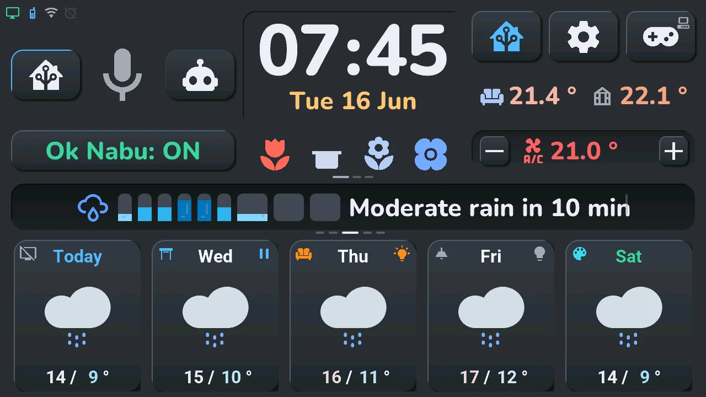

**User manual:** [Home screen — central card](notice/home.md#central-card-12), [Alerts](notice/alerts.md) · **Internals:** [details](screens_internals.md#central-card--planning--rain--alerts--info)

---

## Bottom card region — rooms

The five cards at the bottom show either the **weather forecast** (the default) or, after a tap on the Home Assistant button (top right), the **devices** of a room. Each of the five pages is also a room of up to five devices, described in Home Assistant by the blueprint « Tab5 — emplacements ». The Home Assistant button is lit while the devices are shown, and hidden when no room has a device.

**User manual:** [Bottom row and rooms](notice/tiles.md) · **Internals:** [details](screens_internals.md#bottom-card-region--rooms)

### Weather mode (default)

Five cards, moved by a left / right swipe. The home window shows today and the next four days; a left swipe goes through three daily windows (a 15-day forecast, five days each), a right swipe through two hourly windows (the next 15 hours, five time slots each). An hourly card shows the time, the icon, the temperature and the rain in mm; a daily card the day name, the icon and the highest and lowest temperatures, colour-coded (see [Color coding](#color-coding-for-readability)). A tap on a day's temperatures shows that day's schedule in the central card for a few seconds.

A card can also carry a device of its room beside the weather: its icon on the left, a bulb or the arrow of a shutter's next move on the right. A tap on the weather icon sends the device's command; a long press opens its quick-action wheel. The device switch **Devices on the weather** turns this off.

**User manual:** [Bottom row — weather](notice/tiles.md#weather) · **Internals:** [details](screens_internals.md#weather-mode-default)

### HA mode

The five cards show the devices of the current room, each drawn like the « tile » card of a Home Assistant dashboard: its icon in a round badge coloured by its state, its name, and a state line (« 60 % », « Allumé », « Ouvert »…). Empty tiles are hidden. The central card shows the room's name; a tap on it opens the [House popup](#house-popup--every-room-at-once). A left / right swipe goes to the next or previous room that has a device.

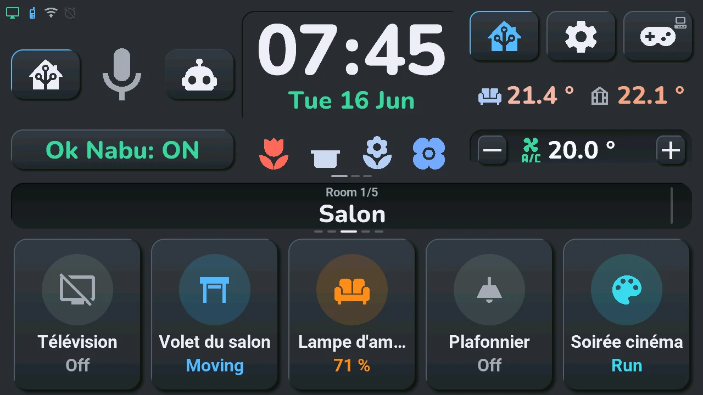

**User manual:** [Bottom row — your devices](notice/tiles.md#your-devices) · **Internals:** [details](screens_internals.md#ha-mode)

---

## Climate

The compact card of the home area shows the temperature and its target, with − / + buttons. A tap on the target opens the **climate window**: the modes (Cool, Heat, Dry, Fan, Off), a round thermostat for the target, and the options (Eco, Boost, Quiet, airflow Swing / Breeze). It follows your unit — its name, its range and its step — and shows only the buttons the unit can do. With several climate units the window has one page per unit: swipe left or right.

A tap on the room's temperature opens a quick-action wheel for its climate, and a long press on the value between − and + lets the − / + buttons adjust another device instead (a volume, a light's brightness, a thermostat…).

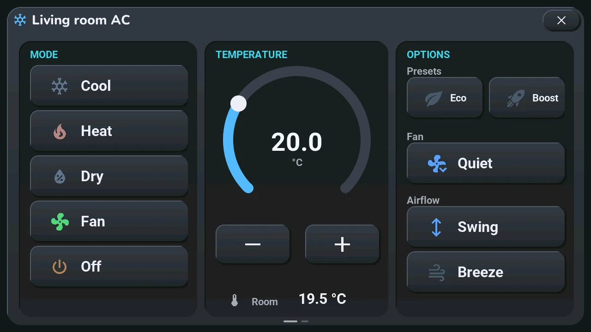

**User manual:** [Climate](notice/climate.md) · **Internals:** [details](screens_internals.md#climate)

---

## Row under the clock

Under the clock, a row shows one line at a time: the plants line, and up to three lines of four sensors or devices picked in the blueprint (section « Sous l'horloge · Under the clock »). With two lines or more they take turns, just before the central card changes; a tap shows the next line at once, and small dashes under the row show which one is on. Icons are coloured like tiles (on, off, offline); a value follows what it measures — the temperature scale, humidity, battery, gold for power and energy. The row only shows: it commands nothing, and a long press on the plants line opens the plant details.

**User manual:** [Home screen — row under the clock](notice/home.md#row-under-the-clock-11) · **Internals:** [details](screens_internals.md#row-under-the-clock)

---

## « Ok Nabu » panel

The wide **Ok Nabu: ON / OFF** button can also hold up to three lines of four sensors, like the row under the clock (section « Panneau Ok Nabu · Ok Nabu panel » of the blueprint). The listening line is first by default, or second, third or hidden. A tap on it turns wake-word listening on or off; a sensor line only shows. A tap on the hours of the clock shows the next line. Without any line picked, it is the plain button.

**User manual:** [Home screen — voice](notice/home.md#voice-domo-microphone-discu-ok-nabu-1-to-4) · **Internals:** [details](screens_internals.md#-ok-nabu--panel)

---

## Plant moisture card

The plants line of the row under the clock shows one icon per pot, from the driest to the wettest, coloured by soil moisture: red, to water; green, fine; blue, too wet. Up to five Bluetooth moisture sensors are read but four icons are shown (the driest, the next one, the middle one and the wettest), so which pot sits where changes as they dry. A long press opens the details.

**User manual:** [Plants](notice/plants.md) · **Internals:** [details](screens_internals.md#plant-moisture-card)

### Plant details popup — long press

A long press on the plants line opens one card per sensor (up to five, always in the same order): the pot's name and icon, its soil moisture in large digits with a watering status — OK, drying soon (20 % or less), needs water (14 % or less) or offline — and its fertility, light, temperature and the sensor's battery. The window only shows; the values follow the sensors while it is open.

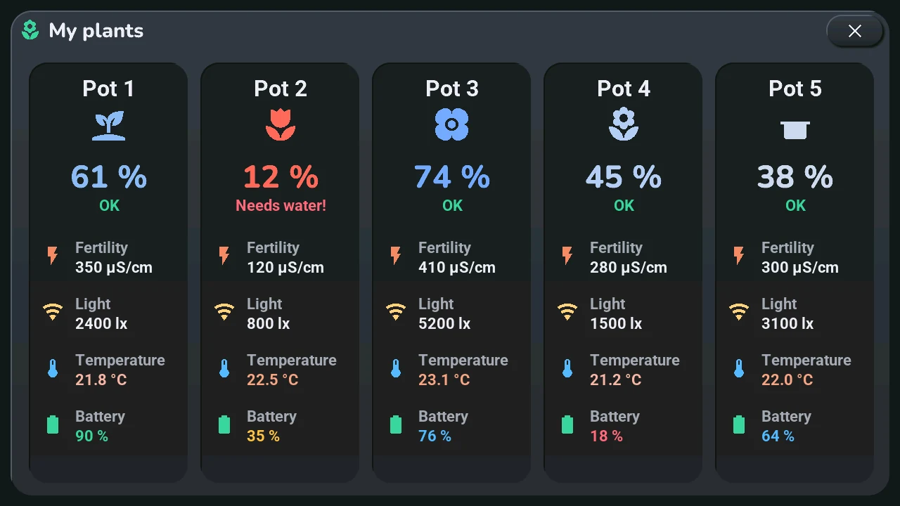

**User manual:** [Plants](notice/plants.md) · **Internals:** [details](screens_internals.md#plant-details-popup--long-press)

---

## Calendar popup — long press on the date

A long press on the date opens a monthly calendar (◀ ▶ to change month, « Aujourd'hui » to come back to today). The grid of days works without Home Assistant. For each month you look at, Home Assistant adds your work hours inside each day, public holidays, school holidays, appointments (a gold dot) and birthdays (a pink dot). A tap on a day opens its detail: holiday, school holiday, work hours, timed appointments, birthdays.

**User manual:** [Calendar](notice/calendar.md) · **Internals:** [details](screens_internals.md#calendar-popup--long-press-on-the-date)

---

## Alarm clock — long press on the time

A long press on the time (hours or minutes) opens the alarm clock; a bell in the status row shows its state at a glance — green: armed, amber: armed but no day qualifies, struck through and dim: off. **The alarm rings even without Home Assistant**: the time, the next days' work hours and the melody are on the tablet. Home Assistant only adds the spoken briefing, the appointment reminders and an optional ringtone.

The window has five pages (Time, Days, Shift start, Ringtone, Announcements), and every value is set on a wheel. The alarm stops with a touch anywhere on the ring screen, or by voice — any wake word cuts it, « Stop » included — and « Répéter » snoozes it.

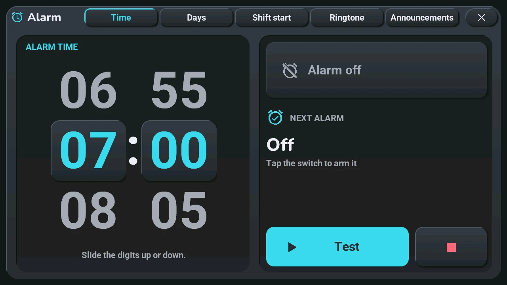

**Three modes**, because "base it on the calendar" means two different things depending on the day:

| Mode | When it rings |
|---|---|
| **Fixe** (fixed) | At the set time, on the weekdays you ticked |
| **Travail** (work days) | Same time, but only when the calendar says there is work |
| **Ouverture** (before opening) | Time is **derived from the shift**: shift start − a configurable lead, clamped by "never before" / "never after" |

The **closing time is used too**, through the **"repos mini"** (minimum rest) setting: after a 21:00 close, a 9 h rest forbids ringing before 06:00 — clamped by "never after", so rest can never make you late. The **day selector only governs the fixed time**: a calendar-driven day rings whatever the weekday, otherwise unticking Saturday would make you miss a Saturday-morning opening.

**User manual:** [Alarm clock](notice/alarm.md) · **Internals:** [details](screens_internals.md#alarm-clock--long-press-on-the-time)

---

## Voice assistant

The microphone icon of the home screen is the voice assistant: its colour shows the state (standby, idle, listening, processing, speaking, error). Say « Ok Nabu », or tap the microphone, then speak; a long press opens the assistant window, which shows longer answers — formatted text, tables, even an image. Two modes: **Domo** (Home Assistant's own assistant, which runs commands) and **Discu** (an LLM-backed conversation pipeline, for questions and chat); without a conversation pipeline, the mode buttons disappear. A tap on the microphone while it speaks cuts the answer and listens again. While a roller shutter moves, saying « Stop » halts it.

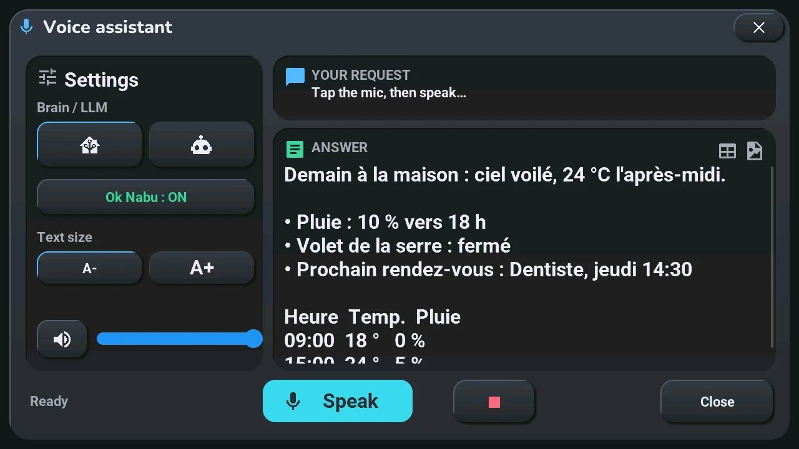

**User manual:** [Voice](notice/voice.md) · **Internals:** [details](screens_internals.md#voice-assistant)

---

## System page of the settings (former console)

The fourth page of the settings, opened directly by a long press on the gear button. Four cards: **memory**; **network** (Wi-Fi name, IP address, signal, and whether Home Assistant is connected); **system** (uptime, processor temperature and load, the tablet's battery, and the volume slider); and **management** — buttons to push the screen again from Home Assistant (« MAJ Écran »), reload the automations, restart Home Assistant and reboot the tablet, the last two behind a confirmation. It is not a log viewer.

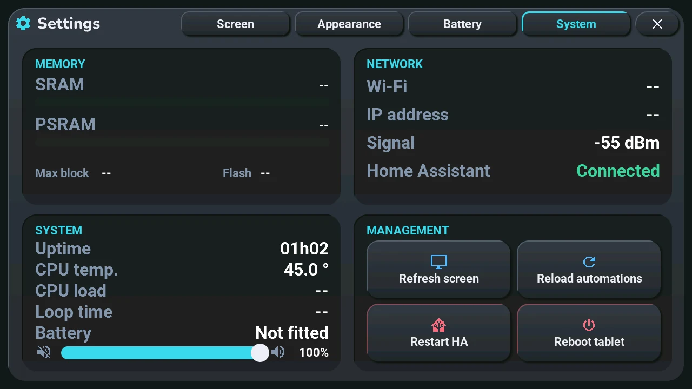

**User manual:** [System console](notice/console.md) · **Internals:** [details](screens_internals.md#system-page-of-the-settings-former-console)

---

## Settings popup

A tap on the gear button opens the settings, on four pages named at the top (slide left or right, or tap a name): **Screen** (brightness, auto screen-off, waking the screen with « Okay Nabu » or a tap), **Appearance** (theme, dark / light / auto, animations, language — the tablet restarts to apply a new language), **Battery** (charge limit, charging mode, power saving, Wi-Fi eco, battery fitted or not, and the battery's state) and **System** (the system console, above). Each setting is also an entity in Home Assistant: a change made there shows on the tablet at once. The same settings in Home Assistant: [Tablet settings](installation/settings.md).

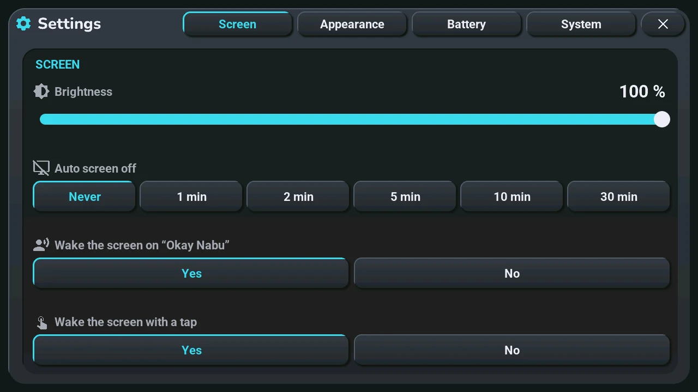

**User manual:** [Settings](notice/settings.md) · **Internals:** [details](screens_internals.md#settings-popup)

---

## Lights popup — one page per room

A long press on a light, then **Details** in its quick-action wheel, opens the lights window on that light's room. It shows every light of the house, one page per room: the room names are at the top, tap one or swipe left / right to change room. On the left, the room's lights (five at most; tap the round icon to switch one, long press for its wheel, **Tout éteindre** for the whole room); in the centre, a brightness arc with the percentage and four shortcuts (10, 35, 65, 100 %); on the right, three whites (warm, cream, cold) and twelve colour swatches.

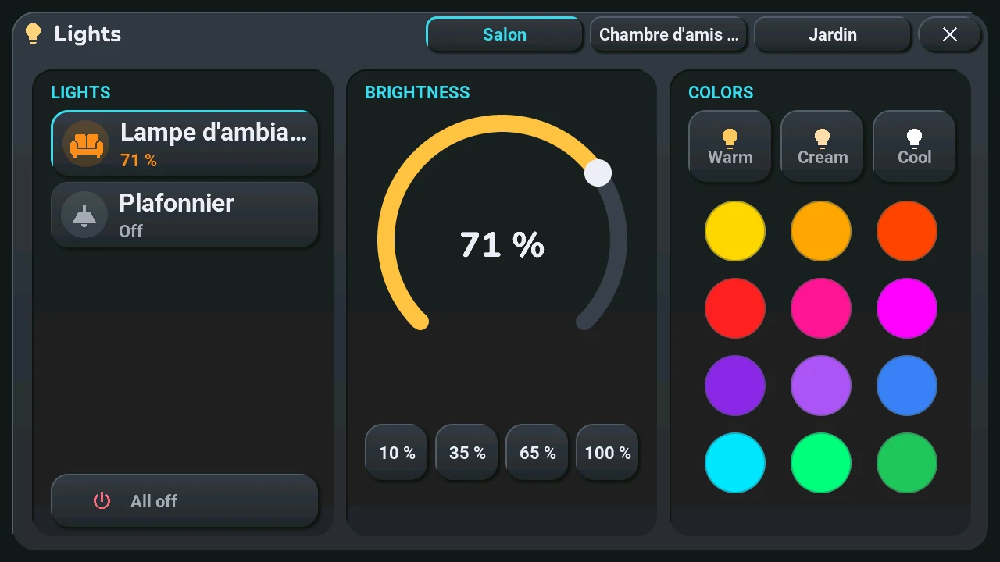

**User manual:** [Lights](notice/lights.md) · **Internals:** [details](screens_internals.md#lights-popup--one-page-per-room)

---

## TV remote popup

A remote for the TV: power, source and menu keys, a round pad with OK, a volume column with mute, the Play · Pause · Back · Home keys and a row of app buttons (Netflix, Prime, YouTube, CANAL+, PC). It opens with a long press on the gamepad button or on the TV's card. The keys go through Home Assistant (no infrared). Up to four remotes, one page each (swipe or tap their names); on an Apple TV box (Apple TV, Freebox Player) the keys adapt: Stop instead of Source, no mute, and a playback row instead of the apps.

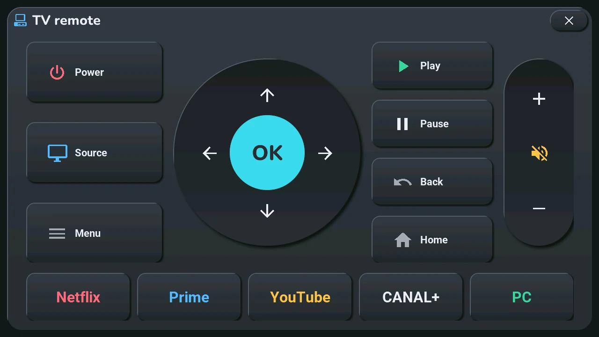

**User manual:** [TV remote](notice/tv.md) · **Internals:** [details](screens_internals.md#tv-remote-popup)

---

## Energy popup — solar installation (optional)

Only if sensors are picked in the « Énergie » sections of the blueprint. It opens with a tap on the card of one of those sensors, or with a long press on the Home Assistant button when the solar production is received. The window has up to four pages, shown only when their data exists: **Flow** (solar, home, grid and battery as circles joined by lines as thick as the power), **Today** (the sun's course and the hour-by-hour production against the forecast), **Production** (live cards and a history by hours, days or months) and **Balance** (in kWh). Swipe left or right, or tap a page name.

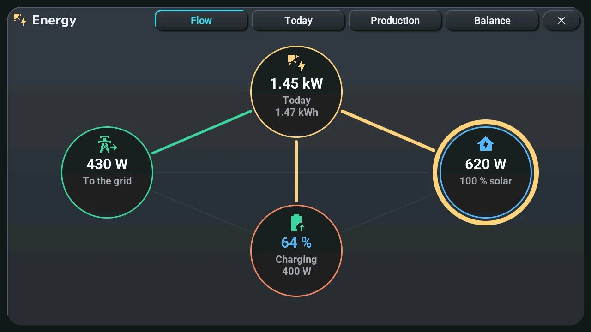

**User manual:** [Energy](notice/energy.md) · **Internals:** [details](screens_internals.md#energy-popup--solar-installation-optional)

---

## Temperature popup — history and forecast

A long press on one of the two temperatures of the home screen (the room's, or a second one: a greenhouse or outdoors) opens its history: cards for **Now**, **Minimum** and **Maximum**, then a curve over **24 h**, **7 days** or **30 days** — the line is the average, the pale bar behind it goes from the minimum to the maximum. For the second temperature, the weather forecast is shown after « Now ». When the place has a humidity sensor, its curve is drawn on the same chart. One tab per known temperature: tap one or swipe to switch.

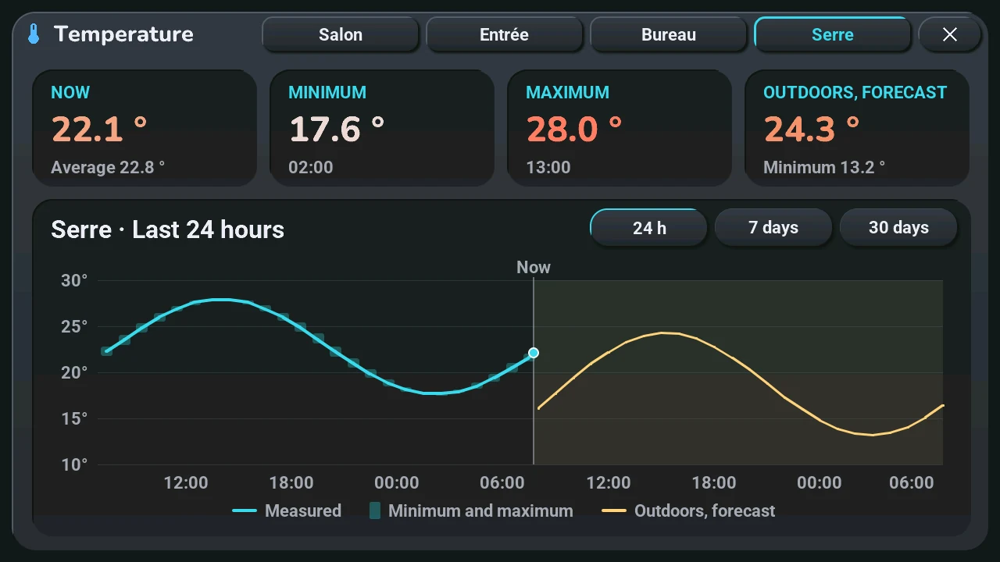

**User manual:** [Temperature](notice/temperature.md) · **Internals:** [details](screens_internals.md#temperature-popup--history-and-forecast)

---

## House popup — every room at once

Every room at once, like a Home Assistant dashboard: one column per room of the blueprint that has devices, and in each column one row per device — its icon in a badge of its state's colour, its name and its state. A tap on a row does what a tap on the device's card does; a long press (or the « ⋯ » button) opens its quick-action wheel. **Éteindre les lumières**, in the title bar, switches off the lights of every room. With more than five rooms the window has pages. It opens with a tap on the room's name in device mode, or from Home Assistant.

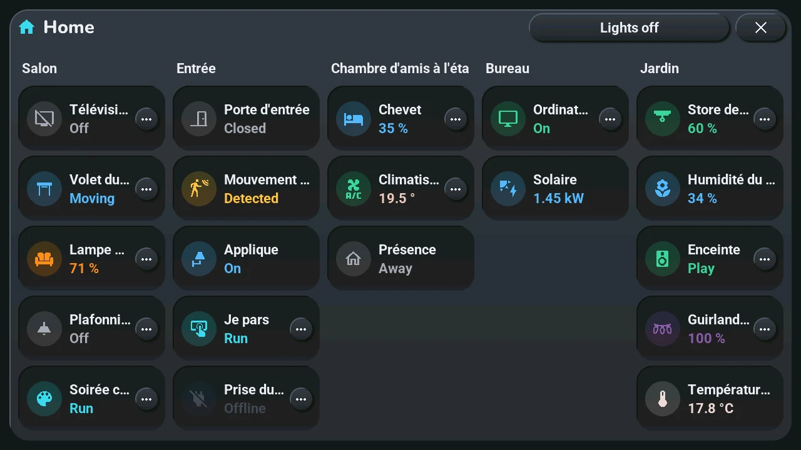

**User manual:** [House](notice/house.md) · **Internals:** [details](screens_internals.md#house-popup--every-room-at-once)

---

## Weather popup — the forecast in graphs

The weather in graphs, on three pages named at the top (tap a name or swipe): **Today** (now: icon, temperature, condition, low and high, and the rain expected; then the next hours with a temperature curve and rain bars), **10 days** (one row per day with a bar from the low to the high on a common scale) and **Details** (the rain in the next hour, humidity, UV index, frost and snow probabilities). It opens with a long press on a weather card that holds no device, from the navigation wheel, or from Home Assistant.

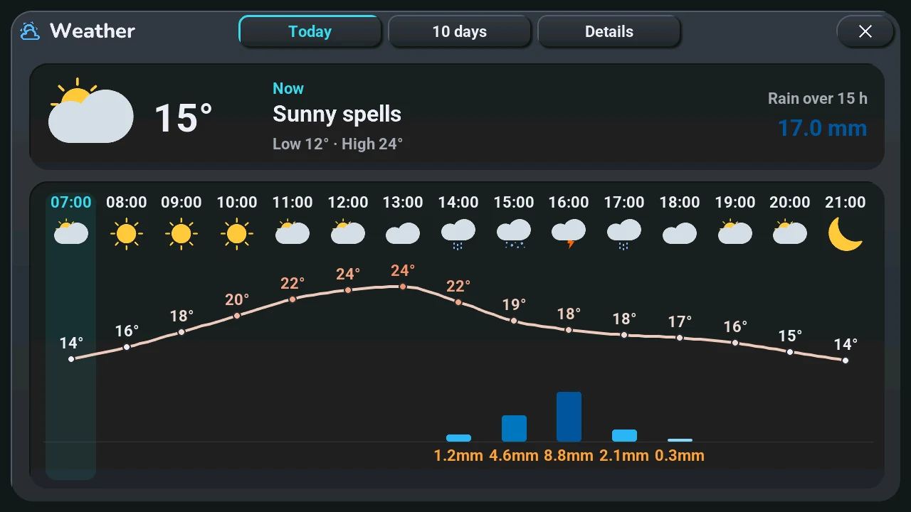

**User manual:** [Weather](notice/weather.md) · **Internals:** [details](screens_internals.md#weather-popup--the-forecast-in-graphs)

---

## Cameras popup — a still image of each camera

A still image of each camera you picked in the blueprint (sixteen at most): new images are fetched, one at a time, only while the window is open; the camera shown large can play as video (optional, off by default). With two cameras or more, a **mosaic** of up to four squares per page (swipe for the next four); a tap on a square shows that camera large, a tap on the large image goes back. With two rooms or more, a column on the left filters by room. A camera that is offline says so. It opens from the navigation wheel (Agenda ▸ Caméras) or from Home Assistant, for instance when the doorbell rings.

**User manual:** [Cameras](notice/cameras.md) · **Internals:** [details](screens_internals.md#cameras-popup--a-still-image-of-each-camera)

---

## Tracking popup — tracked sensors

The sensors you follow, one card each, up to six: a share price, a temperature, a power, a level… any Home Assistant sensor that has a number and statistics. A card shows the name, the value with its unit, the change with an arrow (green up, red down, grey when flat) and the curve of the last 24 hours. It opens with a tap on the tracked sensor left of the clock, or from Home Assistant.

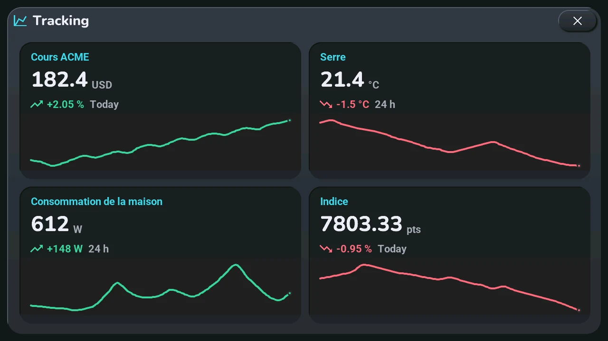

**User manual:** [Tracking](notice/tracking.md) · **Internals:** [details](screens_internals.md#tracking-popup--tracked-sensors)

---

## Fridges and freezers popup — food-safety norms

Your fridges and freezers, one card each, up to four. A card shows the temperature — green within the norm, orange for attention, red for a serious problem — a status (« Conforme », « Porte ouverte ? », « Capteur muet »…), the 24-hour lowest and highest with the norm, a 24-hour curve between the dashed lines of the norm, and the last incident. A red icon blinks in the clock's corner while one of them is at the serious level; a tap on it opens this window.

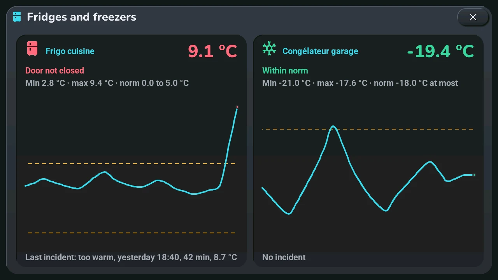

**User manual:** [Fridges and freezers](notice/fridge.md) · **Internals:** [details](screens_internals.md#fridges-and-freezers-popup--food-safety-norms)

---

## AI server popup — a local LLM server

The dashboard of a local LLM server (Ollama, llama.cpp, LM Studio, vLLM…): a band with its state (online or offline), its name and the loaded model; the **tokens per second** with their curve, and the requests running and queued; and cards for the graphics card's **VRAM**, the **GPU** temperature, the **RAM** and the **power**. Up to three action buttons (unload the model, wake the server, restart it) appear when Home Assistant offers them; unloading and restarting ask for a second tap. It opens from the navigation wheel (Agenda ▸ Serveur IA) once Home Assistant has sent a server, or from Home Assistant.

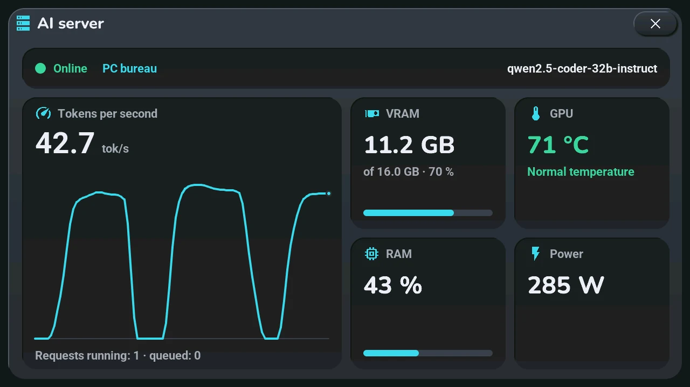

**User manual:** [AI server](notice/ai-server.md) · **Internals:** [details](screens_internals.md#ai-server-popup--a-local-llm-server)

---

## Cars popup — your electric cars at a glance

One large card per electric car (two at most), side by side; with a single car, one card across the whole width. Each card shows the car's name, a silhouette tinted by its state (green while charging, blue when plugged in, dim otherwise), the **battery in a ring** with its percentage, the **range**, a line with the state (« En charge · 7.20 kW », « Branchée », « Débranchée », or « Hors ligne » for a car that sleeps: its last known values stay on screen) and, under it, the energy added and the time left while charging, or the charge limit. With no car chosen, a short message says where to choose them. Opened by a short tap on a car circle of the Flux page of the Energy popup, or by « Go to screen → Cars ». **Internals:** [details](screens_internals.md#cars-popup--your-electric-cars-at-a-glance)

---

## Color coding for readability

Color is used consistently as a primary information channel — to let you read state at a glance without reading labels.

| What | Colours |
|---|---|
| **Temperatures** (indoor sensors and forecast) | blue (cold) → green (comfortable) → orange (warm) → red (hot) |
| **Day names** of the daily forecast | cyan: today · green: day off · amber: Sunday off · rose / red: Sunday worked, or any day with a shift starting before 09:00 · dim slate: past day |
| **Plant moisture** | red: 14 % or less (very dry, needs watering) · gradient green → white-ish: 30–80 % · blue: 80 % or more (too wet) |
| **Batteries** (phone, tablet, solar production, plant sensors) | green: above 80 % · blue: 41–80 % · amber: 20–40 % · red: below 20 % · grey: unknown |
| **Microphone icon** | see the voice assistant above |

Twenty-one themes, each with a dark and a light mode, change the colours, the shapes (radius, borders, shadows) and the fonts of the time, the date and the titles; a new tablet starts in « Relief doux ».

The theme (« Theme »), the mode (« Light or dark »: Dark, Light, Auto) and the « Night (auto theme) » switch are entities of the tablet, also in the settings popup: [Tablet settings](installation/settings.md#theme-light-or-dark).

**Internals:** [details](screens_internals.md#color-coding-for-readability)

---

## Roller shutter control

Every shutter or valve of a room is a card of its own: a tap stops it while it moves, else closes it if it is open, opens it otherwise. A long press then **Details** opens the shutters window on that room (one page per room, like the lights): on the left the room's shutters with **Tout ouvrir** / **Tout fermer**; on the right a **drawn shutter** you drag with a finger — the position leaves when you let go — with its position in large digits and the **Ouvrir**, **Stop** and **Fermer** buttons. A shutter that does not report its position cannot be dragged: the drawing shows its state.

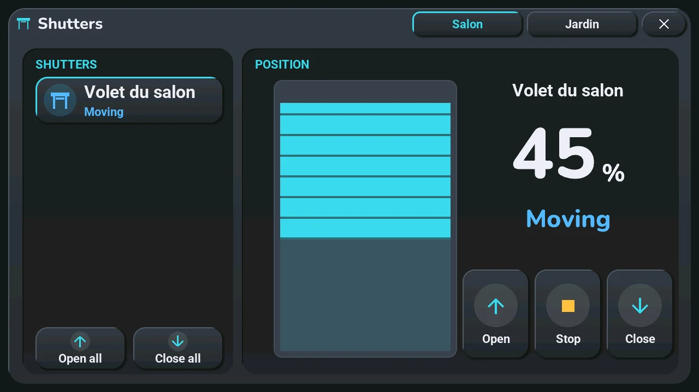

**User manual:** [Shutters](notice/shutters.md) · **Internals:** [details](screens_internals.md#roller-shutter-control)

---

## Device popup

A long press on the card of a switch, a scene or a media player (not a TV remote) opens a « more info » window like a Home Assistant dashboard's: on the left the device's icon in a badge of its state's colour, its state in words and its room; on the right one large vertical switch that does what a tap on the card does — turn on or off, or run — and, with the option « confirm », asks for a second press. The window follows the device while it is open. It shows only what Home Assistant already pushes for the cards: no history, no attributes.

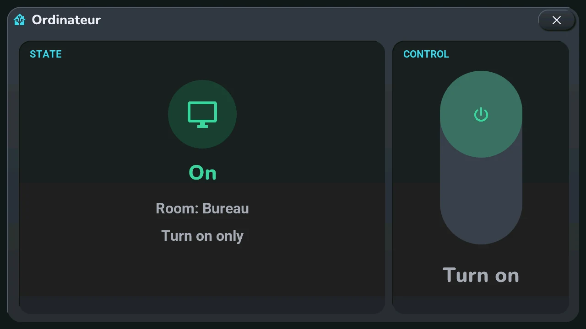

**User manual:** [Bottom row — device window](notice/tiles.md#device-window) · **Internals:** [details](screens_internals.md#device-popup)

---

## Arcade — 8 game consoles (experimental)

> **Status: early prototypes.** First-pass AI-generated games, built to see what LVGL + C++ can do on an ESP32-P4. Functional but unpolished — proof of concept, not finished product.

Eight small games that run on the tablet alone — no Home Assistant, no network. They open with a tap on the gamepad button (top right) or « Jeux » in the navigation wheel; each game is a full-screen page of its own.

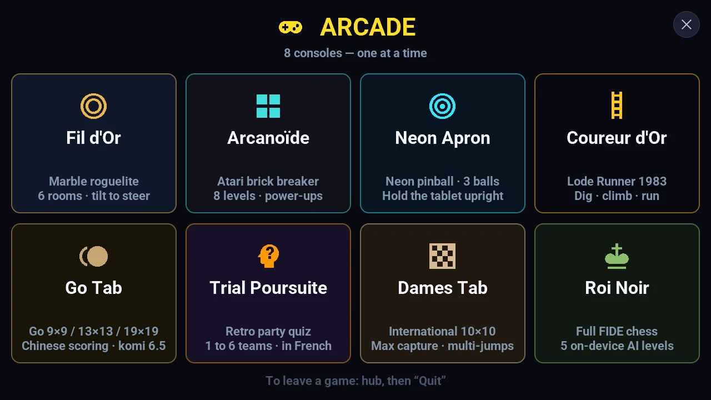

| # | Console | Description | Controls |
|---|---------|-------------|----------|
| 1 | **Fil d'Or** | Marble roguelite, 6 rooms, Dark Souls-style progression | BMI270 tilt |
| 2 | **Arcanoïde** | Breakout, 8 levels, power-ups, combo | Tilt + touch |
| 3 | **Neon Apron** | Neon 3-ball pinball — **switches the screen to portrait 720×1280** | Touch zones + IMU nudge |
| 4 | **Coureur d'Or** | Lode Runner, 10 levels, dig & climb | Touch D-pad |
| 5 | **Go Tab** | Go 9×9/13×13/19×19, Chinese scoring (komi 6.5), 4 AI levels | Touch |
| 6 | **Trial Poursuite** | Trivia, 1–6 teams, 42-space wheel + 6 spokes | Touch |
| 7 | **Dames Tab** | International draughts 10×10 (8×8 checkers option), 4 AI levels | Touch |
| 8 | **Roi Noir** | FIDE chess, 5 AI levels, perft-validated | Touch |

| Roi Noir (chess) | Arcanoïde (breakout) |
|:-:|:-:|
| 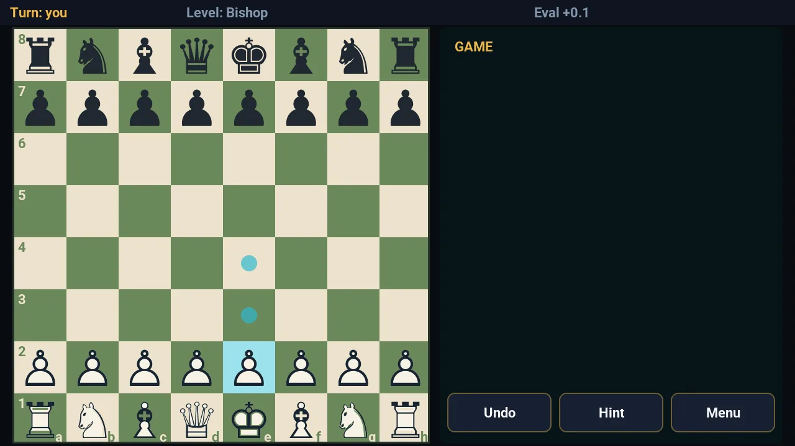 | 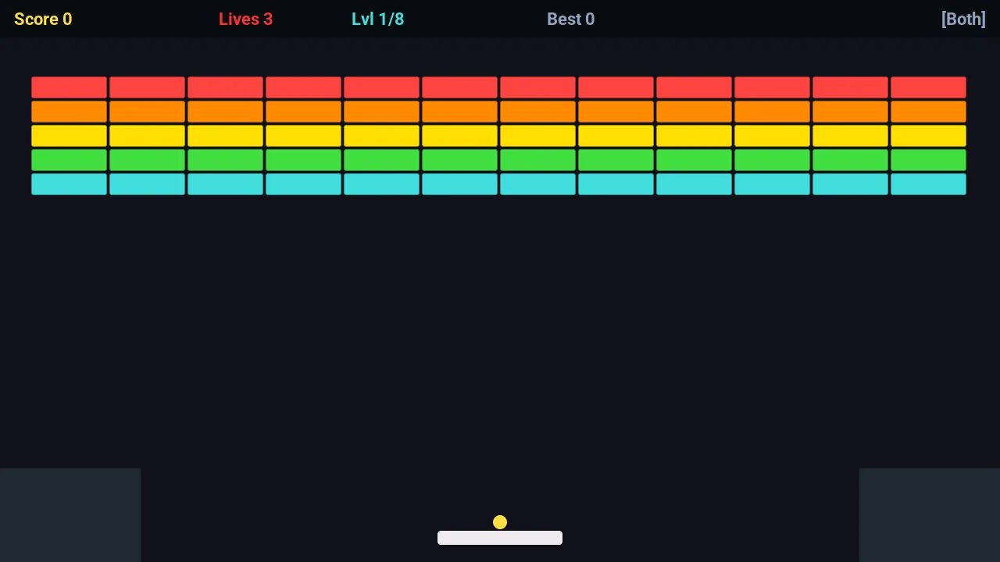 |

| Coureur d'Or (Lode Runner) |
|:-:|
| 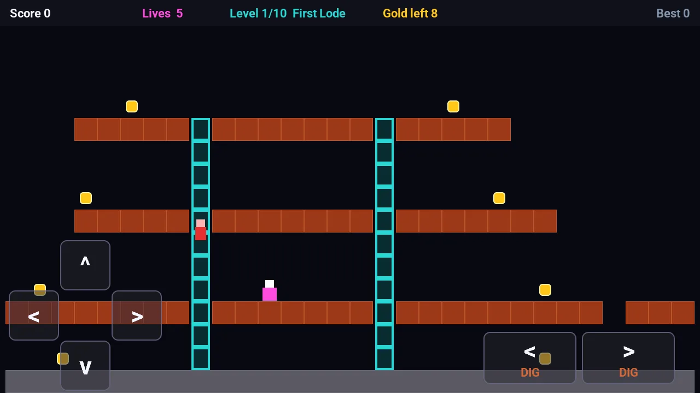 |

To leave a game, use its hub → « Quitter »: the score is saved, and Neon Apron turns the screen back to landscape.

→ Full technical details per game: [`docs/arcade.md`](arcade.md)

**User manual:** [Arcade](notice/arcade.md) · **Internals:** [details](screens_internals.md#arcade--8-game-consoles-experimental)

---

## Version Française

---

Ce que le Tab5 affiche et fait, zone par zone : une courte description, une image quand il y en a une, et la page de la [notice](notice/README.md#version-française) qui dit ce que fait chaque geste. Le fonctionnement interne — noms de fichiers, fonctions, tailles en pixels, temporisations, décisions — est dans [Écrans : détails techniques](screens_internals.md#version-française), section par section. Les images sont des rendus du firmware actuel (dessinés par le firmware lui-même sur un PC, avec les données de démonstration), sauf la photo de la page principale. Le même firmware tourne aussi sur la [carte Waveshare 7B](waveshare-7b.md#version-française). Si quelque chose ci-dessous cesse de correspondre au firmware en marche, c'est le firmware qui a raison : corriger cette page.

---

## Vue d'ensemble de la mise en page

La tablette affiche une seule page de 1280×720 pixels, et non une série d'onglets, en trois zones :

1. **Zone d'accueil** — toujours visible : horloge, capteurs intérieurs, actions rapides, carte clim compacte, et la rangée sous l'horloge (plantes et capteurs).
2. **Carte centrale** — une petite zone qui alterne automatiquement entre planning, prévision de pluie, alertes météo et un panneau info (récap calendrier / texte d'alerte).
3. **Zone de cartes du bas** — soit les 5 cartes prévisions météo (avec, dans leurs épaules, les appareils de la pièce de chaque page), soit, en mode HA, les 5 cartes d'appareil de la pièce courante.

Des fenêtres s'ouvrent par-dessus cette page — lumières, volets, climatisation, télécommande TV, assistant vocal, calendrier, réveil, plantes, énergie et réglages, dont la dernière page est la console système — et les jeux de l'Arcade ont des pages à eux. Un appui sur le bouton engrenage (en haut à droite) ouvre les réglages, un appui long leur page Système. Quel geste ouvre quelle fenêtre, et ce que fait chaque bouton : la [notice](notice/README.md#version-française).

**Notice :** [Vue d'ensemble de l'écran](notice/README.md#version-française) · **Détails techniques :** [le détail](screens_internals.md#vue-densemble-de-la-mise-en-page)

---

## Captures générées

Ces images ne sont pas des photos : la CI les dessine sans tablette, avec le même code d'interface, à chaque pull request qui touche l'écran ([ADR-0021](decisions/0021-host-render-stubs.md), workflow `rendu-host.yml`). Les trois scènes sont celles du [mode démo](demo_mode.md#version-française), à date fixe (16 juin, 07:45, heure de Paris), en français puis en anglais. Ce sont aussi les références auxquelles la CI compare chaque nouveau rendu : elles suivent donc le firmware.

| Scène | Français | English |
|---|---|---|
| Journée ensoleillée |  |  |
| Pluie et alerte orange |  |  |
| Jour de repos, plantes à surveiller |  |  |

---

## Zone d'accueil

Le haut de l'écran ne change jamais :

- **Icônes d'état**, en haut à gauche : PC, téléphone, Wi-Fi, réveil et, quand ils existent, la production solaire et la batterie de la tablette.
- **Horloge et date**, chacune avec ses zones tactiles : un appui long sur les heures ou les minutes ouvre le réveil, sur la date le calendrier.
- **Température et humidité intérieures** ; un appui long sur une température montre son historique.
- **Commandes vocales** : le micro, les deux modes vocaux et le bouton du mot d'éveil **Ok Nabu**. La zone à gauche de l'horloge peut montrer à la place un graphique des 15 prochaines heures, un lecteur de musique compact ou un capteur suivi.
- **Trois boutons en haut à droite** : Home Assistant (les appareils à la place de la météo), les réglages (engrenage) et l'Arcade (manette). Un appui long sur chacun ouvre une autre fenêtre.
- **Carte de climatisation compacte** : la température et sa consigne, avec les boutons − / +.
- **Rangée sous l'horloge** : les plantes et jusqu'à trois lignes de capteurs.

Ce que font un appui et un appui long sur l'horloge et sur les boutons du haut se choisit dans le blueprint.

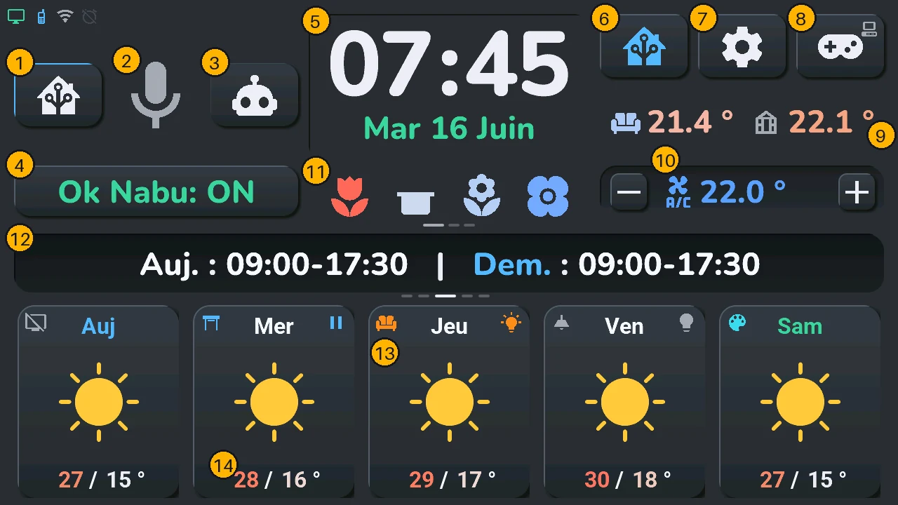

**Notice :** [Écran d'accueil](notice/home.md#version-française) · **Détails techniques :** [le détail](screens_internals.md#zone-daccueil)

---

## Carte centrale — planning / pluie / alertes / info

Une carte unique au milieu de l'écran tourne seule, toutes les 8 secondes, entre le planning du jour, la prévision de pluie de l'heure à venir, les alertes météo, un panneau d'information (récapitulatif du calendrier ou texte d'alerte) et jusqu'à quatre messages ou alertes poussés par Home Assistant. Un panneau sans rien à montrer est sauté. Les alertes météo gardent les couleurs officielles jaune, orange et rouge.

Un appui montre tout de suite le panneau suivant ; un appui sur un message ou une alerte le rejette jusqu'à ce que Home Assistant en envoie un nouveau. Un appui long ouvre la roue de navigation, qui mène à tous les écrans de la tablette. Quand vous glissez vers une autre fenêtre de prévisions, la carte montre les dates de cette fenêtre à la place et la rotation se met en pause jusqu'à votre retour.

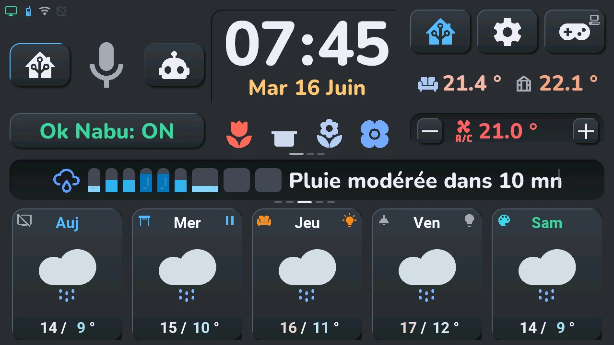

**Notice :** [Écran d'accueil — carte centrale](notice/home.md#carte-centrale-12), [Alertes](notice/alerts.md#version-française) · **Détails techniques :** [le détail](screens_internals.md#carte-centrale--planning--pluie--alertes--info)

---

## Zone de cartes du bas — les pièces

Les cinq cartes du bas montrent soit la **prévision météo** (par défaut), soit, après un appui sur le bouton Home Assistant (en haut à droite), les **appareils** d'une pièce. Chacune des cinq pages est aussi une pièce de cinq appareils au plus, décrite dans Home Assistant par le blueprint « Tab5 — emplacements ». Le bouton Home Assistant est allumé tant que les appareils sont affichés, et masqué quand aucune pièce n'a d'appareil.

**Notice :** [Rangée du bas et pièces](notice/tiles.md#version-française) · **Détails techniques :** [le détail](screens_internals.md#zone-de-cartes-du-bas--les-pièces)

### Mode météo (par défaut)

Cinq cartes, déplacées par un glissement gauche / droite. La fenêtre d'accueil montre aujourd'hui et les quatre jours suivants ; un glissement vers la gauche parcourt trois fenêtres de jours (une prévision à 15 jours, cinq jours chacune), un glissement vers la droite deux fenêtres d'heures (les 15 prochaines heures, cinq créneaux chacune). Une carte horaire montre l'heure, l'icône, la température et la pluie en mm ; une carte journalière le nom du jour, l'icône et les températures maximale et minimale, colorées (voir [Coloration sémantique](#coloration-sémantique)). Un appui sur les températures d'un jour montre le planning de ce jour dans la carte centrale pendant quelques secondes.

Une carte peut aussi porter un appareil de sa pièce à côté de la météo : son icône à gauche, une ampoule ou la flèche du prochain mouvement d'un volet à droite. Un appui sur l'icône météo envoie la commande de l'appareil ; un appui long ouvre sa roue d'actions rapides. L'interrupteur **Devices on the weather** coupe cela.

**Notice :** [Rangée du bas — météo](notice/tiles.md#météo) · **Détails techniques :** [le détail](screens_internals.md#mode-météo-par-défaut)

### Mode HA

Les cinq cartes montrent les appareils de la pièce courante, chacun dessiné comme la carte « tuile » d'un tableau de bord Home Assistant : son icône dans un badge rond de la couleur de son état, son nom et une ligne d'état (« 60 % », « Allumé », « Ouvert »…). Les tuiles vides sont masquées. La carte centrale montre le nom de la pièce ; un appui dessus ouvre le [popup Maison](#popup-maison--toutes-les-pièces-dun-coup). Un glissement gauche / droite passe à la pièce suivante ou précédente qui a un appareil.

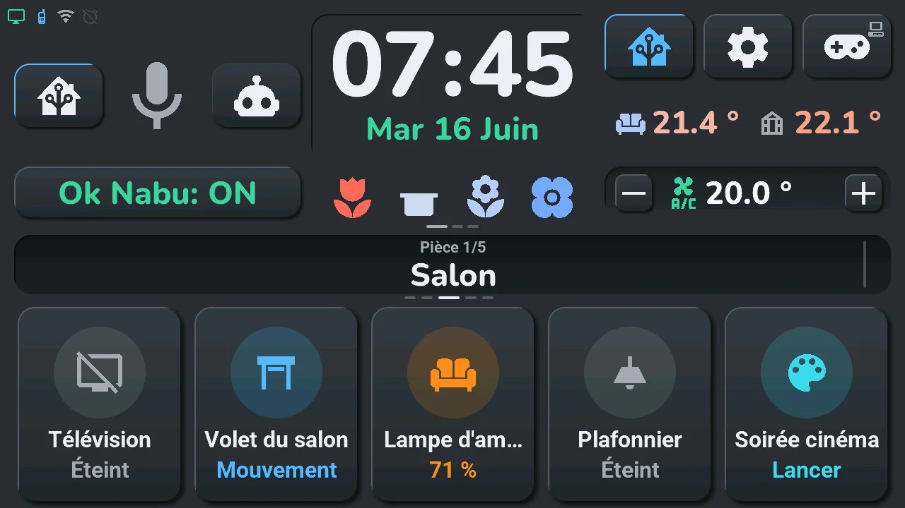

**Notice :** [Rangée du bas — vos appareils](notice/tiles.md#vos-appareils) · **Détails techniques :** [le détail](screens_internals.md#mode-ha)

---

## Climatisation

La carte compacte de l'accueil montre la température et sa consigne, avec les boutons − / +. Un appui sur la consigne ouvre la **fenêtre de climatisation** : les modes (Froid, Chaud, Sec, Ventilation, Éteint), un thermostat rond pour la consigne, et les options (Éco, Boost, Silence, flux d'air Oscillation / Brise). Elle suit votre appareil — son nom, sa plage et son pas — et ne montre que les boutons qu'il sait faire. Avec plusieurs climatiseurs, la fenêtre a une page par appareil : glissez à gauche ou à droite.

Un appui sur la température de la pièce ouvre une roue d'actions rapides de sa clim, et un appui long sur la valeur entre − et + permet aux boutons − / + de régler un autre appareil (un volume, la luminosité d'une lampe, un thermostat…).

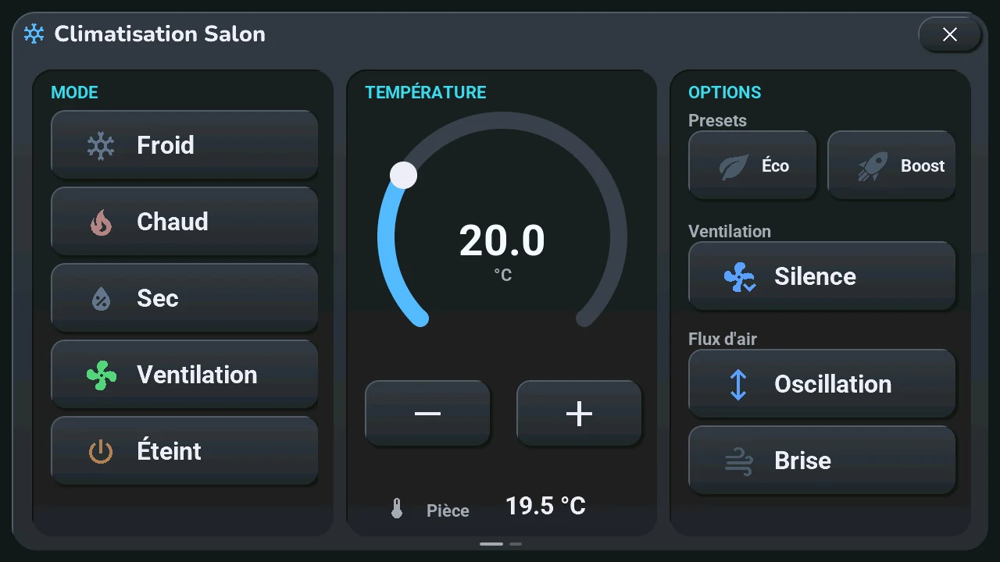

**Notice :** [Climatisation](notice/climate.md#version-française) · **Détails techniques :** [le détail](screens_internals.md#climatisation)

---

## Rangée sous l'horloge

Sous l'horloge, une rangée montre une ligne à la fois : la ligne des plantes et jusqu'à trois lignes de quatre capteurs ou appareils choisis dans le blueprint (section « Sous l'horloge · Under the clock »). Avec deux lignes ou plus, elles alternent, juste avant que la carte centrale change ; un appui montre la ligne suivante tout de suite, et de petits tirets sous la rangée montrent laquelle est affichée. Les icônes sont colorées comme les tuiles (allumé, éteint, hors ligne) ; une valeur suit ce qu'elle mesure — l'échelle des températures, l'humidité, la batterie, l'or pour la puissance et l'énergie. La rangée ne fait que montrer : elle ne commande rien, et un appui long sur la ligne des plantes ouvre le détail des plantes.

**Notice :** [Écran d'accueil — rangée sous l'horloge](notice/home.md#rangée-sous-lhorloge-11) · **Détails techniques :** [le détail](screens_internals.md#rangée-sous-lhorloge)

---

## Panneau « Ok Nabu »

Le large bouton **Ok Nabu : ON / OFF** peut aussi porter jusqu'à trois lignes de quatre capteurs, comme la rangée sous l'horloge (section « Panneau Ok Nabu · Ok Nabu panel » du blueprint). La ligne d'écoute est la première d'origine, ou la deuxième, la troisième, ou masquée. Un appui dessus active ou coupe l'écoute du mot d'éveil ; une ligne de capteurs ne fait que montrer. Un appui sur les heures de l'horloge montre la ligne suivante. Sans aucune ligne choisie, c'est le simple bouton.

**Notice :** [Écran d'accueil — voix](notice/home.md#voix--domo-micro-discu-ok-nabu-1-à-4) · **Détails techniques :** [le détail](screens_internals.md#panneau--ok-nabu-)

---

## Carte humidité des plantes

La ligne des plantes de la rangée sous l'horloge montre une icône par pot, du plus sec au plus humide, colorée selon l'humidité du sol : rouge, à arroser ; vert, bien ; bleu, trop humide. Jusqu'à cinq capteurs d'humidité Bluetooth sont lus mais quatre icônes sont affichées (la plus sèche, la suivante, celle du milieu et la plus humide) : quel pot occupe quelle place change donc à mesure qu'ils sèchent. Un appui long ouvre le détail.

**Notice :** [Plantes](notice/plants.md#version-française) · **Détails techniques :** [le détail](screens_internals.md#carte-humidité-des-plantes)

### Popup détails plantes — appui long

Un appui long sur la ligne des plantes ouvre une carte par capteur (cinq au plus, toujours dans le même ordre) : le nom et l'icône du pot, son humidité du sol en grands chiffres avec un état d'arrosage — OK, bientôt sec (20 % ou moins), à arroser (14 % ou moins) ou hors ligne — et sa fertilité, sa lumière, sa température et la batterie du capteur. La fenêtre ne fait que montrer ; les valeurs suivent les capteurs tant qu'elle est ouverte.

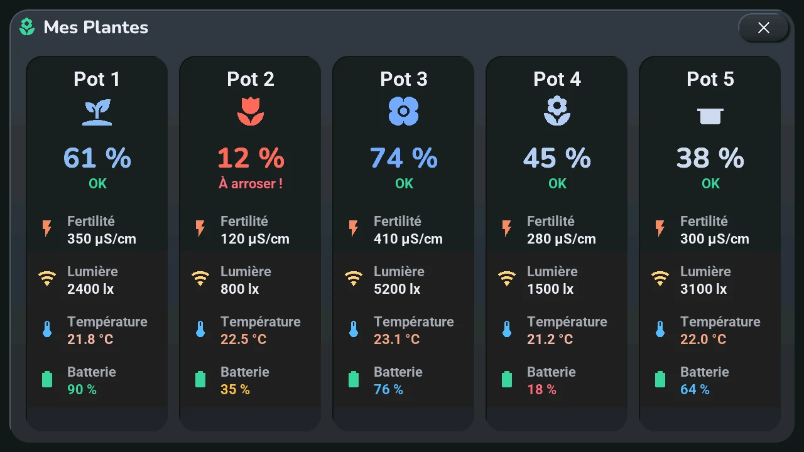

**Notice :** [Plantes](notice/plants.md#version-française) · **Détails techniques :** [le détail](screens_internals.md#popup-détails-plantes--appui-long)

---

## Popup calendrier — appui long sur la date

Un appui long sur la date ouvre un calendrier mensuel (◀ ▶ pour changer de mois, « Aujourd'hui » pour revenir à aujourd'hui). La grille des jours fonctionne sans Home Assistant. Pour chaque mois consulté, Home Assistant ajoute vos horaires de travail dans chaque case, les jours fériés, les vacances scolaires, les rendez-vous (un point doré) et les anniversaires (un point rose). Un appui sur un jour ouvre son détail : jour férié, vacances scolaires, horaires de travail, rendez-vous avec leur heure, anniversaires.

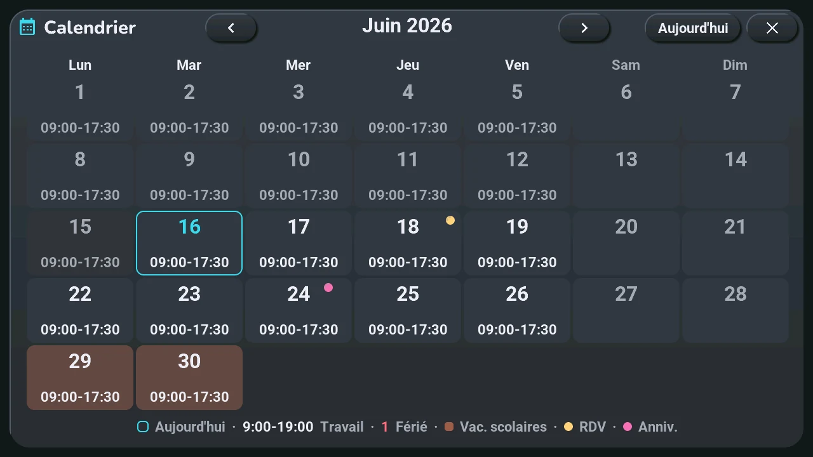

**Notice :** [Calendrier](notice/calendar.md#version-française) · **Détails techniques :** [le détail](screens_internals.md#popup-calendrier--appui-long-sur-la-date)

---

## Réveil — appui long sur l'heure

Un appui long sur l'heure (heures ou minutes) ouvre le réveil ; une petite cloche dans la rangée d'état montre son état d'un coup d'œil — verte : armé, ambre : armé mais aucun jour ne convient, barrée et atténuée : éteint. **Le réveil sonne même sans Home Assistant** : l'heure, les horaires de travail des jours à venir et la mélodie sont sur la tablette. Home Assistant n'ajoute que le briefing parlé, les rappels de rendez-vous et une sonnerie facultative.

La fenêtre a cinq pages (Heure, Jours, Ouverture, Sonnerie, Annonces), et chaque valeur se règle sur une molette. Le réveil s'arrête d'un toucher n'importe où sur l'écran de sonnerie, ou à la voix — n'importe quel mot d'éveil le coupe, « Stop » compris — et « Répéter » le reporte.

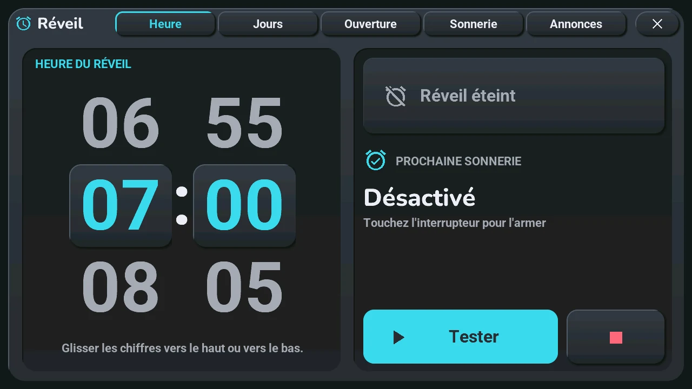

**Trois modes**, parce que « se baser sur le calendrier » veut dire deux choses différentes selon les jours :

| Mode | Quand ça sonne |
|---|---|
| **Fixe** | À l'heure réglée, les jours de la semaine cochés |
| **Travail** | La même heure, mais seulement quand le calendrier annonce du travail |
| **Ouverture** | L'heure est **dérivée de l'embauche** : début du service − un délai réglable, borné par « jamais avant » / « jamais après » |

**L'heure de fermeture sert aussi**, via le réglage **« repos mini »** : après une fermeture à 21:00, un repos de 9 h interdit de sonner avant 06:00 — borné par « jamais après », le repos ne peut donc jamais faire arriver en retard. Le **sélecteur de jours ne gouverne QUE l'heure fixe** : une journée pilotée par le calendrier sonne quel que soit le jour de la semaine, sinon décocher le samedi ferait rater une embauche du samedi matin.

**Notice :** [Réveil](notice/alarm.md#version-française) · **Détails techniques :** [le détail](screens_internals.md#réveil--appui-long-sur-lheure)

---

## Assistant vocal

L'icône du micro de l'accueil est l'assistant vocal : sa couleur montre l'état (veille, repos, écoute, traitement, réponse, erreur). Dites « Ok Nabu », ou touchez le micro, puis parlez ; un appui long ouvre la fenêtre de l'assistant, qui affiche les réponses plus longues — texte mis en forme, tableaux, même une image. Deux modes : **Domo** (l'assistant de Home Assistant, qui exécute des commandes) et **Discu** (un pipeline de conversation adossé à un LLM, pour les questions et la discussion) ; sans pipeline de conversation, les boutons de mode disparaissent. Un appui sur le micro pendant que l'assistant parle coupe la réponse et relance l'écoute. Pendant qu'un volet roulant bouge, dire « Stop » l'arrête.

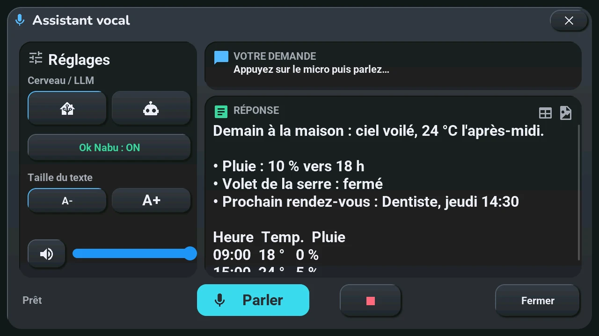

**Notice :** [Voix](notice/voice.md#version-française) · **Détails techniques :** [le détail](screens_internals.md#assistant-vocal)

---

## Page Système des réglages (ancienne console)

La quatrième page des réglages, ouverte directement par un appui long sur le bouton engrenage. Quatre cartes : **mémoire** ; **réseau** (nom du Wi-Fi, adresse IP, signal, et si Home Assistant est connecté) ; **système** (durée de fonctionnement, température et charge du processeur, batterie de la tablette, et le curseur de volume) ; et **gestion** — des boutons pour repousser l'écran depuis Home Assistant (« MAJ Écran »), recharger les automatisations, redémarrer Home Assistant et redémarrer la tablette, les deux derniers derrière une confirmation. Ce n'est pas un lecteur de journaux.

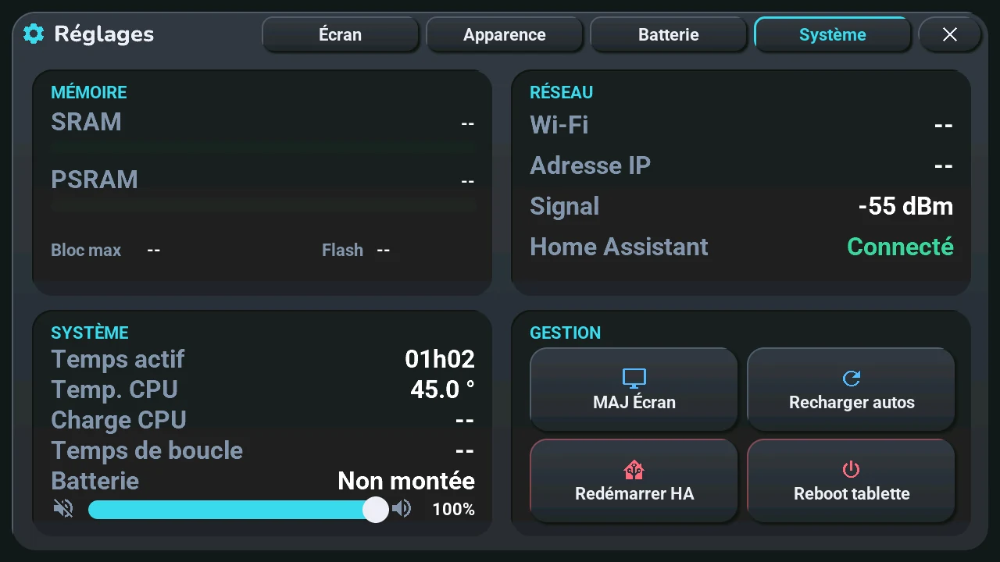

**Notice :** [Console système](notice/console.md#version-française) · **Détails techniques :** [le détail](screens_internals.md#page-système-des-réglages-ancienne-console)

---

## Popup Réglages

Un appui sur le bouton engrenage ouvre les réglages, sur quatre pages nommées en haut (glissez à gauche ou à droite, ou touchez un nom) : **Écran** (luminosité, extinction automatique, réveil de l'écran par « Okay Nabu » ou par un toucher), **Apparence** (thème, sombre / clair / auto, animations, langue — la tablette redémarre pour appliquer une nouvelle langue), **Batterie** (limite de charge, mode de charge, économie d'énergie, Wi-Fi éco, batterie présente ou non, et son état) et **Système** (la console système, ci-dessus). Chaque réglage est aussi une entité dans Home Assistant : un changement fait là-bas se voit tout de suite sur la tablette. Les mêmes réglages dans Home Assistant : [Réglages de la tablette](installation/settings.md#version-française).

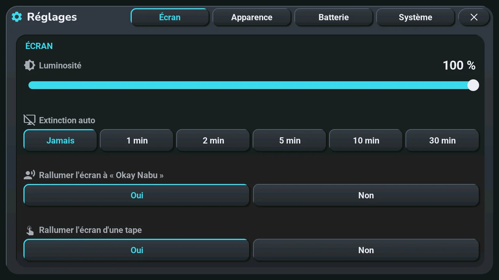

**Notice :** [Réglages](notice/settings.md#version-française) · **Détails techniques :** [le détail](screens_internals.md#popup-réglages)

---

## Popup Lumières — une page par pièce

Un appui long sur une lampe, puis **Détails** dans sa roue d'actions rapides, ouvre la fenêtre des lumières sur la pièce de cette lampe. Elle montre toutes les lumières de la maison, une page par pièce : les noms des pièces sont en haut, touchez-en un ou glissez à gauche / droite pour changer de pièce. À gauche, les lumières de la pièce (cinq au plus ; touchez la pastille ronde pour en commuter une, appui long pour sa roue, **Tout éteindre** pour toute la pièce) ; au centre, un arc de luminosité avec le pourcentage et quatre raccourcis (10, 35, 65, 100 %) ; à droite, trois blancs (chaud, crème, froid) et douze pastilles de couleur.

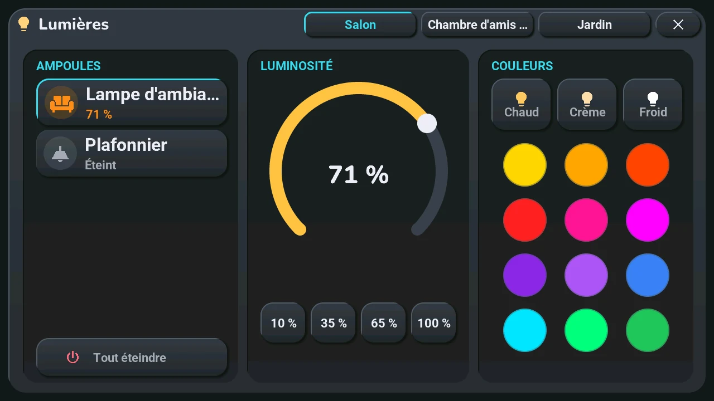

**Notice :** [Lumières](notice/lights.md#version-française) · **Détails techniques :** [le détail](screens_internals.md#popup-lumières--une-page-par-pièce)

---

## Popup télécommande TV

Une télécommande pour la TV : touches marche, source et menu, une croix ronde avec OK, une colonne de volume avec muet, les touches Lecture · Pause · Retour · Accueil et une rangée de boutons d'applications (Netflix, Prime, YouTube, CANAL+, PC). Elle s'ouvre par un appui long sur le bouton manette ou sur la carte de la TV. Les touches passent par Home Assistant (pas d'infrarouge). Jusqu'à quatre télécommandes, une page chacune (glissez ou touchez leur nom) ; sur un boîtier Apple TV (Apple TV, Freebox Player), les touches s'adaptent : Stop à la place de Source, pas de muet, et une rangée de lecture à la place des applications.

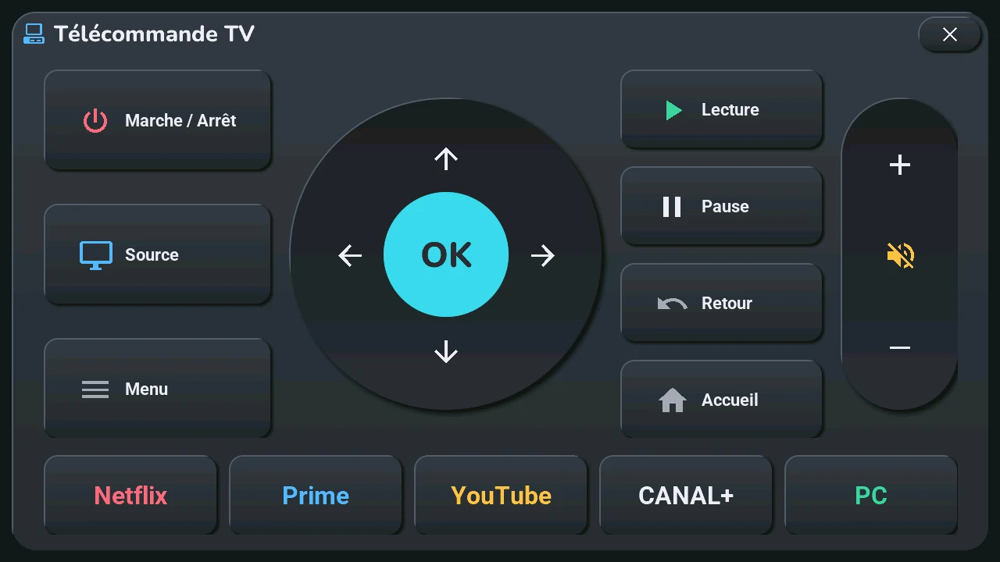

**Notice :** [Télécommande TV](notice/tv.md#version-française) · **Détails techniques :** [le détail](screens_internals.md#popup-télécommande-tv)

---

## Popup Énergie — installation solaire (facultatif)

Seulement si des capteurs sont choisis dans les sections « Énergie » du blueprint. Elle s'ouvre par un appui sur la carte d'un de ces capteurs, ou par un appui long sur le bouton Home Assistant quand la production solaire est reçue. La fenêtre a jusqu'à quatre pages, affichées seulement si leurs données existent : **Flux** (solaire, maison, réseau et batterie en cercles reliés par des traits aussi épais que la puissance), **Aujourd'hui** (la course du soleil et la production heure par heure face à la prévision), **Production** (des cartes en direct et un historique par heures, jours ou mois) et **Bilan** (en kWh). Glissez à gauche ou à droite, ou touchez le nom d'une page.

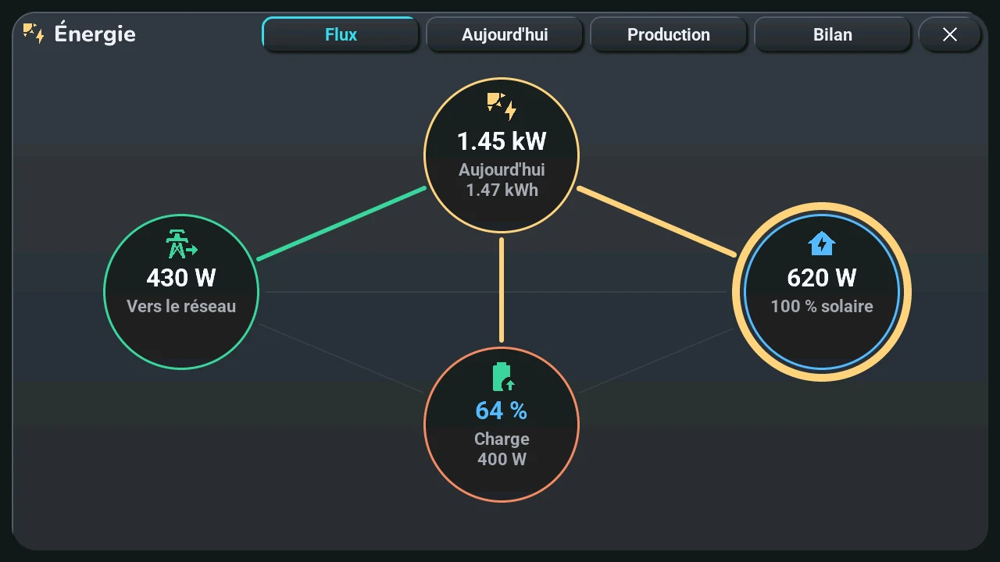

**Notice :** [Énergie](notice/energy.md#version-française) · **Détails techniques :** [le détail](screens_internals.md#popup-énergie--installation-solaire-facultatif)

---

## Popup Température — historique et prévision

Un appui long sur l'une des deux températures de l'accueil (celle de la pièce, ou une seconde : une serre ou l'extérieur) ouvre son historique : des cartes **Maintenant**, **Minimum** et **Maximum**, puis une courbe sur **24 h**, **7 jours** ou **30 jours** — la ligne est la moyenne, la barre pâle derrière va du minimum au maximum. Pour la seconde température, la prévision météo est montrée après « Maintenant ». Quand le lieu a un capteur d'humidité, sa courbe est tracée sur le même graphique. Un onglet par température connue : touchez-en un ou glissez pour passer de l'une à l'autre.

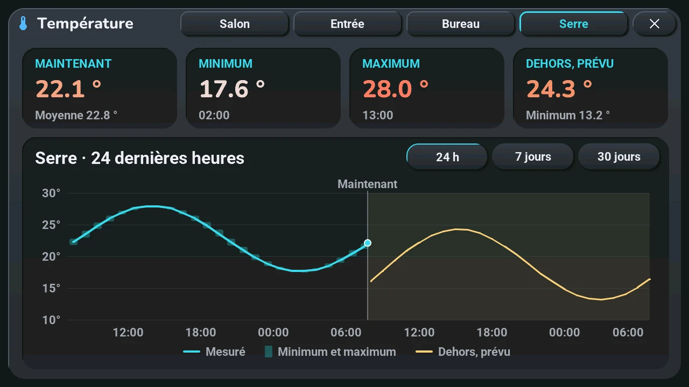

**Notice :** [Température](notice/temperature.md#version-française) · **Détails techniques :** [le détail](screens_internals.md#popup-température--historique-et-prévision)

---

## Popup Maison — toutes les pièces d'un coup

Toutes les pièces d'un coup, comme un tableau de bord Home Assistant : une colonne par pièce du blueprint qui a des appareils, et dans chaque colonne une ligne par appareil — son icône dans un badge de la couleur de son état, son nom et son état. Un appui sur une ligne fait ce que fait un appui sur la carte de l'appareil ; un appui long (ou le bouton « ⋯ ») ouvre sa roue d'actions rapides. **Éteindre les lumières**, dans la barre de titre, éteint les lumières de toutes les pièces. Au-delà de cinq pièces, la fenêtre a des pages. Elle s'ouvre par un appui sur le nom de la pièce en mode appareils, ou depuis Home Assistant.

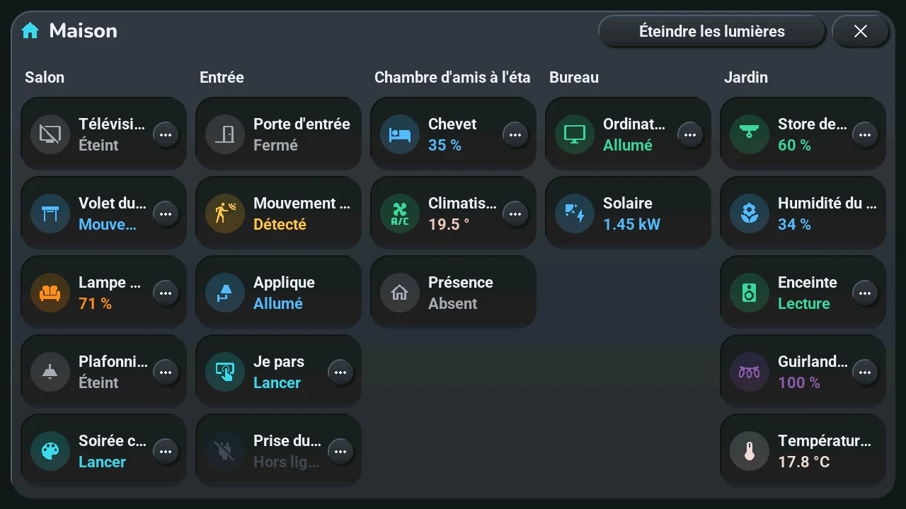

**Notice :** [Maison](notice/house.md#version-française) · **Détails techniques :** [le détail](screens_internals.md#popup-maison--toutes-les-pièces-dun-coup)

---

## Popup Météo — les prévisions en graphiques

La météo en graphiques, sur trois pages nommées en haut (touchez un nom ou glissez) : **Aujourd'hui** (maintenant : icône, température, conditions, minimum et maximum, pluie attendue ; puis les prochaines heures avec une courbe de température et des barres de pluie), **10 jours** (une ligne par jour avec une barre du minimum au maximum sur une échelle commune) et **Détails** (la pluie dans l'heure, l'humidité, l'indice UV, les probabilités de gel et de neige). Elle s'ouvre par un appui long sur une carte météo sans appareil, depuis la roue de navigation, ou depuis Home Assistant.

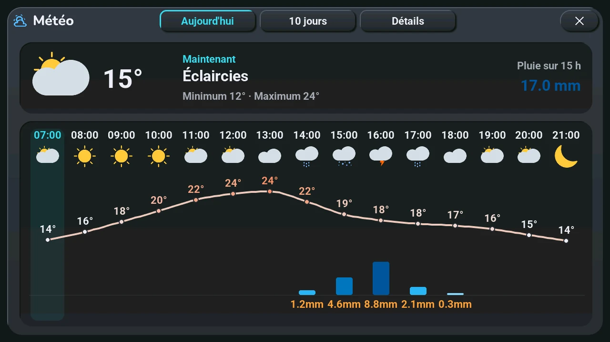

**Notice :** [Météo](notice/weather.md#version-française) · **Détails techniques :** [le détail](screens_internals.md#popup-météo--les-prévisions-en-graphiques)

---

## Popup Caméras — une image fixe de chaque caméra

Une image fixe de chaque caméra choisie dans le blueprint (seize au plus) : de nouvelles images sont récupérées, une à la fois, seulement tant que la fenêtre est ouverte ; la caméra montrée en grand peut passer en vidéo (facultatif, désactivé par défaut). À partir de deux caméras, une **mosaïque** de quatre carrés au plus par page (glissez pour les quatre suivantes) ; un appui sur un carré montre cette caméra en grand, un appui sur la grande image revient à la mosaïque. À partir de deux pièces, une colonne à gauche filtre par pièce. Une caméra hors ligne le dit. Elle s'ouvre par la roue de navigation (Agenda ▸ Caméras) ou depuis Home Assistant, par exemple quand on sonne à la porte.

**Notice :** [Caméras](notice/cameras.md#version-française) · **Détails techniques :** [le détail](screens_internals.md#popup-caméras--une-image-fixe-de-chaque-caméra)

---

## Popup Suivi — capteurs suivis

Les capteurs que vous suivez, une carte chacun, six au plus : un cours de bourse, une température, une puissance, un niveau… tout capteur de Home Assistant qui a un nombre et des statistiques. Une carte montre le nom, la valeur avec son unité, la variation avec une flèche (verte en hausse, rouge en baisse, grise si stable) et la courbe des dernières 24 heures. Elle s'ouvre par un appui sur le capteur suivi à gauche de l'horloge, ou depuis Home Assistant.

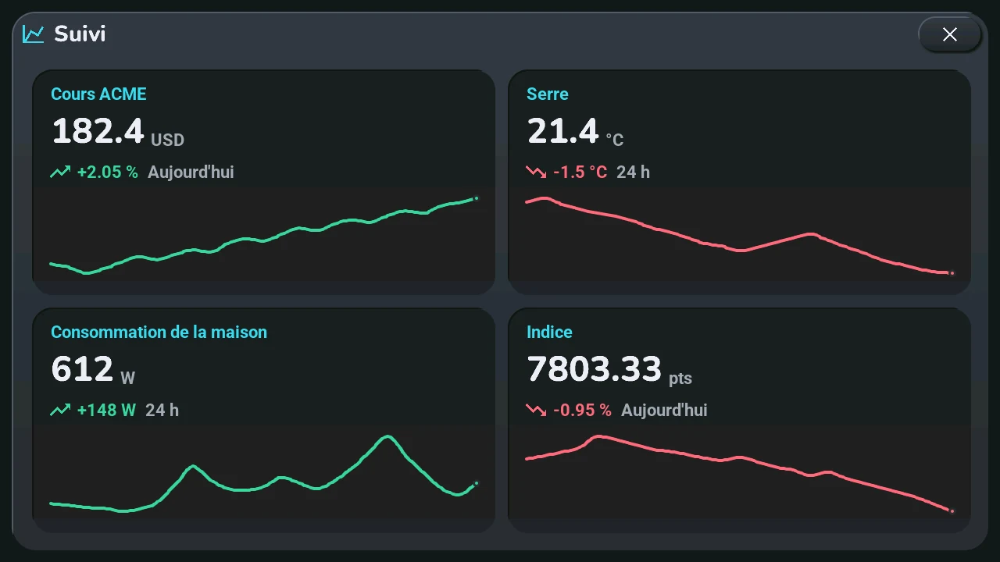

**Notice :** [Suivi](notice/tracking.md#version-française) · **Détails techniques :** [le détail](screens_internals.md#popup-suivi--capteurs-suivis)

---

## Popup Frigos et congélateurs — normes sanitaires

Vos réfrigérateurs et congélateurs, une carte chacun, quatre au plus. Une carte montre la température — verte dans la norme, orange pour l'attention, rouge pour un problème grave — un état (« Conforme », « Porte ouverte ? », « Capteur muet »…), le minimum et le maximum des 24 dernières heures avec la norme, une courbe de 24 heures entre les lignes pointillées de la norme, et le dernier incident. Une icône rouge clignote dans le coin de l'horloge quand l'un d'eux est au niveau grave ; un appui dessus ouvre cette fenêtre.

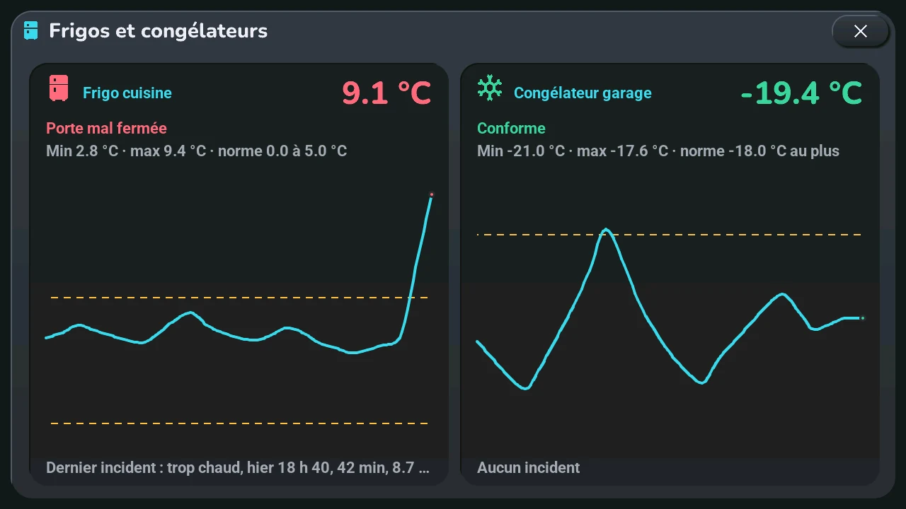

**Notice :** [Frigos et congélateurs](notice/fridge.md#version-française) · **Détails techniques :** [le détail](screens_internals.md#popup-frigos-et-congélateurs--normes-sanitaires)

---

## Popup Serveur IA — un serveur de LLM local

Le tableau de bord d'un serveur de LLM local (Ollama, llama.cpp, LM Studio, vLLM…) : un bandeau avec son état (en ligne ou hors ligne), son nom et le modèle chargé ; les **tokens par seconde** avec leur courbe, et les requêtes en cours et en attente ; et des cartes pour la **VRAM** de la carte graphique, la température du **GPU**, la **RAM** et la **puissance**. Jusqu'à trois boutons d'action (décharger le modèle, réveiller le serveur, le redémarrer) apparaissent quand Home Assistant les propose ; décharger et redémarrer demandent un second appui. Elle s'ouvre par la roue de navigation (Agenda ▸ Serveur IA) une fois que Home Assistant a envoyé un serveur, ou depuis Home Assistant.

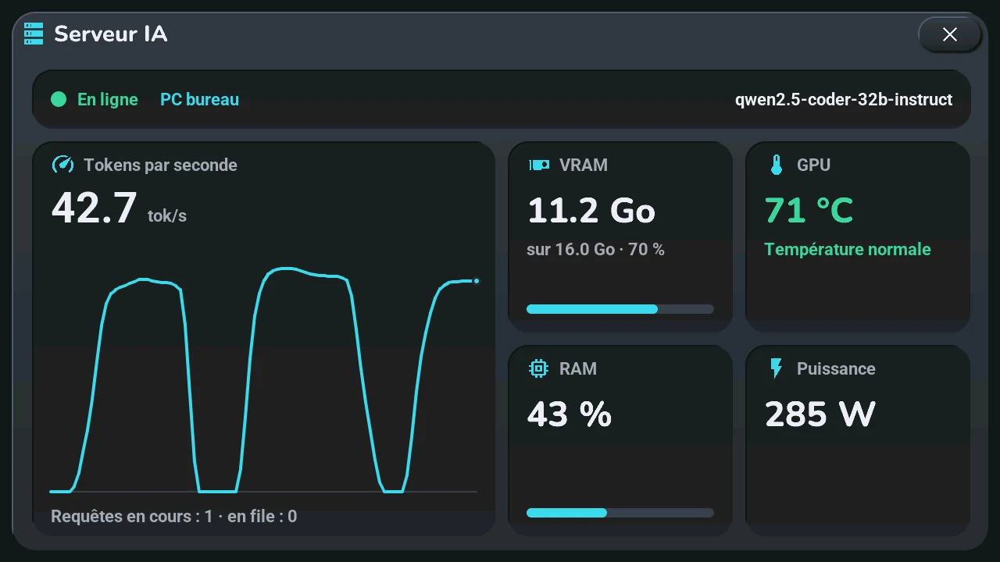

**Notice :** [Serveur IA](notice/ai-server.md#version-française) · **Détails techniques :** [le détail](screens_internals.md#popup-serveur-ia--un-serveur-de-llm-local)

---

## Popup Voitures — vos voitures électriques d'un coup d'œil

Une grande carte par voiture électrique (deux au plus), côte à côte ; avec une seule voiture, une carte sur toute la largeur. Chaque carte montre le nom de la voiture, une silhouette teintée par son état (verte en charge, bleue branchée, pâle sinon), la **batterie dans un anneau** avec son pourcentage, l'**autonomie**, une ligne d'état (« En charge · 7.20 kW », « Branchée », « Débranchée », ou « Hors ligne » pour une voiture endormie : ses dernières valeurs restent affichées) et, dessous, l'énergie ajoutée et le temps restant en charge, ou la limite de charge. Sans voiture choisie, un message court dit où les choisir. Une page **Charge** s'ajoute, avec son onglet (ou un glissement du doigt vers la gauche), dès que Home Assistant a envoyé les heures du jour d'une voiture : une carte par voiture (batterie et limite de charge, état, heure d'arrivée), puis la **frise des 24 heures** — les heures où chaque voiture a chargé aujourd'hui, la prévision de production du soleil en barres dorées, le trait de l'heure actuelle et, pour une voiture en charge, la fin de charge qu'elle annonce elle-même — et enfin un **créneau conseillé** pour charger au soleil, calculé sur l'écran d'après la prévision du jour. Ce créneau est une suggestion fondée sur une prévision, jamais un fait : l'écran le dit, et dit aussi quand la prévision manque. Pas de page sans heures du jour, et jamais sur la Waveshare 7B. Ouvert par un appui court sur un cercle de voiture de la page Flux du popup Énergie, ou par « Go to screen → Cars ». **Détails :** [détails](screens_internals.md#popup-voitures--vos-voitures-électriques-dun-coup-dœil)

---

## Coloration sémantique

La couleur est utilisée de façon systématique comme canal d'information primaire — pour lire l'état d'un coup d'œil sans lire les labels.

| Quoi | Couleurs |
|---|---|
| **Températures** (capteurs intérieurs et prévisions) | bleu (froid) → vert (confortable) → orange (chaud) → rouge (très chaud) |
| **Noms des jours** des prévisions journalières | cyan : aujourd'hui · vert : jour de repos · ambre : dimanche de repos · rose / rouge : dimanche travaillé, ou tout jour avec une prise de service avant 09:00 · ardoise estompée : jour passé |
| **Humidité des plantes** | rouge : 14 % ou moins (très sec, besoin d'arrosage) · dégradé vert → blanc cassé : 30–80 % · bleu : 80 % ou plus (trop humide) |
| **Batteries** (téléphone, tablette, production solaire, capteurs de plantes) | vert : au-dessus de 80 % · bleu : 41 à 80 % · ambre : 20 à 40 % · rouge : sous 20 % · gris : inconnu |
| **Icône microphone** | voir l'assistant vocal ci-dessus |

Vingt et un thèmes, chacun en sombre et en clair, changent les couleurs, les formes (rayons, bordures, ombres) et les polices de l'heure, de la date et des titres ; une tablette neuve démarre en « Relief doux ».

Le thème (« Theme »), le mode (« Light or dark » : Dark, Light, Auto) et l'interrupteur « Night (auto theme) » sont des entités de la tablette, aussi dans le popup Réglages : [réglages de la tablette](installation/settings.md#thème-clair-ou-sombre).

**Détails techniques :** [le détail](screens_internals.md#coloration-sémantique)

---

## Contrôle du volet roulant

Chaque volet ou vanne d'une pièce est une carte à part : un appui l'arrête pendant qu'il bouge, sinon le ferme s'il est ouvert, l'ouvre dans le cas contraire. Un appui long puis **Détails** ouvre la fenêtre des volets sur cette pièce (une page par pièce, comme les lumières) : à gauche les volets de la pièce avec **Tout ouvrir** / **Tout fermer** ; à droite un **volet dessiné** que vous faites glisser du doigt — la position part quand vous relâchez — avec sa position en grands chiffres et les boutons **Ouvrir**, **Stop** et **Fermer**. Un volet qui ne donne pas sa position ne se glisse pas : le dessin montre son état.

**Notice :** [Volets](notice/shutters.md#version-française) · **Détails techniques :** [le détail](screens_internals.md#contrôle-du-volet-roulant)

---

## Popup d'un appareil

Un appui long sur la carte d'un interrupteur, d'une scène ou d'un lecteur multimédia (pas une télécommande TV) ouvre une fenêtre « plus d'infos » comme celle d'un tableau de bord Home Assistant : à gauche l'icône de l'appareil dans un badge de la couleur de son état, son état en mots et sa pièce ; à droite un grand interrupteur vertical qui fait ce que fait un appui sur la carte — allumer, éteindre ou lancer — et qui, avec l'option « confirmer », demande un second appui. La fenêtre suit l'appareil tant qu'elle est ouverte. Elle ne montre que ce que Home Assistant pousse déjà pour les cartes : ni historique ni attributs.

**Notice :** [Rangée du bas — fenêtre de l'appareil](notice/tiles.md#fenêtre-de-lappareil) · **Détails techniques :** [le détail](screens_internals.md#popup-dun-appareil)

---

## Arcade — 8 consoles de jeu (expérimental)

> **Statut : prototypes précoces.** Premiers jets générés par IA pour tester les capacités de LVGL + C++ sur ESP32-P4. Fonctionnels mais non finalisés — preuve de concept, pas produit fini.

Huit petits jeux qui tournent sur la tablette seule — ni Home Assistant, ni réseau. Ils s'ouvrent par un appui sur le bouton manette (en haut à droite) ou « Jeux » dans la roue de navigation ; chaque jeu est une page plein écran à part.

| # | Console | Description | Contrôles |
|---|---------|-------------|----------|
| 1 | **Fil d'Or** | Roguelite de bille, 6 salles, progression Dark Souls | Inclinaison BMI270 |
| 2 | **Arcanoïde** | Casse-briques 8 niveaux, power-ups, combo | Inclinaison + tactile |
| 3 | **Neon Apron** | Flipper néon 3 billes — **bascule l'écran en portrait 720×1280** | Zones tactiles + nudge IMU |
| 4 | **Coureur d'Or** | Lode Runner 10 niveaux, creuser & grimper | D-pad tactile |
| 5 | **Go Tab** | Go 9×9/13×13/19×19, score chinois (komi 6,5), IA 4 niveaux | Tactile |
| 6 | **Trial Poursuite** | Quiz 1–6 équipes, roue 42 cases + 6 rayons | Tactile |
| 7 | **Dames Tab** | Dames 10×10 internationales (option 8×8 anglaises), IA 4 niveaux | Tactile |
| 8 | **Roi Noir** | Échecs FIDE, 5 niveaux IA, perft validé | Tactile |

| Roi Noir (échecs) | Arcanoïde (casse-briques) |
|:-:|:-:|
|  |  |

| Coureur d'Or (Lode Runner) |
|:-:|
|  |

Pour quitter un jeu, utilisez son hub → « Quitter » : le score est sauvegardé, et Neon Apron remet l'écran en paysage.

→ Détails techniques complets par jeu : [`docs/arcade.md`](arcade.md)

**Notice :** [Arcade](notice/arcade.md#version-française) · **Détails techniques :** [le détail](screens_internals.md#arcade--8-consoles-de-jeu-expérimental)
