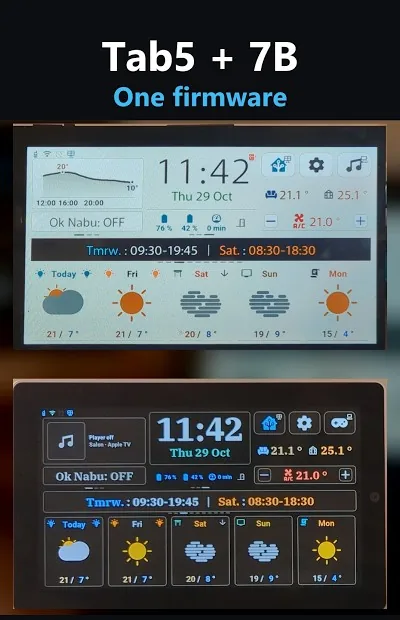

# Which screen: M5Stack Tab5 or Waveshare ESP32-P4 7B for Home Assistant

## English · [Français](#version-française)

---

This project turns two ESP32-P4 touch screens into Home Assistant wall screens with the same firmware: the 5-inch **M5Stack Tab5** and the 7-inch **Waveshare ESP32-P4-WIFI6-Touch-LCD-7B** (« the 7B »). This page puts them side by side, then says which one to pick. The facts come from this project's own pages ([hardware](hardware.md), [Waveshare 7B](waveshare-7b.md)) and its YAML; the prices and the makers' specifications were read on their product pages on 6 Nov 2026.

▶ **Side by side in 29 seconds**: [One firmware, two Home Assistant screens](https://youtube.com/shorts/xdu9M5caVIY), a YouTube Short (English texts on screen).

## Side by side

| | M5Stack Tab5 | Waveshare ESP32-P4 7B |
|---|---|---|
| Screen | 5 inches, IPS, 1280×720 | 7 inches, IPS, 1024×600 |
| Display and touch chips | three revisions, told apart by the sticker on the back: ILI9881C + GT911, ST7123, ST7121 ([hardware revisions](hardware.md#hardware-revisions)) | one: EK79007 display, GT911 touch (5 points) |
| Processor | ESP32-P4, run at 360 MHz by this firmware (chip revision v1.3 on the author's tablets) | ESP32-P4, run at 400 MHz by this firmware (chip revision v3.2 on the author's board; Waveshare's wiki says « up to 360 MHz ») |
| Memory | 16 MB flash, 32 MB PSRAM | 32 MB flash, 32 MB PSRAM |
| Radio | ESP32-C6: Wi-Fi 6 (2.4 GHz) and Bluetooth LE; built-in antenna or external MMCX connector | ESP32-C6-MINI-1: Wi-Fi 6 (2.4 GHz) and Bluetooth LE |
| Battery | removable NP-F550 two-cell pack, supplied with the Kit (K145) but not with the Tab5 alone (C145) ([M5Stack's docs](https://docs.m5stack.com/en/core/Tab5)); the firmware reads its level, controls the charger and shows the battery icon | a connector for a one-cell lithium battery, with its charger on the board but no gauge; this firmware does not read it (the icon and the battery entities stay, without effect) |
| Motion sensor | BMI270: tap to wake, tilt games | none |
| Clock | RX8130CE real-time clock: the time survives a power cut | none: the time comes from the network at each start, so the alarm clock waits for Wi-Fi after a power cut |
| Camera | built-in SC2356, 2 MP (MIPI-CSI); not used by this firmware | MIPI-CSI connector, and a version of the board sold with an OV5647 camera; not used by this firmware |
| Audio | ES8388 codec, ES7210 for the two microphones, built-in speaker, 3.5 mm headphone jack | ES8311 codec, ES7210 for the two microphones, a two-pin speaker connector (the author uses the speaker of Waveshare's official pack), no headphone jack |
| Ports and expansion | USB-C, USB-A host, microSD, RS-485, HY2.0-4P, M5-Bus, GPIO_EXT headers, STAMP pads, a 1/4-inch tripod nut | two USB-C (« USB » and « USB TO UART »), USB-A host, TF card slot, RS-485, CAN, I2C and UART headers, 17 free GPIO on two 12-pin headers |
| Games | the eight consoles of the Arcade, four of them played by tilting the tablet | none by default; built in anyway, the tilt games get no input and none is laid out for 1024×600 ([ADR-0065](decisions/0065-games-optional-module.md)) |
| Support in this project | ST7123: ✅ supported. ST7121: ✅ runs (the author's second tablet, and another user's). ILI9881C: 🧪 built, never run | ✅ supported: the author's daily screen since 15 Oct 2026 (the board arrived on 14 Oct); one board tested so far ([what is left](waveshare-7b.md#what-is-not-done-yet)) |
| Install from the browser | yes, on the [install page](https://axellum.github.io/M5-Tab5-ESPHome-LVGL/install/): pick the display chip ([install the firmware](installation/flash.md)) | offered on the same page since 3.9.0, but on 29 Oct 2026 it did not get through on the author's board; esptool from the computer worked ([details](installation/flash.md#if-it-does-not-work)) |
| Updates | from Home Assistant, following the channel you installed (stable or beta) | the same, from the board's own folder of the site, never the Tab5's |
| Power at the USB input | 2.6 W at full brightness, 1.7 W at 50 %, 1.2 W with the screen off (a tablet with its battery, 10 Oct 2026) | 1.96 W on the home screen at the usual brightness, 3.14 W at full brightness, 1.24 W with the backlight off (16 Oct 2026) |
| Price, read on 6 Nov 2026 | US$ 60.00 on [M5Stack's shop page](https://shop.m5stack.com/products/m5stack-tab5-iot-development-kit-esp32-p4) (this is the page of the Kit, K145: it offers the options with and without the NP-F550 battery and the text read does not say which one the price is for; [M5Stack's docs](https://docs.m5stack.com/en/core/Tab5) list the Tab5 alone as C145 and the Kit with its battery as K145) | US$ 46.99 to 55.99 on [Waveshare's product page](https://www.waveshare.com/esp32-p4-wifi6-touch-lcd-7b.htm) (standard, or with an OV5647 camera) |

The ports, the camera and the battery rows of both boards come from the makers' product pages; prices change, so read the page before you buy. On the 7B the firmware leaves the extra ports unused ([the 7B page](waveshare-7b.md) lists them); for the Tab5, the [pin map](hardware.md#pin-map) lists every pin the firmware configures. The measured power depends on the brightness and on what each board was doing: [Power consumption](consumption.md) gives the conditions.

## Which one to choose

**Take the Tab5** if you want a small screen (5 inches) that can run on a battery, keeps the time through a power cut, has a built-in speaker and a headphone jack, and has a motion sensor for tap to wake and the tilt games. It is also the screen the project grew up on: every popup is laid out for its 1280×720, and the Arcade has its eight consoles.

**Take the 7B** if you want a bigger screen for a wall or a desk, powered over USB, for less money. It shows the same home screen and the same popups, brought to 1024×600, and it gives you CAN, RS-485 and a camera connector for projects of your own (this firmware uses none of them). You give up the games (by default), the motion sensor and the clock chip, and you rely on a board that only the author has tested; its install page has not been proven on a real board.

**Either way**, Home Assistant sees both as the same kind of screen: the same packages and the same blueprint. You can also run both in one Home Assistant, each screen with its own name ([Build your own firmware](installation/build.md), « Several screens »).

## Other ESP32-P4 screens

**Not supported by this project.** Nobody has tried this firmware on the boards below, and nothing here says it would work. They are listed because ESPHome already has a display model for them, which is only the first thing a port needs. What the makers say comes from their product pages, read on 6 Nov 2026; the model names come from the source of ESPHome 2026.9.0 (`esphome/components/mipi_dsi/models/`).

| Board | Screen, as the maker's page says | Display model in ESPHome |
|---|---|---|
| [Guition JC1060P470](https://www.guition.com/esp32p4-display-module/7-inch-esp32p4-display-module) (model on the page: JC1060P470C_I_W_Y) | 7 inches, 1024×600, capacitive touch, JD9165 display driver; ESP32-P4 and ESP32-C6; a lithium battery interface | `JC1060P470`, 1024×600 |
| [Guition JC8012P4A1](https://www.guition.com/esp32p4-display-module/10-1-inch-esp32p4-display-module) (model on the page: JC8012P4A1C_I_W_Y) | 10.1 inches, 800×1280 (a portrait panel), capacitive touch listed as optional, JD9365 display driver | `JC8012P4A1` and `JC8012P4A1-V2`, 800×1280 |
| [Waveshare ESP32-P4-WIFI6-Touch-LCD-7](https://www.waveshare.com/esp32-p4-wifi6-touch-lcd-7-8-10.1.htm) (the 720×1280 board, not the 7B; one page for the 7, 8 and 10.1-inch versions) | 7 inches, 720×1280, GT9271 touch, ESP32-C6, a battery header | not checked |

None of these pages mentions a motion sensor (which is not proof that there is none): without one, there would be no games, as on the 7B.

What a port takes, from [ADR-0061](decisions/0061-board-and-screen-size.md) and the story of the 7B:

- **A board package and a geometry file**: `Tab5/paquets/carte-<name>.yaml` for the hardware (pins, display, touch, audio, Wi-Fi chip) and `geometrie-<name>.yaml` for the screen size, the rotation and the font scale, picked at build time by `tab5_carte`.
- **A pass over the home screen and every popup** for any size other than 1280×720: for the 7B, four lots of work before the board even arrived.
- **The board's own quirks**, which only show on the board: for the 7B, a newer ESPHome, a reset polarity for the Wi-Fi chip, a faster PSRAM, a panel mounted upside down and a touch reset ([problems met](waveshare-7b.md#problems-met-and-how-they-were-solved)).
- **An ESP32-P4 with PSRAM**: the framebuffer does not fit in the chip's own memory ([hardware](hardware.md)); a screen on another chip is another project.

Own one of these boards and willing to try? Say how it went in [Discussions → Hardware compatibility](https://github.com/Axellum/M5-Tab5-ESPHome-LVGL/discussions/categories/hardware-compatibility).

---

---

## Version Française

---

Ce projet transforme deux écrans tactiles ESP32-P4 en écrans muraux Home Assistant avec le même firmware : le **M5Stack Tab5** de 5 pouces et la **Waveshare ESP32-P4-WIFI6-Touch-LCD-7B** de 7 pouces (« la 7B »). Cette page les met côte à côte, puis dit lequel choisir. Les faits viennent des pages du projet ([matériel](hardware.md#version-française), [Waveshare 7B](waveshare-7b.md#version-française)) et de son YAML ; les prix et les caractéristiques des fabricants ont été lus sur leurs pages produit le 06/11/2026.

▶ **Côte à côte en 29 secondes** : [Un firmware, deux écrans Home Assistant](https://youtube.com/shorts/xdu9M5caVIY), un Short YouTube (textes à l'écran en anglais).

## Côte à côte

| | M5Stack Tab5 | Waveshare ESP32-P4 7B |
|---|---|---|
| Écran | 5 pouces, IPS, 1280×720 | 7 pouces, IPS, 1024×600 |
| Puces d'écran et de tactile | trois révisions, qu'on distingue par l'autocollant au dos : ILI9881C + GT911, ST7123, ST7121 ([révisions matérielles](hardware.md#révisions-matérielles)) | une seule : écran EK79007, tactile GT911 (5 points) |
| Processeur | ESP32-P4, à 360 MHz avec ce firmware (puce en révision v1.3 sur les tablettes de l'auteur) | ESP32-P4, à 400 MHz avec ce firmware (puce en révision v3.2 sur la carte de l'auteur ; le wiki de Waveshare annonce « jusqu'à 360 MHz ») |
| Mémoire | 16 Mo de flash, 32 Mo de PSRAM | 32 Mo de flash, 32 Mo de PSRAM |
| Radio | ESP32-C6 : Wi-Fi 6 (2,4 GHz) et Bluetooth LE ; antenne intégrée ou connecteur MMCX externe | ESP32-C6-MINI-1 : Wi-Fi 6 (2,4 GHz) et Bluetooth LE |
| Batterie | batterie amovible NP-F550 à deux éléments, fournie avec le Kit (K145) mais pas avec le Tab5 seul (C145) ([docs de M5Stack](https://docs.m5stack.com/en/core/Tab5)) ; le firmware lit son niveau, pilote le chargeur et affiche l'icône de batterie | un connecteur pour une batterie lithium d'un élément, avec son chargeur sur la carte mais sans jauge ; ce firmware ne la lit pas (l'icône et les entités de batterie restent, sans effet) |
| Capteur de mouvement | BMI270 : toucher pour réveiller, jeux à incliner | aucun |
| Horloge | horloge temps réel RX8130CE : l'heure survit à une coupure de courant | aucune : l'heure vient du réseau à chaque démarrage, donc le réveil attend le Wi-Fi après une coupure |
| Caméra | SC2356 intégrée, 2 Mpx (MIPI-CSI) ; pas utilisée par ce firmware | connecteur MIPI-CSI, et une version de la carte vendue avec une caméra OV5647 ; pas utilisée par ce firmware |
| Audio | codec ES8388, ES7210 pour les deux micros, haut-parleur intégré, prise casque 3,5 mm | codec ES8311, ES7210 pour les deux micros, un connecteur de haut-parleur à deux broches (l'auteur utilise le haut-parleur du pack officiel de Waveshare), pas de prise casque |
| Ports et extensions | USB-C, USB-A hôte, microSD, RS-485, HY2.0-4P, M5-Bus, connecteurs GPIO_EXT, plots STAMP, un écrou de trépied 1/4 de pouce | deux USB-C (« USB » et « USB TO UART »), USB-A hôte, lecteur de carte TF, RS-485, CAN, connecteurs I2C et UART, 17 GPIO libres sur deux connecteurs de 12 broches |
| Jeux | les huit consoles de l'Arcade, dont quatre se jouent en inclinant la tablette | aucun par défaut ; compilés quand même, les jeux à incliner ne reçoivent rien et aucun n'est mis en page pour le 1024×600 ([ADR-0065](decisions/0065-games-optional-module.md)) |
| Prise en charge dans ce projet | ST7123 : ✅ prise en charge. ST7121 : ✅ tourne (la deuxième tablette de l'auteur, et celle d'un autre utilisateur). ILI9881C : 🧪 compilée, jamais lancée | ✅ prise en charge : l'écran de tous les jours de l'auteur depuis le 15/10/2026 (la carte est arrivée le 14/10) ; une seule carte essayée jusqu'ici ([ce qui reste](waveshare-7b.md#ce-qui-reste-à-faire)) |
| Installer depuis le navigateur | oui, sur la [page d'installation](https://axellum.github.io/M5-Tab5-ESPHome-LVGL/install/) : choisissez la puce d'écran ([installer le firmware](installation/flash.md#version-française)) | proposé sur la même page depuis la 3.9.0, mais le 29/10/2026 elle n'est pas passée sur la carte de l'auteur ; esptool depuis l'ordinateur a marché ([détail](installation/flash.md#si-ça-ne-marche-pas)) |
| Mises à jour | depuis Home Assistant, selon le canal installé (stable ou bêta) | pareil, depuis le dossier propre à la carte sur le site, jamais celui du Tab5 |
| Puissance à l'entrée USB | 2,6 W à pleine luminosité, 1,7 W à 50 %, 1,2 W écran éteint (une tablette avec sa batterie, 10/10/2026) | 1,96 W sur l'accueil à la luminosité habituelle, 3,14 W à pleine luminosité, 1,24 W rétroéclairage éteint (16/10/2026) |
| Prix, lu le 06/11/2026 | 60,00 US$ sur la [boutique de M5Stack](https://shop.m5stack.com/products/m5stack-tab5-iot-development-kit-esp32-p4) (c'est la page du Kit, K145 : elle propose les options avec et sans la batterie NP-F550 et le texte lu ne dit pas pour laquelle le prix est affiché ; les [docs de M5Stack](https://docs.m5stack.com/en/core/Tab5) donnent le Tab5 seul sous C145 et le Kit avec sa batterie sous K145) | de 46,99 à 55,99 US$ sur la [page produit de Waveshare](https://www.waveshare.com/esp32-p4-wifi6-touch-lcd-7b.htm) (standard, ou avec une caméra OV5647) |

Les lignes ports, caméra et batterie des deux cartes viennent des pages produit des fabricants ; les prix changent, lisez la page avant d'acheter. Sur la 7B, le firmware laisse les ports supplémentaires inutilisés ([la page de la 7B](waveshare-7b.md#version-française) les liste) ; pour le Tab5, les [broches](hardware.md#broches) listent toutes celles que le firmware configure. La puissance mesurée dépend de la luminosité et de ce que faisait chaque carte : [Consommation](consumption.md#version-française) donne les conditions.

## Lequel choisir

**Prenez le Tab5** si vous voulez un petit écran (5 pouces) qui peut tourner sur batterie, garde l'heure à travers une coupure de courant, a un haut-parleur intégré et une prise casque, et un capteur de mouvement pour le toucher-réveil et les jeux à incliner. C'est aussi l'écran sur lequel le projet a grandi : chaque popup est mis en page pour son 1280×720, et l'Arcade a ses huit consoles.

**Prenez la 7B** si vous voulez un écran plus grand pour un mur ou un bureau, alimenté en USB, pour moins cher. Elle montre le même accueil et les mêmes popups, ramenés à 1024×600, et vous donne du CAN, du RS-485 et un connecteur de caméra pour vos propres projets (ce firmware n'en utilise aucun). Vous renoncez aux jeux (par défaut), au capteur de mouvement et à la puce d'horloge, et vous comptez sur une carte que seul l'auteur a essayée ; sa page d'installation n'a pas été éprouvée sur une vraie carte.

**Dans les deux cas**, Home Assistant voit les deux comme le même genre d'écran : mêmes packages et même blueprint. On peut aussi faire tourner les deux dans un même Home Assistant, chaque écran avec son propre nom ([Compiler son propre firmware](installation/build.md#version-française), « Plusieurs écrans »).

## Les autres écrans ESP32-P4

**Pas pris en charge par ce projet.** Personne n'a essayé ce firmware sur les cartes ci-dessous, et rien ici ne dit qu'il marcherait. Elles sont citées parce qu'ESPHome a déjà un modèle d'écran pour elles, ce qui n'est que la première chose dont un portage a besoin. Ce que disent les fabricants vient de leurs pages produit, lues le 06/11/2026 ; les noms de modèles viennent du code source d'ESPHome 2026.9.0 (`esphome/components/mipi_dsi/models/`).

| Carte | Écran, d'après la page du fabricant | Modèle d'écran dans ESPHome |
|---|---|---|
| [Guition JC1060P470](https://www.guition.com/esp32p4-display-module/7-inch-esp32p4-display-module) (modèle sur la page : JC1060P470C_I_W_Y) | 7 pouces, 1024×600, tactile capacitif, pilote d'écran JD9165 ; ESP32-P4 et ESP32-C6 ; une interface de batterie lithium | `JC1060P470`, 1024×600 |
| [Guition JC8012P4A1](https://www.guition.com/esp32p4-display-module/10-1-inch-esp32p4-display-module) (modèle sur la page : JC8012P4A1C_I_W_Y) | 10,1 pouces, 800×1280 (une dalle en portrait), tactile capacitif indiqué en option, pilote d'écran JD9365 | `JC8012P4A1` et `JC8012P4A1-V2`, 800×1280 |
| [Waveshare ESP32-P4-WIFI6-Touch-LCD-7](https://www.waveshare.com/esp32-p4-wifi6-touch-lcd-7-8-10.1.htm) (la carte en 720×1280, pas la 7B ; une seule page pour les versions 7, 8 et 10,1 pouces) | 7 pouces, 720×1280, tactile GT9271, ESP32-C6, un connecteur de batterie | non vérifié |

Aucune de ces pages ne mentionne de capteur de mouvement (ce qui ne prouve pas qu'il n'y en a pas) : sans lui, il n'y aurait pas de jeux, comme sur la 7B.

Ce que demande un portage, d'après l'[ADR-0061](decisions/0061-board-and-screen-size.md) et l'histoire de la 7B :

- **Un paquet de carte et un fichier de géométrie** : `Tab5/paquets/carte-<nom>.yaml` pour le matériel (broches, écran, tactile, audio, puce Wi-Fi) et `geometrie-<nom>.yaml` pour la taille de l'écran, la rotation et l'échelle des polices, choisis à la compilation par `tab5_carte`.
- **Un passage sur l'accueil et sur chaque popup** pour toute taille autre que 1280×720 : pour la 7B, quatre lots de travail avant même l'arrivée de la carte.
- **Les particularités de la carte**, qui n'apparaissent que sur la carte : pour la 7B, un ESPHome plus récent, une polarité de reset pour la puce Wi-Fi, une PSRAM plus rapide, une dalle montée à l'envers et un reset du tactile ([problèmes rencontrés](waveshare-7b.md#les-problèmes-rencontrés-et-comment-ils-ont-été-réglés)).
- **Un ESP32-P4 avec de la PSRAM** : le tampon d'image ne tient pas dans la mémoire propre de la puce ([matériel](hardware.md#version-française)) ; un écran sur une autre puce est un autre projet.

Vous avez une de ces cartes et l'envie d'essayer ? Racontez ce que ça a donné dans [Discussions → Hardware compatibility](https://github.com/Axellum/M5-Tab5-ESPHome-LVGL/discussions/categories/hardware-compatibility).
