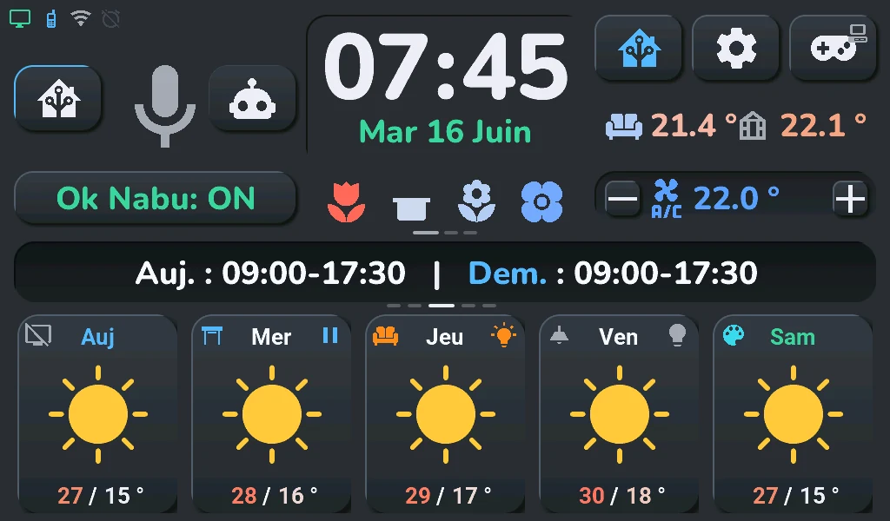
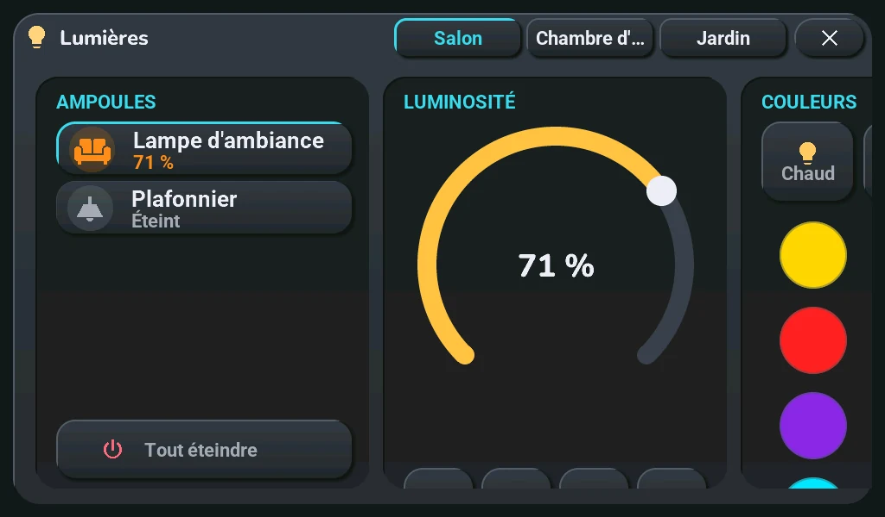
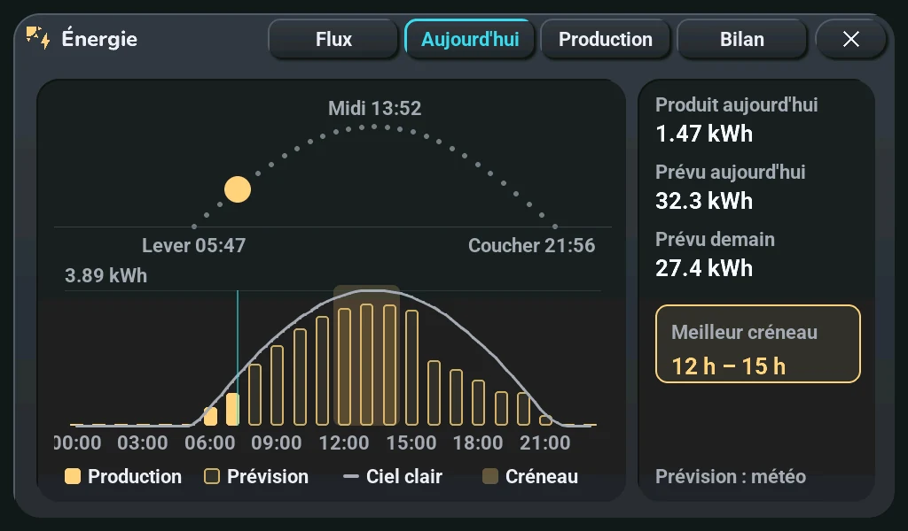

# Waveshare ESP32-P4 7B

## English · [Français](#version-française)

---

The same firmware also runs on a second board, the **Waveshare ESP32-P4-WIFI6-Touch-LCD-7B**: a 7-inch, 1024×600 touch screen built around the same chips as the Tab5 (an ESP32-P4, an ESP32-C6 for Wi-Fi, an ES7210 for the microphones). It is a cheaper and bigger screen, with less on board: no motion sensor, no clock chip, no battery gauge (it does have a battery connector, which this firmware does not use yet).

**Status: supported.** The author's board has been the daily screen of their home since 2026-10-14: display, touch, backlight, sound and Wi-Fi work, and Home Assistant sees it like a Tab5. One board only, though, and one energy page is not adapted to its screen yet ([what is left](#what-is-not-done-yet)); the games are left out by default. If you try it, say how it went in [Discussions → Hardware compatibility](https://github.com/Axellum/M5-Tab5-ESPHome-LVGL/discussions/categories/hardware-compatibility): it helps a lot.

The choice of the board is one line at build time ([ADR-0061](decisions/0061-board-and-screen-size.md)); on the Tab5, nothing changes.

## What changes on screen

The home screen is the Tab5's layout brought to 1024×600: same places, same proportions, smaller. The large fonts are scaled by 0.82 (about 1024 / 1280 and 600 / 720), the small ones keep their size so they stay readable. The popups do the same: each keeps the Tab5's layout, smaller. Where a fixed-size text no longer fitted, it moves a little instead (the plant rows lose some margin, a rain amount drops its « mm » in a narrow weather column, the « On / Off » key of the remote wraps onto two lines); the camera pictures are asked at 720 × 405 instead of 960 × 540. The details are in [ADR-0061](decisions/0061-board-and-screen-size.md).

| Home screen | Lights | Energy |
|---|---|---|
|  |  |  |

These pictures come from the off-device render (the firmware running on a PC, [debugging](debugging.md)), which draws every screen at 1024×600 on each firmware change; they are the same pixels as on the board, without the touch. The render of this board is in French only.

What the board does not have, and what it means on screen:

- **No motion sensor (IMU), so no games by default:** the firmware of this board is built without the eight consoles ([ADR-0065](decisions/0065-games-optional-module.md)): no Arcade, no « Games » in the navigation wheel; the gamepad button's tap opens the audio player (Music popup) and its long press the TV remote, both changeable in the blueprint. To build them in anyway, add `tab5_jeux: oui` to `Tab5/user_entities.yaml` (or `-s tab5_jeux oui`); the games played by tilting (Fil d'Or, Arcanoïde, Coureur d'Or, Neon Apron) then get no input, and none is laid out for 1024×600.
- **A battery connector, but no battery gauge, and nothing read by this firmware:** Waveshare's schematic shows a connector for a one-cell lithium battery (J4, MX1.25), a charger (ETA6098), a converter that raises the battery to 5 V and an ON/OFF switch. There is no gauge: the battery voltage only reaches the P4 through a divider (200 kΩ / 100 kΩ, a third of the voltage) on GPIO 20, and this firmware does not read it yet. So the battery icon, the charging settings and the battery entities stay, without effect (« Battery » stays unknown), and energy saving « on battery » never triggers. Nothing on this page was tried with a battery.
- **No clock chip:** the time comes from the network at each start. After a power cut, the alarm clock waits for Wi-Fi. (The board has a 1220 coin-cell holder for the P4's own clock; this firmware does not use it. The board charges that cell: fit only a rechargeable ML1220, never a CR1220, which is not made to be charged. Waveshare's wiki also says rechargeable cells only.)
- **No headphone jack detection, no switchable power rails:** their switches are kept so Home Assistant finds the same entities, and do nothing.

## Install it

**From the browser**, since 3.9.0 (the pre-releases since 3.9.0-rc.6): on the [install page](https://axellum.github.io/M5-Tab5-ESPHome-LVGL/install/), pick « Waveshare ESP32-P4 7B » and plug in the USB-C port of the ESP32-P4; the steps are those of a Tab5 ([install the firmware](installation/flash.md)). This firmware is built and signed by the project with ESPHome 2026.9.1, for a board mounted either way (« Screen direction », below) and without the games; its updates then come from Home Assistant, from this board's own folder of the site, never from the Tab5's. Not tried from the install page on a real board yet: the author's board runs the published firmware since 21 Oct 2026, put on it as an over-the-air update. The [Home Assistant steps](installation/README.md) stay the same (files, adding the device, sources, the blueprint).

**Or build it yourself**, to add the games: the [Build your own firmware](installation/build.md) page with three differences.

1. **ESPHome 2026.9.1 or newer.** 2026.9.0 crashes while starting the display of this board's ESP32-P4 revision 3 ([esphome#18984](https://github.com/esphome/esphome/pull/18984)); the build stops with a clear message under 2026.9.1. The Tab5 itself still builds from 2026.9.0.
2. **One line** in `Tab5/user_entities.yaml`: `tab5_carte: waveshare-7b` (or `-s tab5_carte waveshare-7b` on the command line).
3. **First flash over USB**: plug the USB-C port marked for the ESP32-P4 into the computer, then `esphome run tab5-ha-hmi.yaml`. Wi-Fi exactly as on the Tab5: the open **« Tab5 Fallback AP »** network with a phone, or Improv from [ESPHome Web](https://web.esphome.io). Later updates go over Wi-Fi. <!-- pragma: allowlist secret -->

Before the first flash, if you care about the factory demo, back up the flash with `esptool read-flash`: on the author's board, each read restarts the board, and a 4 KB block at 0x37C000 could not be read (filled with zeros in the backup).

**Board mounted the other way round?** The panel is mounted upside down compared with its driver's default, so the firmware turns the picture by 180° in software, on every frame. If you mount the board upside down, pick **Upside down** (« Retourné » before 2026-10-24) in its « Screen direction » setting in Home Assistant (device page, **Configuration** card; [tablet settings](installation/settings.md)): the picture turns at once, without a restart or a rebuild, and the choice is kept across restarts and updates, so the published firmware fits both mountings and the board keeps getting its updates. The picture then goes to the panel as LVGL draws it, without the 180° step: a full-screen redraw takes about 69 ms instead of 83 ms (4 runs each on the author's board, 2026-10-16, with the same code built for that angle). Nothing else to change: ESPHome turns the touch points with the picture, so the touch follows by itself, also on a new board that still shows the picture upside down. Up to 3.9.0-rc.6 it took `carte_rotation: "0"` at build time; building with `-s carte_rotation 0` and picking « Upside down » would turn the picture twice ([ADR-0069](decisions/0069-screen-direction-from-home-assistant.md)).

The board announces itself in Home Assistant with the Tab5's name and model (`tab5-ha-hmi`): the packages and the blueprint find it with nothing to change. **Replacing a Tab5 in the same Home Assistant?** Disable the Tab5's ESPHome entry first. Otherwise Home Assistant keeps both, gives the new board's entities a `_2` suffix, and the pushes keep going to the old one.

## Problems met, and how they were solved

What happened on the author's board when it arrived (2026-10-14), in order. Everything here is already in the firmware: you should not meet these again.

| What we saw | Cause | Fix |
|---|---|---|
| Boot loop, then safe mode | ESPHome 2026.9.0 aborts while setting up the display clock of a P4 revision 3 (`mipi_dsi_ll_set_phy_pllref_clock_source`) | ESPHome 2026.9.1; the build of this board refuses an older ESPHome |
| No Wi-Fi, `sdmmc_card_init failed` | the reset of the ESP32-C6 was set active low | `esp32_hosted: active_high: true`, as on the Tab5 (same wiring) |
| About 30 « lcd.dsi underrun » per second (first trial firmware) | the PSRAM ran at its default speed | `psram: speed: 200MHz` |
| Touch almost dead: one touch recognised in 5 minutes, the brightness slider frozen | the panel is mounted upside down compared to the driver's default, and the touch controller was never reset (Waveshare's own code says its reset pin is not connected) | LVGL `rotation: 180`, the GT911 mirrored in X and Y, and its reset on GPIO 23, as in the other public configurations that work on this board: then every touch lands in the right place |
| The first sound was only a click | the microphone kept the I2S bus the speaker shares with it; the exact cause of the click was not established | the speaker at 48 kHz like the other configurations, the shared-bus rule of the Tab5 ([ADR-0010](decisions/0010-shared-i2s-bus-mic-speaker.md)): sound works since that evening |
| The speaker saturated completely at volume 100 % (2026-10-17) | ESPHome's ES8311 driver writes the volume as is to the DAC volume register: 0.75 is 0 dB, 1.0 is +32 dB of digital gain (the Tab5's ES8388 stops at 0 dB) | `volume_max: 75%` on the 7B's media player: 100 % on the screen or in Home Assistant is now 0 dB; by ear, 100 % and 80 % distorted, 75 % was clean |
| The volume was only heard in the last third of its slider (2026-10-18) | the ES8311 register gives 0.5 dB per step (volume × 255, 0xBF = 0 dB): with the default `volume_min` of 0, 20 % was ≈ −76 dB, silent while the player said « playing » | `volume_min: 40%`: the bottom of the slider is ≈ −44 dB, the top stays 0 dB. Tested by ear on 2026-10-19 with the speaker from the official pack: crystal-clear sound, no distortion, well-balanced curve |
| Boot loop after a software reboot (2026-10-16, after a few reboots from Home Assistant), Wi-Fi never up, then safe mode; only a power cut helped | the SDIO link to the C6 failed and the bad state, on the P4 side, survived `esp_restart()`, which only resets the CPU cores | every software reboot ends with a reset of the whole digital core (`Tab5/ecran/tab5_lien_c6.cpp`, [troubleshooting](troubleshooting.md#waveshare-7b-boot-loop-after-a-software-reboot-wi-fi-link-down-2026-10-16)) |
| The board restarted every 15 minutes before Home Assistant knew it | ESPHome's default `reboot_timeout` while no API client is connected (first trial firmware) | the full firmware waits 60 minutes, like the Tab5 |

Two things learnt along the way:

- **The backlight is dimmed in analog, not chopped.** GPIO 32 does not switch the LED driver (AP3032) on and off: it goes through an RC filter (10 kΩ, 100 nF) into the driver's feedback pin, so the PWM becomes a steady voltage that shifts the LED current. A higher PWM frequency is smoother: the firmware uses 5 kHz, like Waveshare's code.
- **Start from the configurations that already work.** The three touch fixes were all in public ESPHome configurations of this board ([agillis/esphome-modular-lvgl-buttons](https://github.com/agillis/esphome-modular-lvgl-buttons), [Jordi1990/openamber](https://github.com/Jordi1990/openamber), the Home Assistant forum), not in the manufacturer's code. Reading them first would have saved an evening.

## What is not done yet

- **Not checked on the board:** the microphone and the wake word, the cameras popup (JPEG decoding), a power cut without network, the firmware published by the project (install page, then an update from Home Assistant).
- **Not adapted to 1024×600 yet:** in German and Turkish, « Close all » in the shutters popup (« Alle schließen », « Tümünü kapat »: 140 and 143 px in a font that does not shrink with the screen) runs past its 134-px button. The other popups follow the screen, the « Balance » page of the Energy popup included since 2026-10-18. For every screen, the render counts on each change what runs past its area: about as much as on the Tab5 itself, mostly the shutters, alarm clock and cameras popups, which do the same there.
- Reported by others on this board, then seen here too: a faint glow with the backlight at 0 % (the screen off is now a black panel, [ADR-0064](decisions/0064-screen-really-off-night.md)). The speaker distortion reported earlier was completely solved by setting `volume_max: 75%` (0 dB unitary gain).
- The firmware version of the C6 Wi-Fi chip cannot be read on this board (« C6 Version » stays « Unknown » since 2026-10-14, while the Tab5 answers 1.4.1): its factory firmware may be older than the ESP-Hosted library of the P4 (2.12.12 with ESPHome 2026.9.1). Updating it is possible, from ESPHome (`update:` with `platform: esp32_hosted`, the firmware sent over the SDIO link) or over the C6's own serial port on the H4 connector (TXD, RXD, GND, IO9 = BOOT). **Not done, by choice:** a failed update would leave the screen without Wi-Fi, and Wi-Fi works as it is. Since the request went unanswered and froze the screen for 1 s each time (3 to 4 times after every boot, measured on 2026-10-16), the 7B no longer asks: the sensor says « Unknown » straight away (`carte_c6_version: "false"` in `Tab5/paquets/carte-waveshare-7b.yaml`, to set back to `"true"` after a C6 update).

## Measured on the board (2026-10-16)

Firmware `main` 46ad7f03, details and method in [Power consumption](consumption.md#waveshare-7b-at-the-usb-input-2026-10-16).

- **Start-up**: first image at 5.6-5.8 s, Wi-Fi at 10.4-11.7 s, Home Assistant connected at 11.5-12.7 s (4 starts, read on the board's « Boot timeline » sensors). It used to be about 20 s before the first image, like the Tab5; [#478](https://github.com/Axellum/M5-Tab5-ESPHome-LVGL/pull/478) removed the cost of creating the labels.
- **One second less at every start (2026-10-17)**: the boot waited 1 s before the display, a wait made for the Tab5, whose display reset goes through an I/O expander; the 7B has none, its panel reset is a pin of the P4 ([ADR-0005](decisions/0005-boot-delay-gpio-expander-reset.md), `carte_attente_ecran_ms: "0"`). Over 10 restarts from the « Restart » button, against the 10 of the night of 2026-10-16: backlight on at 0.97 s (2.02 s), first image at 4.78-4.84 s (5.84-5.90 s), Wi-Fi at 9.38-9.44 s (10.37-10.43 s); every other step keeps its length, and the screen comes back on with its picture (seen by the author).
- **The clock can show up late**: the board has no real-time clock, so the time is only known once the Wi-Fi is up and the time is received (10 s or more after power-up); the first image comes before it.
- **Power at the USB input**: 1.96 W on the home screen at the usual brightness, 3.14 W at 100 %, 1.24 W with the backlight off. Popups and pages cost nothing measurable.
- **Precise USB power measurement (2026-10-19, FNIRSI FNB-58)**: measured over USB HID at 100 samples/s on the home screen at default brightness (~60 %): **5.028 V** (5.010–5.044 V), **309.8 mA** (278.1–323.3 mA), average power **1.558 W** (p95 1.569 W, max 1.626 W). Sound playback (TTS announcement) adds about 0.1 to 0.2 W peak.

## Hardware

| | Waveshare ESP32-P4-WIFI6-Touch-LCD-7B |
|---|---|
| Main processor | ESP32-P4 (ESP32-P4NRW32), revision **v3.2** on the author's board, run at 400 MHz, its normal speed (ESP-IDF offers 360 MHz only to chips older than v3: the 360 MHz asked until 2026-10-16 were ignored; ESPHome's « experimental » warning is about those older chips) |
| Memory | 32 MB PSRAM (hex mode, 200 MHz), 32 MB flash |
| Display | 7 inches, 1024×600, landscape panel, EK79007 controller over MIPI-DSI (2 lanes), ESPHome model `WAVESHARE-ESP32-P4-WIFI6-TOUCH-LCD-7B` |
| Touch | GT911, I2C at 0x5D, polled every 50 ms (no interrupt) |
| Backlight | AP3032 LED driver, analog dimming from GPIO 32 (LEDC, 5 kHz, inverted) |
| Sound out | ES8311 DAC (0x18), NS4150B amplifier enabled by GPIO 53, a two-pin speaker connector (validated with the official Waveshare pack speaker, clean playback up to 75% / 0 dB) |
| Microphones | two, through an ES7210 ADC (0x40), 16 kHz / 16-bit like the Tab5; the firmware reads MIC1 (left slot), like Waveshare's demo |
| Wi-Fi and Bluetooth | ESP32-C6-MINI-1 over SDIO (ESP-Hosted), reset on GPIO 54; Wi-Fi in 2.4 GHz only |
| ESP32-C6 serial connector | « C6-UART », 4 pins (TXD, RXD, GND, IO9; IO9 to ground = download mode), to flash the C6 directly |
| USB | USB-C « USB » (the P4's own USB Serial/JTAG), USB-C « USB TO UART » (CH343P bridge to the P4's UART0, GPIO 37 TX / GPIO 38 RX, with automatic reset and boot), USB-A host |
| Power | the two USB-C ports; a one-cell lithium battery connector (J4, MX1.25) with an ETA6098 charger, a 5 V boost converter and an ON/OFF switch; no gauge, the battery voltage divided by three on GPIO 20 (not read by this firmware) |
| Clock backup cell | 1220 holder on the P4's own clock, charged by the board: rechargeable ML1220 only, never a CR1220 (not used by this firmware) |
| Free GPIO | 17, on two 12-pin PH2.0 headers: GPIO 2-5, 28-31, 34 and 36 on P3, GPIO 46-52 on P1 |
| Not on this board | battery gauge, motion sensor, clock chip, I/O expanders, headphone jack |
| Also on the board, not used | microSD slot, MIPI-CSI camera connector, USB-A, I2C / UART / RS485 connectors, CAN bus (TJA1051T/3 transceiver on GPIO 21 RX / GPIO 22 TX with 120 Ω termination jumper H5), battery input |

The Wi-Fi band, the power, USB, coin-cell and free-pin rows come from Waveshare's schematic and wiki; they were not tried on the author's board.

Everything the firmware sets for this board is in `Tab5/paquets/carte-waveshare-7b.yaml`, its screen size in `Tab5/paquets/geometrie-waveshare-7b.yaml`. What does not depend on the board (logger, OTA, energy saving, media player…) is copied from the Tab5's file, and `tests/test_carte_7b.py` keeps both equal.

### Pin map

Every pin the board's file configures. The display reset (GPIO 33) is set by ESPHome's display model, not in the YAML. As for the Tab5, `tests/test_doc_broches.py` checks every row, in both languages, against `carte-waveshare-7b.yaml`.

| Function | Pin | In the YAML |
|---|---|---|
| I2C bus, SDA (touch and codecs, 400 kHz) | GPIO 7 | `bsp_bus` · `sda` |
| I2C bus, SCL | GPIO 8 | `bsp_bus` · `scl` |
| Touch reset | GPIO 23 | `touch` · `reset_pin` |
| Backlight PWM (LEDC, 5 kHz, inverted) | GPIO 32 | `backlight_pwm` · `pin` |
| I2S word select (microphones and speaker) | GPIO 10 | `mic_bus` · `i2s_lrclk_pin` |
| I2S bit clock | GPIO 12 | `mic_bus` · `i2s_bclk_pin` |
| I2S master clock | GPIO 13 | `mic_bus` · `i2s_mclk_pin` |
| I2S data in, from the ES7210 (microphones) | GPIO 11 | `tab5_microphone` · `i2s_din_pin` |
| I2S data out, to the ES8311 (speaker) | GPIO 9 | `tab5_speaker` · `i2s_dout_pin` |
| Speaker amplifier enable | GPIO 53 | `speaker_enable` · `pin` |
| ESP32-C6 link (SDIO), clock | GPIO 18 | `esp32_hosted` · `clk_pin` |
| ESP32-C6 link (SDIO), command | GPIO 19 | `esp32_hosted` · `cmd_pin` |
| ESP32-C6 link (SDIO), data 0 | GPIO 14 | `esp32_hosted` · `d0_pin` |
| ESP32-C6 link (SDIO), data 1 | GPIO 15 | `esp32_hosted` · `d1_pin` |
| ESP32-C6 link (SDIO), data 2 | GPIO 16 | `esp32_hosted` · `d2_pin` |
| ESP32-C6 link (SDIO), data 3 | GPIO 17 | `esp32_hosted` · `d3_pin` |
| ESP32-C6 reset | GPIO 54 | `esp32_hosted` · `reset_pin` |

Sources: Waveshare's board support package and schematic, ESPHome's display model, and the public configurations named above. The pins of the C6 link are ESP-Hosted's defaults for the P4, which this board follows.

---

---

## Version Française

---

Le même firmware tourne aussi sur une deuxième carte, la **Waveshare ESP32-P4-WIFI6-Touch-LCD-7B** : un écran tactile de 7 pouces en 1024×600, construit autour des mêmes puces que le Tab5 (un ESP32-P4, un ESP32-C6 pour le Wi-Fi, un ES7210 pour les micros). Un écran moins cher et plus grand, avec moins de choses à bord : pas de capteur de mouvement, pas de puce d'horloge, pas de jauge de batterie (elle a bien un connecteur de batterie, dont ce firmware ne se sert pas encore).

**Statut : prise en charge.** La carte de l'auteur est l'écran de tous les jours de sa maison depuis le 14/10/2026 : écran, tactile, rétroéclairage, son et Wi-Fi marchent, et Home Assistant la voit comme un Tab5. Une seule carte, cela dit, et une page de l'énergie n'est pas encore adaptée à son écran ([ce qui reste](#ce-qui-reste-à-faire)) ; les jeux sont laissés de côté par défaut. Si vous l'essayez, racontez ce que ça a donné dans [Discussions → Hardware compatibility](https://github.com/Axellum/M5-Tab5-ESPHome-LVGL/discussions/categories/hardware-compatibility) : ça aide beaucoup.

Le choix de la carte tient en une ligne à la compilation ([ADR-0061](decisions/0061-board-and-screen-size.md)) ; sur le Tab5, rien ne change.

## Ce qui change à l'écran

L'accueil reprend la mise en page du Tab5, ramenée à 1024×600 : mêmes places, mêmes proportions, en plus petit. Les grosses polices sont réduites à 0,82 (à peu près 1024 / 1280 et 600 / 720), les petites gardent leur taille pour rester lisibles. Les popups font de même : chacun garde la mise en page du Tab5, en plus petit. Là où un texte de taille fixe ne tenait plus, il se décale un peu (les lignes des plantes perdent un peu de marge, une quantité de pluie perd son « mm » dans une colonne météo étroite, la touche « Marche / Arrêt » de la télécommande passe sur deux lignes) ; les images des caméras sont demandées en 720 × 405 au lieu de 960 × 540. Le détail est dans l'[ADR-0061](decisions/0061-board-and-screen-size.md).

| Accueil | Lumières | Énergie |
|---|---|---|
|  |  |  |

Ces images viennent du rendu hors tablette (le firmware qui tourne sur un PC, [diagnostiquer](debugging.md#version-française)), qui dessine chaque écran en 1024×600 à chaque changement du firmware : ce sont les mêmes pixels que sur la carte, sans le tactile. Le rendu de cette carte n'existe qu'en français.

Ce que la carte n'a pas, et ce que ça donne à l'écran :

- **Pas de capteur de mouvement (IMU), donc pas de jeux par défaut :** le firmware de cette carte se compile sans les huit consoles ([ADR-0065](decisions/0065-games-optional-module.md)) : pas d'Arcade, pas de « Jeux » dans la roue de navigation ; le tap du bouton manette ouvre le lecteur audio (popup Musique) et son appui long la télécommande, les deux se changent dans le blueprint. Pour les compiler quand même, ajoutez `tab5_jeux: oui` à `Tab5/user_entities.yaml` (ou `-s tab5_jeux oui`) ; les jeux qui se jouent en inclinant (Fil d'Or, Arcanoïde, Coureur d'Or, Neon Apron) ne reçoivent alors rien, et aucun n'est mis en page pour le 1024×600.
- **Un connecteur de batterie, mais pas de jauge, et rien de lu par ce firmware :** le schéma de Waveshare montre un connecteur pour une batterie lithium d'un élément (J4, MX1.25), un chargeur (ETA6098), un convertisseur qui remonte la batterie à 5 V et un interrupteur ON/OFF. Pas de jauge : la tension de la batterie n'arrive au P4 que par un pont diviseur (200 kΩ / 100 kΩ, un tiers de la tension) sur GPIO 20, et ce firmware ne la lit pas encore. L'icône de batterie, les réglages de charge et les entités de batterie restent donc, sans effet (« Battery » reste inconnue), et l'économie d'énergie « sur batterie » ne se déclenche jamais. Rien de cette page n'a été essayé avec une batterie.
- **Pas de puce d'horloge :** l'heure vient du réseau à chaque démarrage. Après une coupure de courant, le réveil attend le Wi-Fi. (La carte a un support de pile 1220 pour l'horloge propre du P4 ; ce firmware ne s'en sert pas. La carte recharge cette pile : n'y mettre qu'une ML1220 rechargeable, jamais une CR1220, qui n'est pas faite pour être chargée. Le wiki de Waveshare dit aussi : piles rechargeables seulement.)
- **Pas de détection de prise casque, pas d'alimentations commutables :** leurs interrupteurs sont gardés pour que Home Assistant retrouve les mêmes entités, et ne font rien.

## L'installer

**Depuis le navigateur**, depuis la 3.9.0 (les pré-releases depuis la 3.9.0-rc.6) : sur la [page d'installation](https://axellum.github.io/M5-Tab5-ESPHome-LVGL/install/), choisissez « Waveshare ESP32-P4 7B » et branchez le port USB-C de l'ESP32-P4 ; les étapes sont celles d'un Tab5 ([installer le firmware](installation/flash.md#version-française)). Ce firmware est compilé et signé par le projet avec ESPHome 2026.9.1, pour une carte montée dans un sens ou dans l'autre (« Screen direction », plus bas) et sans les jeux ; ses mises à jour arrivent ensuite par Home Assistant, depuis le dossier de cette carte sur le site, jamais depuis celui du Tab5. Pas encore essayé depuis la page d'installation sur une vraie carte : celle de l'auteur tourne avec le firmware publié depuis le 21/10/2026, posé par une mise à jour sans fil. Les [étapes Home Assistant](installation/README.md#version-française) restent les mêmes (fichiers, ajout de l'appareil, sources, blueprint).

**Ou compilez-le vous-même**, pour ajouter les jeux : la page [Compiler son propre firmware](installation/build.md#version-française) avec trois différences.

1. **ESPHome 2026.9.1 ou plus récent.** La 2026.9.0 plante au démarrage de l'écran de l'ESP32-P4 révision 3 de cette carte ([esphome#18984](https://github.com/esphome/esphome/pull/18984)) ; en dessous de 2026.9.1, la compilation s'arrête avec un message clair. Le Tab5, lui, se compile toujours à partir de 2026.9.0.
2. **Une ligne** dans `Tab5/user_entities.yaml` : `tab5_carte: waveshare-7b` (ou `-s tab5_carte waveshare-7b` en ligne de commande).
3. **Premier flash par l'USB** : branchez sur l'ordinateur le port USB-C de l'ESP32-P4, puis `esphome run tab5-ha-hmi.yaml`. Le Wi-Fi exactement comme sur le Tab5 : le réseau ouvert **« Tab5 Fallback AP »** avec un téléphone, ou Improv depuis [ESPHome Web](https://web.esphome.io). Les mises à jour suivantes passent par le Wi-Fi. <!-- pragma: allowlist secret -->

Avant le premier flash, si vous tenez à la démo d'usine, sauvegardez la flash avec `esptool read-flash` : sur la carte de l'auteur, chaque lecture redémarre la carte, et un bloc de 4 Ko à 0x37C000 n'a pas pu être lu (rempli de zéros dans la sauvegarde).

**Carte montée dans l'autre sens ?** La dalle est montée à l'envers par rapport au réglage par défaut de son pilote : le firmware tourne donc l'image de 180° en logiciel, à chaque image. Si vous montez la carte à l'envers, choisissez **Upside down** (« Retourné » avant le 24/10/2026) dans son réglage « Screen direction » dans Home Assistant (page de l'appareil, carte **Configuration** ; [réglages de la tablette](installation/settings.md#version-française)) : l'image tourne aussitôt, sans redémarrer ni recompiler, et le choix est gardé d'un démarrage et d'une mise à jour à l'autre : le firmware publié sert les deux montages et la carte continue de recevoir ses mises à jour. L'image part alors vers la dalle telle que LVGL la dessine, sans l'étape des 180° : redessiner tout l'écran prend environ 69 ms au lieu de 83 ms (4 passes de chaque, sur la carte de l'auteur, le 16/10/2026, avec le même code compilé pour cet angle). Rien d'autre à changer : ESPHome tourne les appuis avec l'image, le tactile suit tout seul, même sur une carte neuve qui montre encore l'image à l'envers. Jusqu'à la 3.9.0-rc.6, il fallait `carte_rotation: "0"` à la compilation ; compiler avec `-s carte_rotation 0` et choisir « Upside down » tournerait l'image deux fois ([ADR-0069](decisions/0069-screen-direction-from-home-assistant.md)).

La carte s'annonce dans Home Assistant avec le nom et le modèle du Tab5 (`tab5-ha-hmi`) : les packages et le blueprint la trouvent sans rien changer. **Elle remplace un Tab5 dans le même Home Assistant ?** Désactivez d'abord l'entrée ESPHome du Tab5. Sinon Home Assistant garde les deux, ajoute un suffixe `_2` aux entités de la nouvelle carte, et les envois continuent de partir vers l'ancienne.

## Les problèmes rencontrés, et comment ils ont été réglés

Ce qui s'est passé sur la carte de l'auteur à son arrivée (14/10/2026), dans l'ordre. Tout est déjà dans le firmware : vous ne devriez pas les revoir.

| Ce qu'on a vu | Cause | Correction |
|---|---|---|
| Redémarrages en boucle, puis mode sans échec | ESPHome 2026.9.0 plante en réglant l'horloge de l'écran d'un P4 révision 3 (`mipi_dsi_ll_set_phy_pllref_clock_source`) | ESPHome 2026.9.1 ; la compilation de cette carte refuse un ESPHome plus ancien |
| Pas de Wi-Fi, `sdmmc_card_init failed` | le reset de l'ESP32-C6 était réglé actif bas | `esp32_hosted: active_high: true`, comme sur le Tab5 (même câblage) |
| Une trentaine de « lcd.dsi underrun » par seconde (premier firmware d'essai) | la PSRAM tournait à sa vitesse par défaut | `psram: speed: 200MHz` |
| Tactile presque mort : un appui reconnu en 5 minutes, le curseur de luminosité figé | la dalle est montée à l'envers par rapport au défaut du pilote, et le contrôleur tactile n'était jamais réinitialisé (le code de Waveshare dit que sa broche de reset n'est pas reliée) | `rotation: 180` dans LVGL, le GT911 inversé en X et en Y, et son reset sur GPIO 23, comme dans les autres configurations publiques qui marchent sur cette carte : depuis, chaque appui tombe au bon endroit |
| Le premier son n'était qu'un claquement | le micro gardait le bus I2S que le haut-parleur partage avec lui ; la cause exacte du claquement n'a pas été établie | le haut-parleur à 48 kHz comme les autres configurations, la règle du bus partagé du Tab5 ([ADR-0010](decisions/0010-shared-i2s-bus-mic-speaker.md)) : le son marche depuis ce soir-là |
| Le haut-parleur saturait complètement au volume 100 % (17/10/2026) | le pilote ES8311 d'ESPHome écrit le volume tel quel dans le registre de volume du DAC : 0,75 = 0 dB, 1,0 = +32 dB de gain numérique (l'ES8388 du Tab5 s'arrête à 0 dB) | `volume_max: 75%` sur le lecteur de la 7B : 100 % à l'écran ou dans Home Assistant vaut maintenant 0 dB ; à l'oreille, 100 % et 80 % saturaient, 75 % était propre |
| Le volume ne s'entendait que dans le dernier tiers de son curseur (18/10/2026) | le registre de l'ES8311 donne 0,5 dB par pas (volume × 255, 0xBF = 0 dB) : avec le `volume_min` à 0 par défaut, 20 % valait ≈ −76 dB, muet alors que le lecteur disait « playing » | `volume_min: 40%` : le bas du curseur vaut ≈ −44 dB, le haut reste à 0 dB. Testé à l'oreille le 19/10/2026 avec le haut-parleur du pack officiel : son très propre, aucune distorsion, progression bien équilibrée |
| Redémarrages en boucle après un redémarrage logiciel (16/10/2026, après quelques redémarrages depuis Home Assistant), Wi-Fi jamais revenu, puis mode sans échec ; seule une coupure débloquait | le lien SDIO avec le C6 tombait, et le mauvais état, côté P4, survivait à `esp_restart()`, qui ne remet à zéro que les CPU | chaque redémarrage logiciel finit par un reset de tout le cœur numérique (`Tab5/ecran/tab5_lien_c6.cpp`, [dépannage](troubleshooting.md#waveshare-7b--boucle-de-redémarrages-après-un-redémarrage-logiciel-lien-wi-fi-absent-16102026)) |
| La carte redémarrait toutes les 15 minutes tant que Home Assistant ne la connaissait pas | le `reboot_timeout` par défaut d'ESPHome sans client de l'API (premier firmware d'essai) | le firmware complet attend 60 minutes, comme le Tab5 |

Deux choses apprises en route :

- **Le rétroéclairage se règle en analogique, pas en hachant.** GPIO 32 n'allume et n'éteint pas le pilote de LED (AP3032) : il passe par un filtre RC (10 kΩ, 100 nF) vers l'entrée de contre-réaction du pilote, et le PWM devient une tension continue qui décale le courant des LED. Plus la fréquence du PWM est haute, plus c'est lisse : le firmware est à 5 kHz, comme le code de Waveshare.
- **Partir des configurations qui marchent déjà.** Les trois corrections du tactile étaient toutes dans des configurations ESPHome publiques de cette carte ([agillis/esphome-modular-lvgl-buttons](https://github.com/agillis/esphome-modular-lvgl-buttons), [Jordi1990/openamber](https://github.com/Jordi1990/openamber), le forum Home Assistant), pas dans le code du fabricant. Les lire d'abord aurait épargné une soirée.

## Ce qui reste à faire

- **Pas vérifié sur la carte :** le micro et le mot d'activation, le popup Caméras (décodage JPEG), une coupure de courant sans réseau, le firmware publié par le projet (page d'installation, puis une mise à jour depuis Home Assistant).
- **Pas encore adapté au 1024×600 :** en allemand et en turc, « Tout fermer » du popup Volets (« Alle schließen », « Tümünü kapat » : 140 et 143 px dans une police qui ne rétrécit pas avec l'écran) dépasse de son bouton de 134 px. Les autres popups suivent l'écran, la page « Bilan » du popup Énergie comprise depuis le 18/10/2026. Pour chaque écran, le rendu compte à chaque changement ce qui dépasse de sa zone : à peu près autant que sur le Tab5 lui-même, surtout dans les popups Volets, Réveil et Caméras, qui font pareil là-bas.
- Signalé par d'autres sur cette carte, puis vu ici aussi : une faible lueur avec le rétroéclairage à 0 % (l'écran éteint est désormais une dalle noire, [ADR-0064](decisions/0064-screen-really-off-night.md)). La saturation du haut-parleur rapportée au début a été totalement réglée par le `volume_max: 75%` (gain unitaire à 0 dB).
- La version du firmware de la puce Wi-Fi C6 est illisible sur cette carte (« C6 Version » reste à « Unknown » depuis le 14/10/2026, alors que le Tab5 répond 1.4.1) : son firmware d'usine est peut-être plus ancien que la bibliothèque ESP-Hosted du P4 (2.12.12 avec ESPHome 2026.9.1). Le mettre à jour est possible, depuis ESPHome (`update:` avec `platform: esp32_hosted`, le firmware envoyé par le lien SDIO) ou par le port série du C6 lui-même sur le connecteur H4 (TXD, RXD, GND, IO9 = BOOT). **Pas fait, par choix :** une mise à jour ratée laisserait l'écran sans Wi-Fi, et le Wi-Fi marche tel quel. Comme la demande restait sans réponse et figeait l'écran 1 s à chaque fois (3 à 4 fois après chaque démarrage, mesuré le 16/10/2026), la 7B ne la fait plus : le capteur dit « Unknown » tout de suite (`carte_c6_version: "false"` dans `Tab5/paquets/carte-waveshare-7b.yaml`, à remettre à `"true"` après une mise à jour du C6).

## Mesuré sur la carte (16/10/2026)

Firmware `main` 46ad7f03, détail et méthode dans [Consommation](consumption.md#waveshare-7b-à-lentrée-usb-16102026).

- **Démarrage** : première image à 5,6-5,8 s, Wi-Fi à 10,4-11,7 s, Home Assistant connecté à 11,5-12,7 s (4 démarrages, lus sur les capteurs « Chronologie du démarrage » de la carte). Avant, il fallait une vingtaine de secondes avant la première image, comme sur le Tab5 ; [#478](https://github.com/Axellum/M5-Tab5-ESPHome-LVGL/pull/478) a supprimé le coût de la création des textes.
- **Une seconde de moins à chaque démarrage (17/10/2026)** : le démarrage attendait 1 s avant l'écran, une attente faite pour le Tab5, dont le reset de l'écran passe par un expandeur ; la 7B n'en a pas, le reset de sa dalle est une broche du P4 ([ADR-0005](decisions/0005-boot-delay-gpio-expander-reset.md), `carte_attente_ecran_ms: "0"`). Sur 10 redémarrages par le bouton « Restart », contre les 10 de la nuit du 16/10/2026 : rétroéclairage allumé à 0,97 s (2,02 s), première image à 4,78-4,84 s (5,84-5,90 s), Wi-Fi à 9,38-9,44 s (10,37-10,43 s) ; les autres étapes gardent leur durée, et l'écran revient avec son image (vu par l'auteur).
- **L'horloge peut s'afficher en retard** : la carte n'a pas d'horloge temps réel, l'heure n'est connue qu'une fois le Wi-Fi monté et l'heure reçue (10 s ou plus après la mise sous tension) ; la première image arrive avant.
- **Puissance à l'entrée USB** : 1,96 W sur l'accueil à la luminosité habituelle, 3,14 W à 100 %, 1,24 W rétroéclairage éteint. Les popups et les pages ne coûtent rien de mesurable.
- **Mesure précise à l'USB (19/10/2026, multimètre FNIRSI FNB-58)** : mesuré en liaison directe HID à 100 éch/s sur l'écran d'accueil à luminosité par défaut (~60 %) : **5,028 V** (5,010–5,044 V), **309,8 mA** (278,1–323,3 mA), puissance moyenne **1,558 W** (p95 1,569 W, max 1,626 W). La lecture audio (annonce TTS) ajoute environ 0,1 à 0,2 W crête.

## Matériel

| | Waveshare ESP32-P4-WIFI6-Touch-LCD-7B |
|---|---|
| Processeur principal | ESP32-P4 (ESP32-P4NRW32), révision **v3.2** sur la carte de l'auteur, à 400 MHz, sa fréquence normale (ESP-IDF ne propose 360 MHz qu'aux puces d'avant la v3 : les 360 MHz demandés jusqu'au 16/10/2026 étaient ignorés ; l'avertissement « expérimental » d'ESPHome vise ces anciennes puces) |
| Mémoire | 32 Mo de PSRAM (mode hex, 200 MHz), 32 Mo de flash |
| Écran | 7 pouces, 1024×600, dalle en paysage, contrôleur EK79007 en MIPI-DSI (2 voies), modèle ESPHome `WAVESHARE-ESP32-P4-WIFI6-TOUCH-LCD-7B` |
| Tactile | GT911, I2C en 0x5D, interrogé toutes les 50 ms (sans interruption) |
| Rétroéclairage | pilote de LED AP3032, gradation analogique depuis GPIO 32 (LEDC, 5 kHz, inversé) |
| Son | DAC ES8311 (0x18), ampli NS4150B activé par GPIO 53, un connecteur deux broches pour le haut-parleur (validé avec le haut-parleur officiel du pack Waveshare, son très propre jusqu'à 75% / 0 dB) |
| Micros | deux, par un ADC ES7210 (0x40), 16 kHz / 16 bits comme le Tab5 ; le firmware lit MIC1 (slot gauche), comme la démo Waveshare |
| Wi-Fi et Bluetooth | ESP32-C6-MINI-1 en SDIO (ESP-Hosted), reset sur GPIO 54 ; Wi-Fi en 2,4 GHz seulement |
| Connecteur série de l'ESP32-C6 | « C6-UART », 4 broches (TXD, RXD, GND, IO9 ; IO9 à la masse = mode téléchargement), pour flasher le C6 directement |
| USB | USB-C « USB » (l'USB Serial/JTAG du P4 lui-même), USB-C « USB TO UART » (pont CH343P vers l'UART0 du P4, GPIO 37 TX / GPIO 38 RX, avec reset et boot automatiques), USB-A hôte |
| Alimentation | les deux ports USB-C ; un connecteur de batterie lithium d'un élément (J4, MX1.25) avec un chargeur ETA6098, un survolteur 5 V et un interrupteur ON/OFF ; pas de jauge, la tension de la batterie divisée par trois sur GPIO 20 (pas lue par ce firmware) |
| Pile de l'horloge | support 1220 sur l'horloge propre du P4, rechargé par la carte : ML1220 rechargeable seulement, jamais une CR1220 (pas utilisée par ce firmware) |
| GPIO libres | 17, sur deux connecteurs PH2.0 de 12 broches : GPIO 2-5, 28-31, 34 et 36 sur P3, GPIO 46-52 sur P1 |
| Absent de cette carte | jauge de batterie, capteur de mouvement, puce d'horloge, expandeurs d'E/S, prise casque |
| Présent, pas utilisé | lecteur microSD, connecteur de caméra MIPI-CSI, USB-A, connecteurs I2C / UART / RS485, bus CAN (émetteur-récepteur TJA1051T/3 sur GPIO 21 RX / GPIO 22 TX avec cavalier de terminaison 120 Ω H5), entrée batterie |

La bande du Wi-Fi et les lignes alimentation, USB, pile et GPIO libres viennent du schéma et du wiki de Waveshare ; elles n'ont pas été essayées sur la carte de l'auteur.

Tout ce que le firmware règle pour cette carte est dans `Tab5/paquets/carte-waveshare-7b.yaml`, la taille de son écran dans `Tab5/paquets/geometrie-waveshare-7b.yaml`. Ce qui ne dépend pas de la carte (journal, OTA, économie d'énergie, lecteur…) est recopié du fichier du Tab5, et `tests/test_carte_7b.py` garde les deux égaux.

### Broches

Toutes les broches que le fichier de la carte configure. Le reset de l'écran (GPIO 33) est réglé par le modèle d'écran d'ESPHome, pas dans le YAML. Comme pour le Tab5, `tests/test_doc_broches.py` compare chaque ligne, dans les deux langues, à `carte-waveshare-7b.yaml`.

| Fonction | Broche | Dans le YAML |
|---|---|---|
| Bus I2C, SDA (tactile et codecs, 400 kHz) | GPIO 7 | `bsp_bus` · `sda` |
| Bus I2C, SCL | GPIO 8 | `bsp_bus` · `scl` |
| Reset du tactile | GPIO 23 | `touch` · `reset_pin` |
| PWM du rétroéclairage (LEDC, 5 kHz, inversé) | GPIO 32 | `backlight_pwm` · `pin` |
| Sélection de mot I2S (micros et haut-parleur) | GPIO 10 | `mic_bus` · `i2s_lrclk_pin` |
| Horloge bit I2S | GPIO 12 | `mic_bus` · `i2s_bclk_pin` |
| Horloge maître I2S | GPIO 13 | `mic_bus` · `i2s_mclk_pin` |
| Données I2S en entrée, depuis l'ES7210 (micros) | GPIO 11 | `tab5_microphone` · `i2s_din_pin` |
| Données I2S en sortie, vers l'ES8311 (haut-parleur) | GPIO 9 | `tab5_speaker` · `i2s_dout_pin` |
| Activation de l'ampli du haut-parleur | GPIO 53 | `speaker_enable` · `pin` |
| Liaison ESP32-C6 (SDIO), horloge | GPIO 18 | `esp32_hosted` · `clk_pin` |
| Liaison ESP32-C6 (SDIO), commande | GPIO 19 | `esp32_hosted` · `cmd_pin` |
| Liaison ESP32-C6 (SDIO), donnée 0 | GPIO 14 | `esp32_hosted` · `d0_pin` |
| Liaison ESP32-C6 (SDIO), donnée 1 | GPIO 15 | `esp32_hosted` · `d1_pin` |
| Liaison ESP32-C6 (SDIO), donnée 2 | GPIO 16 | `esp32_hosted` · `d2_pin` |
| Liaison ESP32-C6 (SDIO), donnée 3 | GPIO 17 | `esp32_hosted` · `d3_pin` |
| Reset de l'ESP32-C6 | GPIO 54 | `esp32_hosted` · `reset_pin` |

Sources : le paquet de support de la carte et le schéma de Waveshare, le modèle d'écran d'ESPHome et les configurations publiques citées plus haut. Les broches de la liaison du C6 sont celles qu'ESP-Hosted prend par défaut sur un P4, que cette carte suit.
